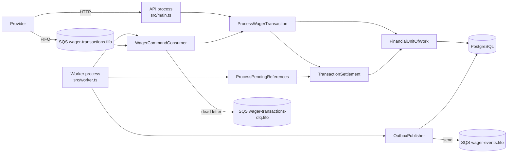
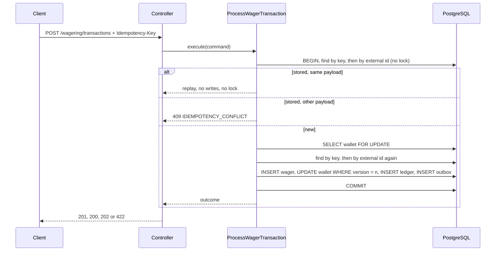
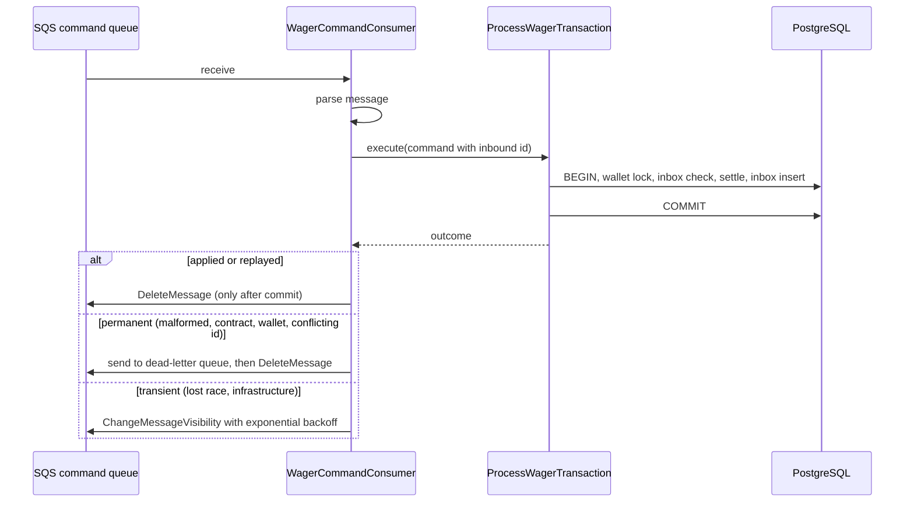

# Architecture

> English reference copy. The main version, in Portuguese, is [ARCHITECTURE.md](ARCHITECTURE.md).

Distributed Wagering Processor: a financial service that applies wager operations
from game providers over HTTP and SQS, with consistent balances under concurrency,
duplicates, out-of-order references, crashes and restarts. This document describes
what is implemented and tested. Each guarantee names the test that proves it. The
requirement-by-requirement status lives in [docs/REQUIREMENTS_MATRIX.md](docs/REQUIREMENTS_MATRIX.md).

## Main decisions

Each row gives a decision, its reason and its cost. The last two columns say where it is proven and
where the reasoning is written. This table is the one place that gathers the justifications. The
numbered sections below develop them, and the ADRs and `DECISIONS.md` keep the alternatives.

| Decision                                                             | Why                                                                                                                         | Cost accepted                                                    | Proven by                                                                          | Reasoning                                                          |
| -------------------------------------------------------------------- | --------------------------------------------------------------------------------------------------------------------------- | ---------------------------------------------------------------- | ---------------------------------------------------------------------------------- | ------------------------------------------------------------------ |
| Pessimistic row lock on the wallet, with `version` as a guard (§5)   | Operations on one wallet serialize, and a hot wallet stays available. Removing the lock double-debits in the measured case. | Operations on one wallet wait for each other.                    | `test/concurrency/hot-wallet.test.ts`                                              | [ADR 0001](docs/adr/0001-pessimistic-wallet-lock.en.md)            |
| Money as a decimal string, exact arithmetic, `NUMERIC(20,2)` (§2)    | No floating-point path, and a row rebuilds to an equal `Money`.                                                             | Amounts are limited to 18 integer digits.                        | `test/unit/shared/domain/money.test.ts`                                            | [ADR 0002](docs/adr/0002-money-representation.en.md)               |
| Enums as `as const` union types (§2)                                 | No runtime object, stored value and JSON are the same literal string, without reverse mapping.                              | No runtime enum namespace; listing values requires the array.    | `bun run typecheck`, `test/unit/shared/validation-and-errors.test.ts`              | [ADR 0003](docs/adr/0003-enums-como-union-de-const.en.md)          |
| Idempotency per provider, with a canonical payload hash (§6)         | The key is the source of truth. An identical request replays, and a different payload conflicts.                            | The same key with another payload is a conflict, never a replay. | `test/integration/wagering/process-wager-transaction.test.ts`, block `idempotency` | [ADR 0003](docs/adr/0003-idempotency-scope-and-payload-hash.en.md) |
| Outbox with claim and lease, at-least-once delivery (§8)             | An event exists only if its operation committed, and concurrent publishers neither lose nor duplicate events indefinitely.  | Duplicates are possible, and consumers deduplicate by `eventId`. | `test/integration/messaging/outbox-publisher.test.ts`                              | [ADR 0004](docs/adr/0004-outbox-claim-lease-at-least-once.en.md)   |
| A missing reference holds the transaction, with bounded retries (§9) | Out-of-order operations converge, and the limit is explicit.                                                                | About one minute of waiting, then REFERENCE_NOT_FOUND.           | `test/integration/wagering/pending-reference.test.ts`                              | [ADR 0005](docs/adr/0005-reference-hold-and-bounded-retries.en.md) |
| One settlement path for HTTP, the queue and the worker (§1)          | The financial rule exists in one implementation.                                                                            | Requests and messages share one use case.                        | `test/concurrency/distributed-contention.test.ts`                                  | [DECISIONS.md](DECISIONS.en.md)                                    |
| API keys with two roles, and provider scope (§12)                    | Identity without an identity provider, stated and tested.                                                                   | No rotation or login, and plain HTTP.                            | `test/e2e/auth-http.test.ts`                                                       | [ADR 0007](docs/adr/0007-api-key-authentication.en.md)             |
| A stable failure code and a status per outcome (§3, §10)             | A provider decides from the code whether to resend, correct or give up.                                                     | Codes are a contract, and renaming one is breaking.              | `test/e2e/wagering-http.test.ts`, `test/e2e/input-contract-http.test.ts`           | [DECISIONS.md](DECISIONS.en.md)                                    |
| Each open question of the specification, decided and tested (§13)    | Every gap is decided in one place, tested, and marked for the owner.                                                        | Some readings need the owner's confirmation, and §13 says which. | `test/unit`, `test/integration`                                                    | [docs/INVARIANT_REVIEW.md](docs/INVARIANT_REVIEW.en.md)            |

## 1. Components and boundaries

A modular monolith with three vertical modules. Each module has `domain`,
`application`, `infrastructure` and `http` folders only where it has code.

| Module      | Owns                                                                                                     |
| ----------- | -------------------------------------------------------------------------------------------------------- |
| `wallet`    | `Wallet` aggregate, `WalletLedgerEntry`, opening, queries, reconciliation                                |
| `wagering`  | `WagerTransaction` lifecycle, reference rules, the one settlement path, pending references               |
| `messaging` | Inbox, Outbox, the SQS adapter, the command consumer and the outbox publisher                            |
| `shared`    | `Money`, `DomainError`, the unit of work port, the integration event envelope, validation, observability |

`domain` imports nothing from NestJS, MikroORM or AWS. Use cases coordinate through
ports (`FinancialUnitOfWork`, the repository ports, `MessageQueue`, `OutboxTransport`).
Controllers only parse and present. Failure-to-HTTP mapping is in one filter.



`ProcessWagerTransaction` handles what is specific to an arriving request: the wallet
lock, idempotency, the inbox record and the retry after a lost race. The financial
decision is in `TransactionSettlement`, which the reference worker also calls. The
rules therefore exist in one implementation.

### Data entry and exit points

Each row is one data path from end to end. A command that arrives over HTTP and one that arrives on the queue pass through the same use case and the same unit of work.

| Entry                                                  | Entry adapter                                                                                                                               | Use case                                          | Outputs                                                                                                                                       | Destination                                  |
| ------------------------------------------------------ | ------------------------------------------------------------------------------------------------------------------------------------------- | ------------------------------------------------- | --------------------------------------------------------------------------------------------------------------------------------------------- | -------------------------------------------- |
| Create transaction                                     | `POST /wagering/transactions` (`wagering/http`)                                                                                             | `ProcessWagerTransaction`                         | HTTP response                                                                                                                                 | PostgreSQL, in the unit of work              |
| Query transaction                                      | `GET /wagering/transactions/:transactionId` and `GET /providers/:providerId/wagering/transactions/:externalTransactionId` (`wagering/http`) | `wager-queries`                                   | HTTP response                                                                                                                                 | PostgreSQL, read                             |
| Wallet                                                 | `/wallets`: create, query, ledger and reconciliation (`wallet/http`)                                                                        | `OpenWallet`, `wallet-queries` and reconciliation | HTTP response                                                                                                                                 | PostgreSQL                                   |
| Provider command from the queue                        | `WagerCommandConsumer` (`messaging/application/inbound/wager-command-consumer.ts`), reading `wager-transactions.fifo`                       | `ProcessWagerTransaction`, the same one as HTTP   | `ack` only after commit; retry with backoff; `DLQ` after the limit                                                                            | PostgreSQL; `wager-transactions-dlq.fifo`    |
| Pending reference (internal trigger, no queue or HTTP) | `ProcessPendingReferences`, in the worker                                                                                                   | `TransactionSettlement`                           | events written to the outbox                                                                                                                  | PostgreSQL                                   |
| Integration events                                     | `OutboxPublisher` (`messaging/application/outbound/outbox-publisher.ts`), reading the outbox                                                | no use case                                       | `WagerTransactionProcessed`, `WagerTransactionRejected`, `WagerTransactionPendingReference`, `WagerTransactionFailed`, `WalletBalanceChanged` | `wager-events.fifo`, through the SQS adapter |
| Observability                                          | `OperationLog` with declared fields; `/health/live`, `/health/ready`, `/metrics`                                                            | no use case                                       | one JSON line per operation; counters                                                                                                         | stdout; the worker's internal port           |

The DLQ is an exit, but the inbound consumer triggers it, so it appears on the queue row. Events leave only after commit, because they are read from the outbox, not from the transaction in progress.

## 2. Domain model

**Money** (`src/shared/domain/money.ts`). An immutable value over `decimal.js`. Inputs
are decimal strings with exactly 2 fractional digits, no leading zero, and at most 18 integer digits. Currency must be
three uppercase letters. Cross-currency arithmetic throws `CURRENCY_MISMATCH`.
`equals` across currencies returns false. Decision: [ADR 0002](docs/adr/0002-money-representation.en.md).

**Wallet** (`src/modules/wallet/domain/wallet.ts`). One per player and currency, at
version 1 after creation. Each debit or credit validates its ledger entry before it
mutates state, so a rejected movement leaves balance and version unchanged. A debit
that the balance cannot cover is refused by `canDebit()` before any exception.
Opening with a positive balance writes a CREDIT entry and keeps version 1.

**WalletLedgerEntry** (`wallet-ledger-entry.ts`). Immutable. Requires a positive amount,
non-negative balances, and arithmetic that balances. It has no transition methods.

**WagerTransaction** (`src/modules/wagering/domain/wager-transaction.ts`). The kinds
and their rules are one table (`wager-transaction-kind.ts`):

| Kind       | Balance effect            | Ledger  | Reference                                                       |
| ---------- | ------------------------- | ------- | --------------------------------------------------------------- |
| `OPENING`  | credit (internal only)    | CREDIT  | none                                                            |
| `BET`      | debit                     | DEBIT   | none                                                            |
| `WIN`      | credit                    | CREDIT  | optional `BET`, not amount-bound                                |
| `LOSS`     | none                      | none    | optional `BET`                                                  |
| `REFUND`   | credit                    | CREDIT  | required `BET` with no result, amount must match                |
| `ROLLBACK` | opposite of the reference | inverse | required `BET`, `WIN` or `REFUND`, any state, amount must match |

Balance-affecting kinds must move a positive amount. `LOSS` may be zero.

```mermaid
stateDiagram-v2
  [*] --> PENDING
  PENDING --> PROCESSED: applied
  PENDING --> REJECTED: business rule
  PENDING --> PENDING_REFERENCE: reference missing
  PENDING_REFERENCE --> PENDING_REFERENCE: lookup missed, attempt counted
  PENDING_REFERENCE --> PROCESSED: reference arrived, applied
  PENDING_REFERENCE --> REJECTED: rejected, or six misses (REFERENCE_NOT_FOUND)
  PENDING --> FAILED: allowed by the domain; no production path reaches it
  PENDING_REFERENCE --> FAILED: permanent failure while the reference is resolved (the only production path)
  PROCESSED --> [*]
  REJECTED --> [*]
  FAILED --> [*]
```



`FAILED` has one production path: the reference worker. A held transaction whose resolution fails with a
permanent error (the classifier's PERMANENT, such as an unreadable wallet) is recorded `FAILED`, with
`PROCESSING_FAILED` and the balance it was held with, in a unit of work of its own, and announced as
`WagerTransactionFailed`. The pass goes on to the rows behind it. A transient error is not recorded: the pass ends
with it, and the row is looked up again. A transaction that fails before it is held is not stored, because its unit of
work rolled back: the queue sends it to the dead-letter queue, and HTTP returns the error. Tests:
`held-failure.test.ts`.

The table above is `STATUS_TRANSITIONS` in `src/modules/wagering/domain/wager-lifecycle.ts`, and the rule that
decides whether a new operation may apply, given the results its reference already has, is `decideAgainstHistory`
in the same module. The database trigger of migration 10 copies the status table, and
`test/integration/schema/row-guards.test.ts` checks every pair of statuses against both places.

## 3. Rejection taxonomy (`failureCode`)

Stable, machine-readable, and persisted with the rejected transaction:

| Code                         | Meaning                                                                     | Provider action                                                               |
| ---------------------------- | --------------------------------------------------------------------------- | ----------------------------------------------------------------------------- |
| `INSUFFICIENT_BALANCE`       | a BET the balance cannot cover                                              | do not resend unchanged                                                       |
| `REVERSAL_WOULD_OVERDRAW`    | a reversal that would make the balance negative                             | investigate; not a payload error                                              |
| `WALLET_PLAYER_MISMATCH`     | the player does not own the wallet                                          | correct the payload                                                           |
| `WALLET_CURRENCY_MISMATCH`   | the currency differs from the wallet                                        | correct the payload                                                           |
| `REFERENCE_NOT_FOUND`        | the reference never arrived within the limit                                | check the reference, then resend under a new id                               |
| `REFERENCE_NOT_PROCESSED`    | the reference was rejected or failed                                        | nothing to reverse                                                            |
| `REFERENCE_CONTEXT_MISMATCH` | another provider, player, wallet, round or currency                         | correct the payload                                                           |
| `REFERENCE_KIND_NOT_ALLOWED` | the reference is of a kind that cannot be reversed                          | correct the payload                                                           |
| `REFERENCE_AMOUNT_MISMATCH`  | a reversal whose amount differs from its reference                          | correct the payload                                                           |
| `REFERENCE_ALREADY_REVERSED` | the referenced transaction was already reversed                             | nothing to do                                                                 |
| `REFERENCE_ALREADY_SETTLED`  | the BET already has a WIN or LOSS, or a REFUND follows one                  | nothing to do                                                                 |
| `BALANCE_LIMIT_EXCEEDED`     | a credit that would leave the balance above the largest storable amount     | do not resend unchanged; the wallet cannot hold it                            |
| `PROCESSING_FAILED`          | a held transaction that failed permanently while its reference was resolved | not resent: the transaction is final; check the wallet and the reference data |

Transport outcomes are not persisted. They are the HTTP table below.

## 4. Persistence and database invariants

Migrations are versioned, reversible and deterministic (`Migration20260731000000`,
`Migration20260731000001`). There is no schema synchronization. `test/integration/schema`
covers migration from an empty database, rollback to zero tables, and re-application.

Invariants enforced by PostgreSQL, each with a constraint test that tries to break it:

- `wallets`: `UNIQUE (player_id, currency)`; `balance >= 0`; `version >= 1`; currency
  shape `^[A-Z]{3}$`; `numeric(20,2)`.
- `wallet_ledger_entries`: `UNIQUE (wallet_id, transaction_id)`; `seq` identity for
  ordering; arithmetic `CHECK` for CREDIT and DEBIT; `amount > 0`; a composite foreign
  key `(transaction_id, wallet_id)`, so an entry must belong to a transaction of the
  same wallet. Append-only: `BEFORE UPDATE OR DELETE` and `BEFORE TRUNCATE` triggers
  refuse mutation. The agreement between each balance and its ledger (challenge 6.2) is enforced by two
  deferred constraint triggers that run at `COMMIT`, in migration 12: `wallets_ledger_balance_check` and
  `wallet_ledger_entries_balance_check`. The cost experiment recommended not adopting them: a median
  increase of up to 1.8 ms under contention, with an unbounded tail (`docs/audit/PERFORMANCE_COMPARISON.md`,
  experiment 1). They were adopted anyway, to close gap F-06, in which a direct database write changed a
  balance without a ledger entry. The full load was not measured again with the triggers. Reconciliation
  still exists, to detect a divergence the schema does not prevent, such as manually disabled triggers.

**Row guards (migration 10).** Checked on every update, each reading only the row being changed, so they add
no lookup inside the wallet lock (`docs/audit/PERFORMANCE_COMPARISON.md`, experiment 1b):

- `wager_transactions`: identity, payload, kind, amount and creation never change. A status changes only along
  the lifecycle table of `src/modules/wagering/domain/wager-lifecycle.ts`, which the trigger copies. A terminal
  transaction does not change. The reference attempt count only grows.
- `wallets`: identity, player, currency and creation never change. The version moves exactly when the balance
  moves, and by one (section 6.2).

`test/integration/schema/row-guards.test.ts` checks every pair of statuses against the table, so a change in
either place alone fails the suite.

- `wager_transactions`: `UNIQUE (provider_id, external_transaction_id)`;
  `UNIQUE (provider_id, idempotency_key)`; kind and status are checked; a `REFUND` or
  `ROLLBACK` must carry a reference, a `BET` or `OPENING` must not, and a `WIN` or `LOSS` may carry one (migration 6, challenge 6.3). Status
  shape: PROCESSED needs `processed_at` and a resulting balance; REJECTED and FAILED
  need a failure code and the balance observed when they were decided (migration 8); a held row needs its next lookup time and the balance it was held with
  (migration 7). Composite foreign key
  `(reference_transaction_id, provider_id, wallet_id)`, so a reference must share the
  provider and the wallet. Partial unique index on `(reference_transaction_id)` where
  PROCESSED and the kind is REFUND or ROLLBACK, so each reference is reversed once, whatever
  the kind of reversal. A BET has at most one PROCESSED settlement, a WIN, a LOSS or a REFUND, enforced by
  `wager_one_processed_settlement_per_reference` (migration 8). A ROLLBACK is not in that index.
- Migration 4 (`api_clients`) and migration 5 add, to the wager and ledger tables: a positive
  amount except for LOSS (`wager_amount_shape`); a ledger entry in its wallet's currency
  (`ledger_wallet_currency_fk`); and a reference in the same round
  (`wager_reference_round_key`, `wager_reference_fk`). The player and currency of a transaction
  are not tied to its wallet in the database. A rejected transaction keeps what it was submitted
  with, so the domain checks them.
- `inbox_messages`: primary key `(consumer_name, message_id)`.
- `outbox_messages`: primary key is the stable event id.

Indexes exist for a named query each:

| Index                                                                                                            | Query it serves                                                                                                                 |
| ---------------------------------------------------------------------------------------------------------------- | ------------------------------------------------------------------------------------------------------------------------------- |
| `ledger_wallet_seq_idx (wallet_id, seq)`                                                                         | ledger pages for one wallet, in sequence order                                                                                  |
| `wager_one_processed_reversal_per_reference` (partial), `wager_one_processed_settlement_per_reference` (partial) | the "reversed once" and "settled once" rules, and the outcome lookup of a reference (`processedOutcomesOf`, one `OR` over both) |
| `wager_pending_reference_due_idx (reference_next_attempt_at)` (partial, PENDING_REFERENCE)                       | the reference worker's due scan                                                                                                 |
| `outbox_due_unpublished_idx (next_attempt_at)` (partial, unpublished)                                            | the publisher's claim                                                                                                           |

Reference lookup by `(provider_id, external_transaction_id)` uses the unique constraint's index.

## 5. Concurrency

The unit of concurrency is the wallet. A new financial operation takes the wallet's row
lock first (`SELECT ... FOR UPDATE`), looks again for the same identity under that lock,
then decides the balance, then writes everything in one transaction. Operations on one
wallet are serialized. Operations on different wallets never wait for each other.

A replay takes no lock. A stored transaction's payload never changes, and the replay writes
nothing, so it is answered from the stored row before the wallet is locked. The lookup
order is: inbox check, identity lookup (one query for the key and the external id), then, only for a new identity, the lock and a
second lookup. The second lookup stops an identical request that waited for the lock from
inserting, colliding on the unique key and retrying, which under load could end in a 503. A queue duplicate
that waited is the same case for the inbox: when the second lookup finds the committed transaction, the
inbox is checked again, so the duplicate records nothing and is answered as a replay. Before this check it
inserted its inbox row, collided on the primary key, rolled back, and counted a lost race that was not one.
The test is `integration: a duplicate delivery that waits for the wallet lock`.



The lock alone is not the whole guard. The balance write is also conditional on the
version read under the lock (`UPDATE ... WHERE version = ?`), and a stale write raises
`ConcurrencyConflictError`. The unique constraints back up the rest, for example two
workers racing on identities of different wallets. A lost race rolls the unit of work
back, and a retry reads the winner, up to three attempts. No effect is applied twice,
because a rolled-back attempt committed nothing.

Measured trade-off ([ADR 0001](docs/adr/0001-pessimistic-wallet-lock.en.md)). With the row
lock removed and the version guard kept, a mixed hot-wallet run exhausts its retries
and fails. With both removed, the 80/80 case double-debits. The lock is what keeps a
hot wallet available.

## 6. Idempotency

The `Idempotency-Key` is required. Identity is per provider. A request is a replay when
the business payload hash matches a stored transaction found by key, or by external id.
The hash is SHA-256 over canonical JSON of the business fields, with keys sorted, and it
excludes transport metadata. A replay returns the original result, including the balance
observed at that time (`resultingBalance`), even if the wallet has changed since. A held
transaction replays the balance it was held with (migration 7). A replay therefore reports the
status, and the balance, that the transaction reached when its state last changed. It is never the live
wallet balance, which `GET /wallets/:id` reports. Once a held transaction is resolved, a replay reports
the processed result with the balance after that processing. A different payload is
`IDEMPOTENCY_CONFLICT`, also when the new request names a wallet that does not exist, since
the key was already used. The conflict is checked before the wallet. Decision: [ADR 0003](docs/adr/0003-idempotency-scope-and-payload-hash.en.md).

### The replay contract, question by question

The specification asks that a replay return the original result, with the balance observed at the time.
A reference that has not arrived has no result yet, so a held operation has two states. The contract below
gives one stored snapshot per transaction: the status and the balance it had when it reached its current
state. A replay returns that snapshot, and nothing else is recomputed.

| Question                                    | Answer                                                                                                                                                                                                               | Proven by                                                                                                                              |
| ------------------------------------------- | -------------------------------------------------------------------------------------------------------------------------------------------------------------------------------------------------------------------- | -------------------------------------------------------------------------------------------------------------------------------------- |
| The first POST                              | 201 `PROCESSED` with the balance after the operation; 202 `PENDING_REFERENCE` with the balance observed when it was held; 422 `REJECTED` with its `failureCode` and the balance observed. `idempotentReplay: false`. | `e2e: wagering-http` (the status of each outcome)                                                                                      |
| An identical POST while it is pending       | 202 `PENDING_REFERENCE`, `idempotentReplay: true`, and the balance it was held with. It takes no wallet lock and writes nothing.                                                                                     | `integration: a redelivered or resent held REFUND ... answer the balance it was held with`                                             |
| An identical POST after it resolved         | 200 with the processed result and the balance after processing, or 422 with the balance observed at rejection. The status changes once, from 202 to the outcome it reached.                                          | `integration: a held REFUND is applied once its BET has been processed`                                                                |
| Replay of the command, against `GET`        | The replay and `GET /wagering/transactions/:id` return the same stored snapshot. Only the replay carries `idempotentReplay`. `GET /wallets/:id` is the live balance, which changes with later operations.            | `e2e: queries-http`, `e2e: wagering-http`                                                                                              |
| Keeping the observed balance                | `resultingBalance` is stored in the same transaction that decides the state: when it is held, when it is processed and when it is rejected. A later change to the wallet does not alter it.                          | `integration: a replay of a held REFUND returns the balance it was held with`                                                          |
| After a restart                             | Every state is in PostgreSQL. The same replay answers from the stored row, and a restarted reference worker continues the persisted schedule.                                                                        | `integration: a restarted worker continues the persisted schedule`, `concurrency: a worker killed inside a transaction, before commit` |
| HTTP and the queue carry the same operation | One idempotency key per provider and one stored transaction. The second arrival is a replay, or a conflict if its payload differs.                                                                                   | `integration: duplicate deliveries` (twenty copies, three consumers, HTTP and queue)                                                   |

Interpretation. The specification's words are "the original result, including the balance observed at that time".
For an operation that waits for its reference, its first answer is "pending", not a result. So the replay after
resolution reports the result the operation reached, with the balance observed when it reached it. Its status
changes once. Returning 202 forever would tell the provider nothing about the outcome. This needs no second state
machine and no snapshot table: the row already holds the one snapshot each state needs.

## 7. Queue ingress, inbox and dead letters

The consumer parses `WagerTransactionRequested` and calls the same use case as HTTP. The
inbox row `(consumer_name, message_id)` is written in the same transaction. A redelivered
message with the same hash is a duplicate, and the same id with a different hash is
`MESSAGE_PAYLOAD_CONFLICT`.



A batch of up to ten messages is processed one at a time. Before each message after the first, the
consumer sets the visibility of the messages still waiting to a full window again (30 s by default), in
one `ChangeMessageVisibilityBatch` request. Without this, a message at the end of a slow batch became
visible while the first consumer still held it, and a second consumer received it
(`test/integration/messaging/visibility-during-batch.test.ts`). While its own command runs, a message is renewed
every third of the window, up to a hold limit of 300 s by default. A renewal the broker refuses ends the renewals.
Past the hold limit the message is released, so a processor that hangs cannot hold it forever; the next delivery
applies the same effect once, because the transaction identity is the same. Tests: `slow-message-hold.test.ts`
(LocalStack) and `wager-command-hold.test.ts`. Past the hold limit, two consumers can process one command at the
same time; the identity keeps its effect to one.

Classification (`failure-classification.ts`). Permanent failures go to the dead-letter
queue. Transient ones are redelivered with visibility backoff of 2 s, 4 s, 8 s, up to 300 s.
The queue's redrive policy (`maxReceiveCount = 10`) moves a message that keeps failing to
the dead-letter queue. Ten deliveries outlast the consumer's backoff for a transient outage, so
a valid command is not dead-lettered by a short failure. The policy is provisioned by
`docker/localstack/init-sqs.sh`, and `test/integration/messaging/broker-redrive.test.ts` checks
the broker-side move on the provisioned queue.

Recovery after a crash in the dead-letter path is tested, not assumed. A crash after the dead-letter
send and before the acknowledgement leaves the message in the command queue. On redelivery it is
dead-lettered again with the same body, and that send carries a deduplication id derived from the body
(SHA-256, 64 hex characters). The broker accepts the repeated send once inside its five-minute window, so
the dead-letter queue keeps one copy. After the window, a repeated send is a new copy: at least once, never
fewer. No effect is applied, because a dead-lettered command never reaches the use case's write path. A
dead-letter send that the broker refuses is not acknowledged, so the message is retried on redelivery. The
tests are `integration: crash after the dead-letter send` (one copy) and `integration: dead-letter send
refused` in `test/integration/messaging/wager-command-consumer.test.ts`.

### Duplicates: what each layer stops

The queue delivers at least once, so one operation can arrive many times. The same operation can also
arrive over HTTP, or be resent under a new message id. Each way a duplicate can arrive has a layer
that stops its effect. `test/integration/messaging/duplicate-deliveries.test.ts` checks each one by
counting the rows and the balance afterwards. It runs three consumers at once, against real PostgreSQL
and LocalStack.

| How the duplicate arrives                                                | What stops its effect                                                                                                                           | Proven by                                                                                                    |
| ------------------------------------------------------------------------ | ----------------------------------------------------------------------------------------------------------------------------------------------- | ------------------------------------------------------------------------------------------------------------ |
| The same message again (lost acknowledgement, crash, expired visibility) | Inbox row `(consumer, messageId)`, written in the operation's transaction, and the identity lookup                                              | `duplicate-deliveries`: twenty copies, three consumers at once; `wager-command-consumer`: crash after commit |
| The producer resends it under a new message id                           | The idempotency key and the external id, each unique per provider                                                                               | `duplicate-deliveries`: five resends under five ids                                                          |
| The same operation over HTTP and in the queue                            | The same idempotency key                                                                                                                        | `duplicate-deliveries`: HTTP and queue                                                                       |
| The same external id under another key, with the same payload            | The external id lookup, which replays (ADR 0003)                                                                                                | `duplicate-deliveries`: rekeyed copy                                                                         |
| A reversal delivered more than once                                      | `processedOutcomesOf`, and the partial unique index on the reference                                                                            | `duplicate-deliveries`: refund five times                                                                    |
| Two copies racing on one wallet                                          | The wallet lock, the second look under it, and the unique constraints                                                                           | `hot-wallet`, `distributed-contention`                                                                       |
| Whatever the code does, the last line                                    | `UNIQUE (provider, external id)`, `UNIQUE (provider, idempotency key)`, `UNIQUE (wallet, transaction)` in the ledger, and the inbox primary key | `schema-constraints`, one test per constraint                                                                |

The replay lookup is what answers a duplicate and lets it finish. The unique constraints are what
make a second effect impossible. Without the lookup, a duplicate that loses a race retries until its
attempts run out, but it still applies nothing. A mutation check showed this: with the stored lookup
disabled, the balance and the ledger stayed correct, and the messages did not settle.

**Not deduplicated, on purpose.** Two operations with different external ids are two operations, even
when their payloads match. A provider that resends a win under a new external id therefore gets a
second credit, unless the win names its BET. A linked win is held to one result per BET. An unnamed
win is not, because the specification makes the reference optional (section 13). The owner must
decide whether that is acceptable, or whether a win must name its BET.

## 8. Transactional outbox

Events are written in the same transaction as the financial change. Nothing is sent to SQS inside it, so an
event exists only if its operation committed. The publisher leases a batch with one statement, `UPDATE ...
WHERE id IN (SELECT ... FOR UPDATE SKIP LOCKED)`, and orders the batch in the same statement by due time and
then by occurrence, because an `UPDATE` returns its rows in no particular order. It then sends the batch
outside any transaction, in SQS requests of at most ten entries, each entry in the aggregate's message group.
The events the broker accepted are marked published together, in one statement, and only where the lease
token still matches. Each event the broker refused is rescheduled on its own, with backoff. A stale token is
refused and counted. Delivery is at-least-once. The event id is the SQS deduplication id and the consumers'
deduplication key. Events committed at the same instant have no defined order within a batch: the claim
orders them by their instant, and the timestamp is the only key. Consumers order by `walletVersion`.
Lease expiry and due times are decided by the database clock (`now()`), so a publisher whose clock runs
ahead or behind cannot take an event that another publisher holds. A refused event waits its backoff from the
database's now(), so a skewed publisher neither retries at once nor waits longer than the backoff. The publication
instant and the lag metric use the publisher's clock; they decide nothing.
Decision: [ADR 0004](docs/adr/0004-outbox-claim-lease-at-least-once.en.md).

```mermaid
sequenceDiagram
  participant P as OutboxPublisher
  participant DB as PostgreSQL
  participant E as SQS events FIFO
  P->>DB: claim due rows, lease token (short statement, commit)
  DB-->>P: rows
  loop each request of up to ten events, no transaction open
    P->>E: SendMessageBatch (MessageGroupId = aggregate, DeduplicationId = eventId)
    P->>DB: mark the accepted events published WHERE lease = token, one statement
    loop each refused event
      P->>DB: reschedule with backoff WHERE lease = token
    end
  end
  end
```

A publisher can stall past its lease. Its send is in flight while the lease expires, so the next
publisher claims the event, sends it and marks it. The stalled send then repeats the event with the same
id, which consumers deduplicate. Its mark is refused under the lost lease and counted in
`outbox_lost_lease_total`, and the event is marked published once. The test is `integration: stalled
publisher loses the lease`, in `test/integration/messaging/outbox-publisher.test.ts`.

Events: `WagerTransactionProcessed` (including LOSS), `WagerTransactionRejected`, `WagerTransactionFailed`,
`WagerTransactionPendingReference`, `WalletBalanceChanged` (only when the balance changes,
carrying `walletVersion`). The envelope is an abstract class (`IntegrationEvent`) with one
concrete subclass per event type. Its data holds only JSON-friendly values.

### What an external consumer can rely on

The events queue is FIFO per wallet (`MessageGroupId` is the aggregate), but FIFO orders only what
arrives in order. Three things are true, and they are all the guarantee there is:

1. **Every event arrives, at least once.** A refused event is retried without a limit on its attempts;
   only its delay is capped (`retryDelayMs`). No event is dropped, and an event the broker accepted is
   not sent again except after a lost acknowledgement.
2. **`eventId` identifies the fact.** It is the outbox id, the SQS deduplication id, and the value a
   consumer deduplicates on. A repeated event has the same `eventId`.
3. **`walletVersion` orders the balance changes of one wallet.** It rises by exactly one with each balance
   change, and `WalletBalanceChanged` is published for each one, so the versions of a wallet are
   `1, 2, 3, ...` with no gap in the committed history.

What is not true: the arrival order. A refused event is retried after its backoff, so a later event of
the same wallet can arrive first. The test `partial-batch-order.test.ts` makes that visible: with E2
refused in the first request, the broker receives `walletVersion` 1 and 3, then 2 after its retry. The
outbox holds E2 alone, with one attempt, until its backoff ends.

**The consumer rule.** To apply a wallet's balance changes in order, keep the last applied `walletVersion`
per wallet, apply `last + 1` when it arrives, and hold a higher version until the missing ones arrive.
A version at or below `last` is a duplicate, and its `eventId` tells whether it is the same fact.

**Why the publisher does not reorder.** Sending a wallet's events in one request per round (one event of
each wallet per request, the next round after the previous one) would keep a refused event from being
overtaken within one publisher. It was evaluated and not adopted:

- The guarantee would hold only for one publisher. Two publishers already send one wallet's events out
  of commit order (`two publishers can send one wallet's events out of commit order`), and rounds do
  not change that. The consumer rule above is needed either way.
- The cost is in broker requests, and it depends on how the events are spread. Twenty events over twenty
  wallets are two requests in both designs. Twenty events on one wallet are two requests now and twenty
  in rounds, because each round holds one entry. A hot wallet would pay ten times the requests for an
  order that the consumer rule gives anyway.
- The alternative that would give a global order is a sequencer per wallet, which this design does not
  build (section 14).

## 9. Out-of-order references

A reversal whose reference is missing is held as `PENDING_REFERENCE`, with its attempt
count and next lookup time in the row. The reference worker resolves due rows under the
wallet lock, re-reads them, and calls the shared settlement. Backoff starts at 1 s and
doubles, capped at 5 minutes. Six misses end in `REJECTED` with `REFERENCE_NOT_FOUND`,
which is announced. The schedule is in PostgreSQL, so a restarted worker resumes it. Due times and
the next lookup are read from the database clock (`DatabaseClock`, the `now()` of the unit of work), never from
a worker's clock, so a worker an hour ahead or behind decides what the others decide
(`database-clock-references.test.ts`).
Decision: [ADR 0005](docs/adr/0005-reference-hold-and-bounded-retries.en.md).

## 10. HTTP contract

| Endpoint                                          | Success                                                      | Errors                                                                                                                                                                                                    |
| ------------------------------------------------- | ------------------------------------------------------------ | --------------------------------------------------------------------------------------------------------------------------------------------------------------------------------------------------------- |
| `POST /wallets`                                   | 201 with `id`, `balance`, `version`                          | 400 `INVALID_MONEY`, `INVALID_REQUEST`; 409 `WALLET_ALREADY_EXISTS`                                                                                                                                       |
| `GET /wallets/:id`                                | 200                                                          | 404 `WALLET_NOT_FOUND`                                                                                                                                                                                    |
| `GET /wallets/:id/ledger?cursor&limit`            | 200, entries and `nextCursor`                                | 400 `INVALID_CURSOR`, `INVALID_REQUEST`; 404                                                                                                                                                              |
| `POST /wagering/transactions` + `Idempotency-Key` | 201 applied; 200 replay; 202 pending reference; 422 rejected | 400 `IDEMPOTENCY_KEY_REQUIRED`, `INVALID_TRANSACTION` (OPENING), `INVALID_MONEY`, `INVALID_REQUEST`; 404 `WALLET_NOT_FOUND`; 409 `IDEMPOTENCY_CONFLICT`; 503 with `Retry-After` for a transient lost race |
| `GET /wagering/transactions/:id`                  | 200                                                          | 404 `TRANSACTION_NOT_FOUND`                                                                                                                                                                               |
| `GET /providers/:p/wagering/transactions/:e`      | 200                                                          | 404 `TRANSACTION_NOT_FOUND`                                                                                                                                                                               |
| `POST /wallets/:id/reconciliation`                | 200 with the report                                          | 404                                                                                                                                                                                                       |
| `GET /health/live`                                | 200, dependency-free                                         | none                                                                                                                                                                                                      |
| `GET /health/ready`                               | 200 when PostgreSQL and the command queue answer             | 503 names the failing check                                                                                                                                                                               |
| `GET /metrics`                                    | 200, this process's counters                                 | none                                                                                                                                                                                                      |

Unknown routes are 404 `NOT_FOUND`. Malformed bodies are 400 `INVALID_REQUEST`, and a body above 16 kB is 413 `PAYLOAD_TOO_LARGE`, refused before
parsing or authentication. A correlation id longer than 128 characters, or with a character outside
`A-Za-z0-9._:-`, is 400. A `walletId` or `transactionId` that is not a UUID, and
a control character in any text field, are 400 `INVALID_REQUEST` on every route, so they never reach
PostgreSQL. A ledger cursor whose sequence is beyond the `bigint` range is 400 `INVALID_CURSOR`. Unknown
errors are 500 `INTERNAL_ERROR` with no internal detail. A business rejection is not a
client error, so it is 422, and a provider can tell "do not resend" from "fix the payload".

Reconciliation recomputes the wallet from every ledger entry, and checks that each entry
starts where the previous one ended. A divergence is reported with its difference and
counted in `reconciliation_divergences_total`. It is never corrected.

It reads the balance and the ledger in one transaction under a shared lock on the wallet
row (`FOR SHARE`). A debit of that wallet waits until the reconciliation commits, so a debit
cannot land between the two reads and show up as a divergence that does not exist. The wait
lasts as long as one reconciliation. Other reads take no lock.

## 11. Observability

Operation logs are one JSON object per line. The fields are `time`, `level`, `operation`,
`status`, and when known `correlationId`, `messageId`, `transactionId`, `walletId`,
`providerId` and `durationMs`. The type has no field for an amount or a payload, and a
compile-time test checks that.

A failure is logged with `errorName`, the class of the thrown error, and `errorCode`, its
`code` when it has one. The message is never logged, because it can carry a payload. A failed
broker send, a failed command and a failed worker pass are logged this way. A worker loop that
fails keeps running after a pause, so one failing dependency does not end the worker.

Counters are per process (`MetricsRegistry`): `transactions_total{status}`,
`idempotent_replays_total`, `concurrency_conflicts_total`, `commands_total{result}`,
`reference_resolutions_total{status}`, `reference_exhausted_total`,
`reconciliation_divergences_total`, `outbox_published_total`,
`outbox_publish_failures_total`, `outbox_lost_lease_total`. Replays are not counted as transactions.

Summaries keep the count, the sum and the maximum of each series, so the mean and the worst case are
known, but no percentile is. The time is in milliseconds, except `outbox_lag_seconds`. They split a
request into its phases, so a slow request can be placed:

| Summary                                      | What it measures                                                       |
| -------------------------------------------- | ---------------------------------------------------------------------- |
| `auth_ms`                                    | the API key lookup, per request                                        |
| `request_validation_ms`                      | parsing the submission, before the use case                            |
| `transaction_begin_ms`                       | the wait for a database connection, and BEGIN                          |
| `wallet_lock_wait_ms`                        | the wait for the wallet row lock, with its query                       |
| `transaction_work_ms`                        | the work inside the transaction: the lock, the decision and the writes |
| `settlement_ms`                              | the decision and its writes, inside the work                           |
| `transaction_commit_ms`                      | COMMIT                                                                 |
| `processing_latency_ms`, `replay_latency_ms` | the whole request, and the whole request of a replay                   |
| `outbox_claim_ms`, `outbox_publish_ms`       | one claim of due events, and one send to the events queue              |
| `outbox_lag_seconds`                         | from the commit of an event to its send                                |

The worker has its own HTTP surface, started with `WORKER_HTTP_PORT` (Compose sets 3001 on the internal
network, and publishes no port). `GET /metrics` returns the counters and summaries of that process, with
`startedAt`, `collectedAt` and `pid`, so a rate is the difference of two reads over the difference of
`collectedAt`. `GET /health/live` answers while the loops run. Before this surface, the worker printed its
counters once, at shutdown, so a crashed worker reported nothing. `worker-metrics-live.test.ts` reads the
counters of a running worker process, which has published committed events, and stops it afterwards.
Collection is pull-based and per process: no aggregation runs across workers, and Prometheus is not
installed (see the audit, `docs/AUDITORIA_FINAL.md`).

No label carries an identifier. `test/unit/observability/metric-cardinality.test.ts` reads the source
and fails on a label named after a transaction, a wallet, a provider or a message.

## 12. Authentication

API keys with two roles. [ADR 0007](docs/adr/0007-api-key-authentication.en.md) records the
decision and its alternatives. Each client sends `Authorization: Bearer <key>`:

- A **PROVIDER** key acts for one provider id. It submits and reads that provider's operations.
  Another provider's id is `403 FORBIDDEN`, before anything is written. A transaction id that
  belongs to another provider is `404 TRANSACTION_NOT_FOUND`, the same answer as a missing id.
- An **OPERATOR** key opens, reads and reconciles wallets, reads metrics, and acts for any
  provider.
- `GET /health/live` and `GET /health/ready` are public. Every other route needs a valid key.
- A missing, unknown or revoked key is `401 UNAUTHENTICATED` with `WWW-Authenticate: Bearer`. The scheme
  is case-insensitive (RFC 9110); the token is case-sensitive and has one shape. A key in the query string
  is not accepted.
- Wallets, the ledger, reconciliation and metrics are checked before the record is read, so a provider
  gets the same `403` for an existing wallet and a missing one.

**Existence of another provider's transaction is not revealed.** `GET /wagering/transactions/:id` answers
`404 TRANSACTION_NOT_FOUND` both for a missing id and for an id that belongs to another provider. The two
responses differ only in the id that was asked for (`test/e2e/authorization-adversarial.test.ts`). Before
this change the second answer was `403`, which revealed that the id existed. The change alters a documented
status, so it is listed for the owner in `docs/audit/FINDINGS.md`. The by-provider route
(`/providers/:providerId/...`) still answers `403` for a provider path that is not the caller's, because that
answer depends on the path and not on the existence of any transaction.

The table `api_clients` stores the SHA-256 hash of each key, never the key. Keys are created
and revoked with `bun run auth:create` and `bun run auth:revoke`. The key is printed once.
The guard is `src/modules/auth/http/api-key.guard.ts`. The rules are in
`src/modules/auth/domain/principal.ts`.

Queue messages are not authenticated, because they arrive on an internal channel (challenge
§2). Their provider and wallet fields are still checked in the domain.

The SQS client takes its credentials from the SDK's default chain. The fixed local pair is used only
when an emulator endpoint is configured (`createSqsClient`), and it is never sent to AWS.

## 13. Interpretations

These are choices the specification leaves open. Each one is tested.

- Idempotency is per provider. A same external id under another key replays when the
  payload matches, and conflicts when it does not.
- Zero amounts are refused for balance-affecting kinds. `LOSS` may be zero.
- A `WIN` and a `LOSS` may name the `BET` they settle. The specification makes that reference
  optional: it requires one only for REFUND and ROLLBACK. A named result is checked against its
  BET, so a second result, or a REFUND after a result, is refused. An unnamed result cannot be tied
  to a BET, so those rules do not apply to it. A REFUND of the same BET may follow an unnamed WIN,
  and both credits stay. That is the cost of following the specification, and the owner must accept
  it or require the reference. The win's amount is not bound to the bet's. The owner should
  confirm this reading.
- A `BET` has at most one result. A second WIN or LOSS on it is `REFERENCE_ALREADY_SETTLED`.
  Before this rule a BET could be credited by two WINs.
- A `REFUND` applies only to a `BET` with no result. After a WIN or a LOSS it is
  `REFERENCE_ALREADY_SETTLED`. This is the owner's decision.
- A `ROLLBACK` applies in every state of the transaction it reverses, with or without a
  result. After a WIN, rolling back the BET returns its stake and the WIN credit stays, so the
  round is cancelled only when the WIN is rolled back too. This is the owner's decision. Its
  economic effect should be confirmed.
- A missing wallet is `404` and writes nothing over HTTP. From the queue it is permanent,
  so the message goes to the dead-letter queue.
- A currency or player mismatch is a persisted rejection, not an HTTP error, so the
  outcome is replayable and auditable.
- `OPENING` is written under the internal provider id `system`.
- A replay of a held transaction returns its current status with the balance observed when it was
  held (migration 7). Later changes to the wallet do not alter that answer, and a replay that arrives
  after the reference is resolved returns the processed result.
- **A referenced transaction is reversed at most once, whatever the kind of reversal.** Rule 4
  of the specification says "pelo mesmo tipo de operação", which would allow a REFUND and then a
  ROLLBACK of the same BET, and that credits the stake twice. This breaks the global rule that
  credits are never duplicated, so the stricter reading is adopted. Enforced in code and by the
  partial unique index `wager_one_processed_reversal_per_reference`. A rolled-back refund does not free
  its BET: a second reversal of the BET is `REFERENCE_ALREADY_REVERSED` (tested). The specification owner
  should confirm this reading.
- `playerId` is the provider's identifier. It is text, not a UUID, although the specification's examples
  use UUIDs. A value that is not a UUID is accepted, and it cannot cause a server error. Control
  characters are refused.
- A credit that would leave the balance above 999999999999999999.99, the largest value `NUMERIC(20,2)`
  stores, is `REJECTED` with `BALANCE_LIMIT_EXCEEDED` (422). It is a business outcome of the wallet's
  state, persisted and auditable. The specification does not cover it.
- An amount needs exactly two fractional digits. `"25"` and `"25.1"` are 400 `INVALID_MONEY`, and a
  JSON number is 400 `INVALID_REQUEST`. This withdraws the earlier normalization of `"25"` to `"25.00"`
  ([ADR 0002](docs/adr/0002-money-representation.en.md), amended).
- A WIN or LOSS on a BET that was already refunded or rolled back is rejected with
  `REFERENCE_ALREADY_REVERSED`.

## 14. Limitations

What is not claimed, and why:

- **No login and no key rotation.** Keys last until they are revoked. The challenge's suggested identity provider (Keycloak or Zitadel) is not integrated. See section 12 and ADR 0007.
- **Plain HTTP.** Keys travel in every request, so a real deployment must put the API behind TLS.
- **Local infrastructure only.** PostgreSQL 17 and LocalStack 4.14, not AWS. The repository's
  Dockerfile build cannot run in the authoring sandbox: `bun install` fails with `SELF_SIGNED_CERT_IN_CHAIN`
  behind the sandbox TLS proxy. The stack was run from an image built outside the repository, from a copy of
  the Dockerfile that adds only the sandbox CA. That image runs as uid 1000 (`bun`). The default stack
  (health, `demo:finance`) and the protected stack (`test:edge`, 12 of 12) were run from it. `edge:check`
  uses `--build`, which the sandbox cannot run.
- **Broker redrive is checked on the provisioned queue** (section 7), not on a queue the test creates.
- **Metrics are per process.** No aggregation or dashboard.
- **Fault injection is partial.** Crash after commit and before acknowledgement, and crash
  before commit, are real process crashes of a worker (exit 137, `test/concurrency`). A
  SIGTERM during a batch is a real process stop. After the broker accepts and before the mark,
  and during reference resolution, faults are injected around real components in one process.
  The HTTP API is not crashed at process level inside a transaction: a provider's retry under
  the same idempotency key is covered in-process only.
- **Restart after a crash is configuration, not a test.** Compose restarts the `api` and
  `worker` services unless they were stopped (`restart: unless-stopped`). `docker compose
config` validates the file. No test starts a container and kills it.
- **Event order is not guaranteed on arrival.** A refused event is retried later, so a later event of its wallet
  can arrive first (`partial-batch-order.test.ts`), and two publishers can send one wallet's events out of
  commit order. Within one publisher's batch the order is the due time, and
  events committed at the same instant have no defined order. `integration: two publishers send one wallet's events out of
commit order` shows it. Consumers order by `walletVersion`, so no order is promised across publishers.
- **Reconciliation runs on demand.** There is no scheduled job.
- **Rate limiting is per client address, and only in protected mode.** The default mode has none. The
  optional edge (section 15) limits each address, which is not protection against a distributed attack.
- **No dead-letter replay tooling.**
- **A win resent under a new external id is a second credit** unless it names its BET (section 7).
- **Dead-letter duplicates after the deduplication window.** A crash between a dead-letter send and its
  acknowledgement leaves one copy. A redelivery more than five minutes later adds another. A dead-letter
  consumer must still deduplicate by the message body (`deadLetterDeduplicationId`).
- **Cloud load was measured on a four-vCPU VM of the Claude Code cloud environment, with the stack pinned to 1, 2 and 4 CPUs.** The pinned report
  (`docs/LOAD_TEST_RESULTS.md`) agreed 100, 200 and 400 req/s, and failed at 125 and 300 on 1 and 2 CPUs. On 4 CPUs
  the top step, 400 req/s, passed. The generator shared those four CPUs with the stack, so the 4-CPU figure is a
  lower bound. The paired runs before and after each change are in `docs/LOAD_TEST_HISTORY.md`. The cloud-VM
  runs are superseded and stay in git history.
  A local baseline, measured by the author on his own machine (Ryzen 7 7735HS, 8 cores with SMT), with 13 scenarios of 1 to 3 APIs and 1 to 8 CPUs, is in
  `docs/LOAD_TEST_BASELINE.en.md`. It also records errors, incorrect answers, violations, duplicates, conflicts and lock
  waits, p50, p95 and p99, and the outbox drain at the agreed step. It does not replace the pinned report.
- **Module size.** `wager-transaction.ts` is 389 lines with its types. It was reviewed: its
  members are the lifecycle and reference rules of the aggregate. Reference evaluation is
  a pure function, and it could move to its own file if the class grows.

## 15. Protected mode: an optional edge

The default mode is `docker compose up`, with the API published on port 3000 and no limit. The protected mode
adds an Nginx edge in front of the API: `docker compose -f docker-compose.yml -f docker-compose.protected.yml up
--build`. It is an operational control. It is not a security boundary, and section 14 says what it does not do.

- **The edge is the only way in.** The API publishes no port in this mode (`docker inspect` shows `3000/tcp: null`).
  The edge publishes the public port, 3000, so the examples in the README work in both modes.
- **Limits are per client address.** The key is `$binary_remote_addr`, the TCP peer. The edge never reads a
  forwarding header to choose a quota. It sets `X-Forwarded-For` and `X-Real-IP` from the peer, replacing any
  value the client sent, and it drops `Forwarded`. It trusts no proxy: behind another proxy, that proxy's
  address must be added with `set_real_ip_from`, explicitly, and only then.
- **Writes and reads have their own quotas.** `POST /wagering/transactions` and `POST /wallets` share
  `EDGE_WRITE_RATE` (20 per second) with a burst of `EDGE_WRITE_BURST` (40), refused at once beyond it. Every other
  route shares `EDGE_READ_RATE` (50 per second) with a burst of `EDGE_READ_BURST` (100). A client may hold
  `EDGE_MAX_CONNECTIONS` (50) requests in progress.
- **A refusal is 429.** It carries `Retry-After: 1` and the body `{"error":{"code":"RATE_LIMITED",...}}`, the same
  shape as every error of the API.
- **Health checks are not limited.** `/health/live` and `/health/ready` answer while a client is throttled, so the
  monitor sees the service.
- **A refusal is logged once**, with its time, client address, method, path and status. No header, body or query
  string is logged, so no key or payload reaches the log.
- **Slow clients are bounded.** Headers and bodies time out after 10 seconds. The edge reads up to 1 MB, and the API
  keeps its own 16 kB limit and its 413.

**What it does not do.** A limit per address does not stop a distributed or volumetric attack. Docker's userland
proxy can give every host client one address, so one host shares a quota. Keys still travel in plain HTTP, and
TLS belongs in front of the edge in a deployment. There is one edge, so quotas are not shared across several.

**What it cost, measured on this host** (`bun run bench:edge`, one run each, `docs/edge/results/`). Sequential
reads with the API directly: p50 2.95 ms, p95 5.45 ms, p99 9.34 ms. Through the edge with the limits raised, so
nothing is refused: p50 3.08 ms, p95 5.72 ms, p99 9.70 ms. Under eight concurrent clients the throughput was 1,153
and 1,113 requests per second. At the default limits, the edge served 500 of 197,790 requests in ten seconds, which
is its quota of 50 per second, and it refused the rest at once.

**What the tests prove** (`bun run edge:up`, then `bun run test:edge`). The API has no host port. The API is reached
on the internal network only through the edge. A legitimate client is served and its financial result is unchanged,
with a replay and a ledger. A request without a key is refused with its own code. A burst above the limit is 429,
as JSON, with `Retry-After`. Health checks answer while a client is throttled. The quota recovers. Spoofed
forwarding headers do not change a quota. Two client containers at different addresses have separate quotas. A
flood of open connections is refused. The stack starts and stops cleanly (`bun run edge:check`). The isolation
tests use containers on the compose network, so each has its own address; requests from the host do not show it.
Two mutations were run and caught. Keying the read limit on `X-Forwarded-For` fails the spoofing test. Keying it on
a constant fails the isolation test.
