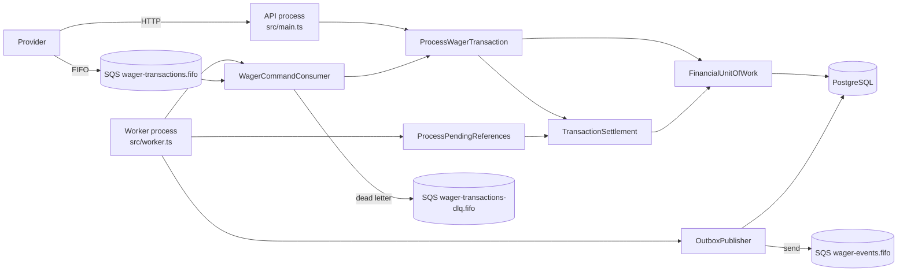
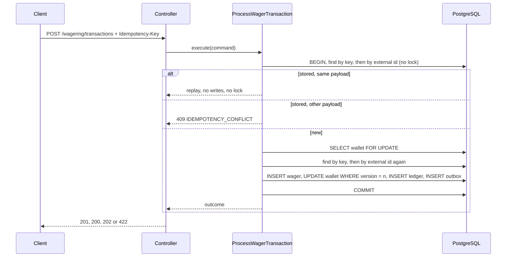
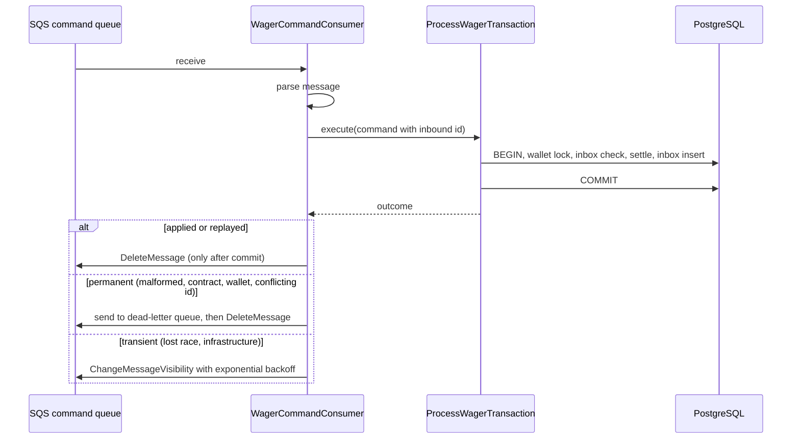
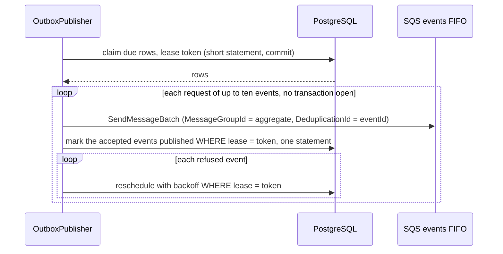

# Arquitetura

Distributed Wagering Processor: um serviço financeiro que aplica operações de aposta
de provedores de jogos via HTTP e SQS, com saldos consistentes sob concorrência,
duplicatas, referências fora de ordem, falhas bruscas (crashes) e reinicializações. Este documento descreve
o que está implementado e testado. Cada garantia nomeia o teste que a comprova. O
status requisito por requisito reside em [docs/REQUIREMENTS_MATRIX.md](docs/REQUIREMENTS_MATRIX.md).

## Principais decisões

Cada linha apresenta uma decisão, seu motivo e seu custo. As duas últimas colunas indicam onde ela é comprovada e
onde o raciocínio está registrado. Esta tabela é o local único que reúne as justificativas. As
seções numeradas abaixo as desenvolvem, e os ADRs e `DECISIONS.md` guardam as alternativas.

| Decisão                                                                   | Por quê                                                                                                                                             | Custo aceito                                                                       | Comprovado por                                                                     | Raciocínio                                                      |
| ------------------------------------------------------------------------- | --------------------------------------------------------------------------------------------------------------------------------------------------- | ---------------------------------------------------------------------------------- | ---------------------------------------------------------------------------------- | --------------------------------------------------------------- |
| Lock pessimista de linha na carteira, com `version` como guarda (§5)      | Operações em uma carteira serializam, e uma carteira concorrida (hot wallet) permanece disponível. Remover o lock gera débito duplo no caso medido. | Operações em uma carteira esperam umas pelas outras.                               | `test/concurrency/hot-wallet.test.ts`                                              | [ADR 0001](docs/adr/0001-pessimistic-wallet-lock.md)            |
| Dinheiro como string decimal, aritmética exata, `NUMERIC(20,2)` (§2)      | Sem caminho de ponto flutuante, e uma linha é reconstruída em um `Money` equivalente.                                                               | Valores são limitados a 18 dígitos inteiros.                                       | `test/unit/shared/domain/money.test.ts`                                            | [ADR 0002](docs/adr/0002-money-representation.md)               |
| Enums como união de tipos com `as const` (§2)                             | Sem objeto em tempo de execução, o valor gravado e o JSON são a mesma string literal, sem mapeamento reverso.                                       | Sem namespace de enum em tempo de execução; a listagem exige o array subjacente.   | `bun run typecheck`, `test/unit/shared/validation-and-errors.test.ts`              | [ADR 0008](docs/adr/0008-enums-como-union-de-const.md)          |
| Idempotência por provedor, com hash canônico de payload (§6)              | A chave é a fonte da verdade. Uma requisição idêntica faz replay, e um payload diferente gera conflito.                                             | A mesma chave com outro payload é um conflito, nunca um replay.                    | `test/integration/wagering/process-wager-transaction.test.ts`, bloco `idempotency` | [ADR 0003](docs/adr/0003-idempotency-scope-and-payload-hash.md) |
| Outbox com reserva (claim) e lease, entrega at-least-once (§8)            | Um evento existe apenas se sua operação foi commitada, e publicadores concorrentes não perdem nem duplicam eventos indefinidamente.                 | Duplicatas são possíveis, e consumidores deduplicam por `eventId`.                 | `test/integration/messaging/outbox-publisher.test.ts`                              | [ADR 0004](docs/adr/0004-outbox-claim-lease-at-least-once.md)   |
| Uma referência ausente retém a transação, com retentativas limitadas (§9) | Operações fora de ordem convergem, e o limite é explícito.                                                                                          | Cerca de um minuto de espera, depois REFERENCE_NOT_FOUND.                          | `test/integration/wagering/pending-reference.test.ts`                              | [ADR 0005](docs/adr/0005-reference-hold-and-bounded-retries.md) |
| Um único caminho de liquidação para HTTP, fila e worker (§1)              | A regra financeira existe em uma única implementação.                                                                                               | Requisições e mensagens compartilham um único caso de uso.                         | `test/concurrency/distributed-contention.test.ts`                                  | [DECISIONS.md](DECISIONS.md)                                    |
| Chaves de API com dois papéis, e escopo de provedor (§12)                 | Identidade sem um provedor de identidade, declarada e testada.                                                                                      | Sem rotação ou login, e HTTP puro.                                                 | `test/e2e/auth-http.test.ts`                                                       | [ADR 0007](docs/adr/0007-api-key-authentication.md)             |
| Um código de falha estável e um status por resultado (§3, §10)            | Um provedor decide a partir do código se deve reenviar, corrigir ou desistir.                                                                       | Códigos são um contrato, e renomear um deles é uma alteração quebrante (breaking). | `test/e2e/wagering-http.test.ts`, `test/e2e/input-contract-http.test.ts`           | [DECISIONS.md](DECISIONS.md)                                    |
| Interpretações da especificação documentadas e testadas (§13)             | Cada interpretação tem uma decisão, testes e limitações explícitas.                                                                                 | D5 (expiração e rotação de chaves) permanece fora do escopo.                       | `test/unit`, `test/integration`                                                    | [docs/INVARIANT_REVIEW.md](docs/INVARIANT_REVIEW.md)            |

## 1. Componentes e fronteiras

Um monólito modular com três módulos verticais. Cada módulo possui pastas `domain`,
`application`, `infrastructure` e `http` apenas onde possui código.

| Módulo      | Responsável por                                                                                                        |
| ----------- | ---------------------------------------------------------------------------------------------------------------------- |
| `wallet`    | Agregado `Wallet`, `WalletLedgerEntry`, abertura, consultas, reconciliação                                             |
| `wagering`  | Ciclo de vida de `WagerTransaction`, regras de referência, o caminho único de liquidação, referências pendentes        |
| `messaging` | Inbox, Outbox, o adaptador SQS, o consumidor de comandos e o publicador do outbox                                      |
| `shared`    | `Money`, `DomainError`, a porta de unidade de trabalho, o envelope de evento de integração, validação, observabilidade |

`domain` não importa nada de NestJS, MikroORM ou AWS. Casos de uso coordenam por meio de
portas (`FinancialUnitOfWork`, as portas de repositório, `MessageQueue`, `OutboxTransport`).
Controladores apenas realizam parse e apresentação. O mapeamento de falha para HTTP fica em um único filtro.

`ProcessWagerTransaction` lida com o que é específico de uma requisição que chega: o lock
da carteira, idempotência, o registro na inbox e a retentativa após uma disputa (race) perdida. A decisão
financeira fica em `TransactionSettlement`, que o worker de referências também chama. As
regras existem, portanto, em uma única implementação.

### Entradas e saídas de dados

Cada linha é um caminho de dados de ponta a ponta. Um comando que chega por HTTP e um que chega pela fila passam pelo mesmo caso de uso e pela mesma unidade de trabalho.

| Entrada                                                  | Adaptador de entrada                                                                                                                      | Caso de uso                                    | Saídas                                                                                                                                        | Destino                                   |
| -------------------------------------------------------- | ----------------------------------------------------------------------------------------------------------------------------------------- | ---------------------------------------------- | --------------------------------------------------------------------------------------------------------------------------------------------- | ----------------------------------------- |
| Criar transação                                          | `POST /wagering/transactions` (`wagering/http`)                                                                                           | `ProcessWagerTransaction`                      | resposta HTTP                                                                                                                                 | PostgreSQL, na unidade de trabalho        |
| Consultar transação                                      | `GET /wagering/transactions/:transactionId` e `GET /providers/:providerId/wagering/transactions/:externalTransactionId` (`wagering/http`) | `wager-queries`                                | resposta HTTP                                                                                                                                 | PostgreSQL, leitura                       |
| Carteira                                                 | `/wallets`: criar, consultar, ledger e reconciliação (`wallet/http`)                                                                      | `OpenWallet`, `wallet-queries` e reconciliação | resposta HTTP                                                                                                                                 | PostgreSQL                                |
| Comando de provedor pela fila                            | `WagerCommandConsumer` (`messaging/application/inbound/wager-command-consumer.ts`), lendo `wager-transactions.fifo`                       | `ProcessWagerTransaction`, o mesmo do HTTP     | `ack` só depois do commit; retentativa com backoff; `DLQ` após o limite                                                                       | PostgreSQL; `wager-transactions-dlq.fifo` |
| Referência pendente (gatilho interno, sem fila nem HTTP) | `ProcessPendingReferences`, no worker                                                                                                     | `TransactionSettlement`                        | eventos gravados no outbox                                                                                                                    | PostgreSQL                                |
| Eventos de integração                                    | `OutboxPublisher` (`messaging/application/outbound/outbox-publisher.ts`), lendo o outbox                                                  | não há caso de uso                             | `WagerTransactionProcessed`, `WagerTransactionRejected`, `WagerTransactionPendingReference`, `WagerTransactionFailed`, `WalletBalanceChanged` | `wager-events.fifo`, pelo adaptador SQS   |
| Observabilidade                                          | `OperationLog` com campos declarados; `/health/live`, `/health/ready`, `/metrics`                                                         | não há caso de uso                             | linha JSON por operação; contadores                                                                                                           | stdout; porta interna do worker           |

A DLQ é uma saída, mas quem a aciona é o consumidor de entrada, por isso ela aparece na linha da fila. Os eventos saem só depois do commit, porque são lidos do outbox, e não da transação em andamento.

## 2. Modelo de domínio

**Money** (`src/shared/domain/money.ts`). Um valor imutável baseado em `decimal.js`. As entradas
são strings decimais com exatamente 2 dígitos fracionários, sem zero à esquerda, e no máximo 18 dígitos inteiros. A moeda deve ter
três letras maiúsculas. Aritmética entre moedas diferentes lança `CURRENCY_MISMATCH`.
`equals` entre moedas diferentes retorna falso. Decisão: [ADR 0002](docs/adr/0002-money-representation.md).

**Wallet** (`src/modules/wallet/domain/wallet.ts`). Uma por jogador e moeda, na
versão 1 após a criação. Cada débito ou crédito valida seu lançamento no ledger antes de
modificar o estado, de modo que uma movimentação recusada deixa saldo e versão inalterados. Um débito
que o saldo não possa cobrir é recusado por `canDebit()` antes de qualquer exceção.
Abertura com saldo positivo registra um lançamento CREDIT e mantém a versão 1.

**WalletLedgerEntry** (`wallet-ledger-entry.ts`). Imutável. Exige um valor positivo,
saldos não negativos e aritmética balanceada. Não possui métodos de transição.

**WagerTransaction** (`src/modules/wagering/domain/wager-transaction.ts`). Os tipos
e suas regras compõem uma tabela única (`wager-transaction-kind.ts`):

| Tipo (Kind) | Efeito no saldo           | Ledger    | Referência                                                                  |
| ----------- | ------------------------- | --------- | --------------------------------------------------------------------------- |
| `OPENING`   | crédito (somente interno) | CREDIT    | nenhuma                                                                     |
| `BET`       | débito                    | DEBIT     | nenhuma                                                                     |
| `WIN`       | crédito                   | CREDIT    | `BET` opcional, não vinculada ao valor                                      |
| `LOSS`      | nenhum                    | nenhum    | `BET` opcional                                                              |
| `REFUND`    | crédito                   | CREDIT    | `BET` obrigatória sem resultado, valor deve coincidir                       |
| `ROLLBACK`  | oposto da referência      | invertido | `BET`, `WIN` ou `REFUND` obrigatória, qualquer estado, valor deve coincidir |

Tipos que afetam o saldo devem movimentar um valor positivo. `LOSS` pode ser zero.

```mermaid
stateDiagram-v2
  [*] --> PENDING
  PENDING --> PROCESSED: applied
  PENDING --> REJECTED: business rule
  PENDING --> PENDING_REFERENCE: reference missing
  PENDING_REFERENCE --> PENDING_REFERENCE: lookup missed, attempt counted
  PENDING_REFERENCE --> PROCESSED: reference arrived, applied
  PENDING_REFERENCE --> REJECTED: rejected, or six misses (REFERENCE_NOT_FOUND)
  PENDING --> FAILED: allowed by the domain; no production path reaches it
  PENDING_REFERENCE --> FAILED: permanent failure while the reference is resolved (the only production path)
  PROCESSED --> [*]
  REJECTED --> [*]
  FAILED --> [*]
```

`FAILED` tem um único caminho em produção: o worker de referências. Uma transação retida cuja resolução falha com um
erro permanente (PERMANENT do classificador, como uma carteira ilegível) é registrada como `FAILED`, com
`PROCESSING_FAILED` e o saldo com o qual foi retida, em uma unidade de trabalho própria, e anunciada como
`WagerTransactionFailed`. A passagem continua para as linhas subsequentes. Um erro transitório não é registrado: a passagem termina
com ele, e a linha é consultada novamente. Uma transação que falha antes de ser retida não é armazenada, porque sua unidade de
trabalho sofreu rollback: a fila a envia para a dead-letter queue, e o HTTP retorna o erro. Testes:
`held-failure.test.ts`.

A tabela acima é `STATUS_TRANSITIONS` em `src/modules/wagering/domain/wager-lifecycle.ts`, e a regra que
decide se uma nova operação pode ser aplicada, dados os resultados que sua referência já possui, é `decideAgainstHistory`
no mesmo módulo. O trigger de banco de dados da migração 10 copia a tabela de status, e
`test/integration/schema/row-guards.test.ts` valida cada par de status em ambos os lugares.

## 3. Taxonomia de recusas (`failureCode`)

Estável, legível por máquina e persistida com a transação recusada:

| Código                       | Significado                                                                           | Ação do provedor                                                                  |
| ---------------------------- | ------------------------------------------------------------------------------------- | --------------------------------------------------------------------------------- |
| `INSUFFICIENT_BALANCE`       | uma BET que o saldo não consegue cobrir                                               | não reenviar sem alterações                                                       |
| `REVERSAL_WOULD_OVERDRAW`    | uma reversão que deixaria o saldo negativo                                            | investigar; não é erro de payload                                                 |
| `WALLET_PLAYER_MISMATCH`     | o jogador não é o dono da carteira                                                    | corrigir o payload                                                                |
| `WALLET_CURRENCY_MISMATCH`   | a moeda difere da carteira                                                            | corrigir o payload                                                                |
| `REFERENCE_NOT_FOUND`        | a referência nunca chegou dentro do limite                                            | verificar a referência, depois reenviar sob um novo id                            |
| `REFERENCE_NOT_PROCESSED`    | a referência foi recusada ou falhou                                                   | nada a reverter                                                                   |
| `REFERENCE_CONTEXT_MISMATCH` | outro provedor, jogador, carteira, rodada ou moeda                                    | corrigir o payload                                                                |
| `REFERENCE_KIND_NOT_ALLOWED` | a referência é de um tipo que não pode ser revertido                                  | corrigir o payload                                                                |
| `REFERENCE_AMOUNT_MISMATCH`  | uma reversão cujo valor difere de sua referência                                      | corrigir o payload                                                                |
| `REFERENCE_ALREADY_REVERSED` | a transação referenciada já foi revertida                                             | nada a fazer                                                                      |
| `REFERENCE_ALREADY_SETTLED`  | a BET já possui um WIN ou LOSS, ou um REFUND segue um deles                           | nada a fazer                                                                      |
| `BALANCE_LIMIT_EXCEEDED`     | um crédito que deixaria o saldo acima do maior valor armazenável                      | não reenviar sem alterações; a carteira não pode comportá-lo                      |
| `PROCESSING_FAILED`          | uma transação retida que falhou permanentemente enquanto sua referência era resolvida | não reenviada: a transação é final; verificar a carteira e os dados da referência |

Resultados de transporte não são persistidos. Eles compõem a tabela HTTP abaixo.

## 4. Persistência e invariantes de banco de dados

As migrações são versionadas, reversíveis e determinísticas (`Migration20260731000000`,
`Migration20260731000001`). Não há sincronização de esquema. `test/integration/schema`
cobre a migração a partir de um banco de dados vazio, o rollback para zero tabelas e a reaplicação.

Invariantes aplicadas pelo PostgreSQL, cada uma com um teste de constraint que tenta quebrá-la:

- `wallets`: `UNIQUE (player_id, currency)`; `balance >= 0`; `version >= 1`; formato de
  moeda `^[A-Z]{3}$`; `numeric(20,2)`.
- `wallet_ledger_entries`: `UNIQUE (wallet_id, transaction_id)`; identidade `seq` para
  ordenação; `CHECK` aritmético para CREDIT e DEBIT; `amount > 0`; uma chave estrangeira
  composta `(transaction_id, wallet_id)`, de modo que um lançamento deve pertencer a uma transação da
  mesma carteira. Somente anexação (append-only): triggers `BEFORE UPDATE OR DELETE` e `BEFORE TRUNCATE`
  recusam mutação. A concordância entre cada saldo e seu ledger (desafio 6.2) é imposta por dois triggers de
  restrição postergados até o `COMMIT`, na migração 12: `wallets_ledger_balance_check` e
  `wallet_ledger_entries_balance_check`. O experimento de custo recomendou não adotá-los: mediana adicionada de até
  1,8 ms sob contenção, com cauda não delimitada (`docs/audit/PERFORMANCE_COMPARISON.md`, experimento 1). Foram
  adotados mesmo assim, para fechar a lacuna F-06, em que uma escrita direta no banco alterava o saldo sem lançamento.
  A carga completa não foi medida de novo com os triggers. A reconciliação continua existindo, para detectar uma
  divergência que o esquema não impede, como a desativação manual dos triggers.

**Guardas de linha (migração 10).** Verificadas a cada atualização, cada uma lendo somente a linha sendo alterada, para que não
acrescentem consultas dentro do lock da carteira (`docs/audit/PERFORMANCE_COMPARISON.md`, experimento 1b):

- `wager_transactions`: identidade, payload, tipo (kind), valor e criação nunca mudam. Um status muda apenas conforme
  a tabela de ciclo de vida de `src/modules/wagering/domain/wager-lifecycle.ts`, que o trigger copia. Uma transação
  terminal não muda. A contagem de tentativas de referência apenas cresce.
- `wallets`: identidade, jogador, moeda e criação nunca mudam. A versão avança exatamente quando o saldo
  muda, e em uma unidade (seção 6.2).

`test/integration/schema/row-guards.test.ts` valida cada par de status contra a tabela, portanto uma alteração em
qualquer um dos lugares isoladamente faz a suíte falhar.

- `wager_transactions`: `UNIQUE (provider_id, external_transaction_id)`;
  `UNIQUE (provider_id, idempotency_key)`; tipo (kind) e status são validados; um `REFUND` ou
  `ROLLBACK` deve conter uma referência, um `BET` ou `OPENING` não deve conter, e um `WIN` ou `LOSS` pode conter uma (migração 6, desafio 6.3). Formato de
  status: PROCESSED exige `processed_at` e um saldo observado; REJECTED e FAILED
  exigem um código de falha e o saldo observado no momento em que foram decididos (migração 8); uma linha retida exige o horário de sua próxima consulta e o saldo com o qual foi retida
  (migração 7). Chave estrangeira composta
  `(reference_transaction_id, provider_id, wallet_id)`, de modo que uma referência deve compartilhar o
  provedor e a carteira. Índice único parcial em `(reference_transaction_id)` onde
  PROCESSED e o tipo é REFUND ou ROLLBACK, para que cada referência seja revertida uma única vez, qualquer
  que seja o tipo de reversão. Uma BET possui no máximo uma liquidação PROCESSED, um WIN, um LOSS ou um REFUND, imposto por
  `wager_one_processed_settlement_per_reference` (migração 8). Um ROLLBACK não está nesse índice.
- A migração 4 (`api_clients`) e a migração 5 adicionam, às tabelas de apostas (wager) e ledger: um valor
  positivo exceto para LOSS (`wager_amount_shape`); um lançamento no ledger na moeda de sua carteira
  (`ledger_wallet_currency_fk`); e uma referência na mesma rodada
  (`wager_reference_round_key`, `wager_reference_fk`). O jogador e a moeda de uma transação
  não são vinculados à sua carteira no banco de dados. Uma transação recusada mantém o que foi submetido
  com ela, portanto o domínio os valida.
- `inbox_messages`: chave primária `(consumer_name, message_id)`.
- `outbox_messages`: chave primária é o id estável do evento.

Índices existem para uma consulta nominal cada:

| Índice                                                                                                           | Consulta que atende                                                                                                                     |
| ---------------------------------------------------------------------------------------------------------------- | --------------------------------------------------------------------------------------------------------------------------------------- |
| `ledger_wallet_seq_idx (wallet_id, seq)`                                                                         | páginas do ledger para uma carteira, em ordem sequencial                                                                                |
| `wager_one_processed_reversal_per_reference` (parcial), `wager_one_processed_settlement_per_reference` (parcial) | as regras "revertida uma vez" e "liquidada uma vez", e a busca de resultado de uma referência (`processedOutcomesOf`, um `OR` em ambos) |
| `wager_pending_reference_due_idx (reference_next_attempt_at)` (parcial, PENDING_REFERENCE)                       | a varredura de itens vencidos do worker de referências                                                                                  |
| `outbox_due_unpublished_idx (next_attempt_at)` (parcial, unpublished)                                            | a reserva (claim) do publicador                                                                                                         |

A busca de referência por `(provider_id, external_transaction_id)` utiliza o índice da restrição UNIQUE.

## 5. Concorrência

A unidade de concorrência é a carteira. Uma nova operação financeira adquire o lock de linha
da carteira primeiro (`SELECT ... FOR UPDATE`), busca novamente pela mesma identidade sob esse lock,
depois decide o saldo, e então grava tudo em uma única transação. Operações em uma mesma
carteira são serializadas. Operações em carteiras diferentes nunca esperam umas pelas outras.

Um replay não obtém lock. O payload de uma transação armazenada nunca muda, e o replay não grava
nada, logo ele é respondido a partir da linha armazenada antes que a carteira seja bloqueada. A ordem
de consulta é: verificação na inbox, busca de identidade (uma consulta pela chave e pelo id externo), e então, somente para uma identidade nova, o lock e uma
segunda consulta. A segunda consulta impede que uma requisição idêntica que aguardou pelo lock
faça inserção, colida na chave única e tente novamente, o que sob carga poderia resultar em um 503. Uma duplicata de fila
que aguardou é o mesmo caso para a inbox: quando a segunda consulta encontra a transação commitada, a
inbox é verificada novamente, de modo que a duplicata nada registra e é respondida como um replay. Antes dessa verificação, ela
inseria sua linha na inbox, colidia na chave primária, sofria rollback e contabilizava uma disputa perdida que não o era.
O teste é `integration: a duplicate delivery that waits for the wallet lock`.

O lock por si só não é toda a proteção. A gravação do saldo também é condicional à
versão lida sob o lock (`UPDATE ... WHERE version = ?`), e uma gravação obsoleta lança
`ConcurrencyConflictError`. As restrições UNIQUE resguardam o restante, por exemplo dois
workers disputando identidades de carteiras distintas. Uma disputa perdida reverte a unidade de
trabalho (rollback), e uma retentativa lê a vencedora, em até três tentativas. Nenhum efeito é aplicado duas vezes,
porque uma tentativa revertida nada commitou.

Compromisso medido ([ADR 0001](docs/adr/0001-pessimistic-wallet-lock.md)). Com o lock
de linha removido e a guarda de versão mantida, uma execução com carteiras concorridas mistas esgota suas retentativas
e falha. Com ambos removidos, o caso 80/80 gera débito duplo. O lock é o que mantém uma
carteira concorrida disponível.

## 6. Idempotência

A `Idempotency-Key` é obrigatória. A identidade é por provedor. Uma requisição é um replay quando
o hash do payload de negócio coincide com uma transação armazenada encontrada pela chave, ou pelo id externo.
O hash é SHA-256 sobre o JSON canônico dos campos de negócio, com chaves ordenadas, e
exclui metadados de transporte. Um replay retorna o resultado original, incluindo o saldo
observado naquele momento (`resultingBalance`), mesmo que a carteira tenha mudado desde então. Uma transação
retida faz replay do saldo com o qual foi retida (migração 7). Um replay relata, portanto, o
status e o saldo que a transação atingiu quando seu estado mudou pela última vez. Nunca é o saldo em tempo real
da carteira, que `GET /wallets/:id` informa. Assim que uma transação retida é resolvida, um replay relata
o resultado processado com o saldo após esse processamento. Um payload diferente gera
`IDEMPOTENCY_CONFLICT`, inclusive quando a nova requisição nomeia uma carteira que não existe, uma vez
que a chave já foi utilizada. O conflito é verificado antes da carteira. Decisão: [ADR 0003](docs/adr/0003-idempotency-scope-and-payload-hash.md).

### O contrato de replay, questão por questão

A especificação pede que um replay retorne o resultado original, com o saldo observado no momento.
Uma referência que não chegou ainda não possui resultado, logo uma operação retida possui dois estados. O contrato abaixo
fornece um snapshot armazenado por transação: o status e o saldo que ela possuía ao atingir seu estado
atual. Um replay retorna esse snapshot, e nada mais é recalculado.

| Questão                                 | Resposta                                                                                                                                                                                                   | Comprovado por                                                                                                                         |
| --------------------------------------- | ---------------------------------------------------------------------------------------------------------------------------------------------------------------------------------------------------------- | -------------------------------------------------------------------------------------------------------------------------------------- |
| O primeiro POST                         | 201 `PROCESSED` com o saldo após a operação; 202 `PENDING_REFERENCE` com o saldo observado quando foi retida; 422 `REJECTED` com seu `failureCode` e o saldo observado. `idempotentReplay: false`.         | `e2e: wagering-http` (o status de cada resultado)                                                                                      |
| Um POST idêntico enquanto está pendente | 202 `PENDING_REFERENCE`, `idempotentReplay: true`, e o saldo com o qual foi retida. Não adquire lock de carteira e não grava nada.                                                                         | `integration: a redelivered or resent held REFUND ... answer the balance it was held with`                                             |
| Um POST idêntico após ser resolvida     | 200 com o resultado processado e o saldo após o processamento, ou 422 com o saldo observado na recusa. O status muda uma única vez, de 202 para o resultado alcançado.                                     | `integration: a held REFUND is applied once its BET has been processed`                                                                |
| Replay do comando, frente ao `GET`      | O replay e `GET /wagering/transactions/:id` retornam o mesmo snapshot armazenado. Apenas o replay traz `idempotentReplay`. `GET /wallets/:id` é o saldo em tempo real, que muda com operações posteriores. | `e2e: queries-http`, `e2e: wagering-http`                                                                                              |
| Manutenção do saldo observado           | `resultingBalance` é armazenado na mesma transação que decide o estado: quando é retida, quando é processada e quando é recusada. Uma alteração posterior na carteira não o modifica.                      | `integration: a replay of a held REFUND returns the balance it was held with`                                                          |
| Após uma reinicialização                | Todo estado reside no PostgreSQL. O mesmo replay responde a partir da linha armazenada, e um worker de referências reinicializado continua o agendamento persistido.                                       | `integration: a restarted worker continues the persisted schedule`, `concurrency: a worker killed inside a transaction, before commit` |
| HTTP e fila carregam a mesma operação   | Uma chave de idempotência por provedor e uma transação armazenada. A segunda chegada é um replay, ou um conflito se seu payload diferir.                                                                   | `integration: duplicate deliveries` (vinte cópias, três consumidores, HTTP e fila)                                                     |

Interpretação. As palavras da especificação são "the original result, including the balance observed at that time".
Para uma operação que aguarda sua referência, sua primeira resposta é "pendente", não um resultado. Assim, o replay após
a resolução informa o resultado que a operação alcançou, com o saldo observado no momento em que o atingiu. Seu status
muda uma vez. Retornar 202 eternamente nada diria ao provedor sobre o desfecho. Isso não exige uma segunda máquina
de estados nem tabela de snapshots: a linha já comporta o snapshot único de que cada estado necessita.

## 7. Entrada pela fila, inbox e dead letters

O consumidor analisa `WagerTransactionRequested` e invoca o mesmo caso de uso que o HTTP. A
linha da inbox `(consumer_name, message_id)` é gravada na mesma transação. Uma mensagem
reentregue com o mesmo hash é uma duplicata, e o mesmo id com um hash diferente gera
`MESSAGE_PAYLOAD_CONFLICT`.

Um lote de até dez mensagens é processado uma de cada vez. Antes de cada mensagem após a primeira, o
consumidor redefine a visibilidade das mensagens que continuam aguardando para uma janela completa novamente (30 s por padrão), em
uma única requisição `ChangeMessageVisibilityBatch`. Sem isso, uma mensagem ao final de um lote lento tornava-se
visível enquanto o primeiro consumidor ainda a retinha, e um segundo consumidor a recebia
(`test/integration/messaging/visibility-during-batch.test.ts`). Enquanto seu próprio comando executa, uma mensagem é renovada
a cada terço da janela, até um limite de retenção de 300 s por padrão. Uma renovação recusada pelo broker encerra as renovações.
Ultrapassado o limite de retenção a mensagem é liberada, de modo que um processador travado não possa retê-la para sempre; a próxima entrega
aplica o mesmo efeito uma vez, pois a identidade da transação é a mesma. Testes: `slow-message-hold.test.ts`
(LocalStack) e `wager-command-hold.test.ts`. Ultrapassado o limite de retenção, dois consumidores podem processar um mesmo comando ao
mesmo tempo; a identidade mantém seu efeito em apenas um.

Classificação (`failure-classification.ts`). Falhas permanentes vão para a dead-letter
queue. As transitórias são reentregues com backoff de visibilidade de 2 s, 4 s, 8 s, até 300 s.
A redrive policy da fila (`maxReceiveCount = 10`) move uma mensagem que persiste em falhar para
a dead-letter queue. Dez entregas sobrevivem ao backoff do consumidor durante uma indisponibilidade transitória, de modo
que um comando válido não é enviado para a dead-letter queue por uma falha passageira. A política é provisionada por
`docker/localstack/init-sqs.sh`, e `test/integration/messaging/broker-redrive.test.ts` verifica
a movimentação do lado do broker na fila provisionada.

A recuperação após um crash no caminho da dead-letter queue é testada, não presumida. Um crash após o
envio para a dead-letter queue e antes da confirmação (acknowledgement) deixa a mensagem na fila de comandos. Na reentrega, ela é
enviada para a dead-letter queue novamente com o mesmo corpo, e esse envio carrega um id de deduplicação derivado do corpo
(SHA-256, 64 caracteres hexadecimais). O broker aceita o envio repetido uma única vez dentro de sua janela de cinco minutos, de modo que
a dead-letter queue mantém uma única cópia. Após a janela, um envio repetido é uma nova cópia: pelo menos uma vez, nunca
menos. Nenhum efeito é aplicado, porque um comando enviado para a dead-letter queue nunca alcança o caminho de escrita do caso de uso. Um
envio para a dead-letter queue recusado pelo broker não é confirmado, portanto o processamento da mensagem é tentado novamente na reentrega. Os
testes são `integration: crash after the dead-letter send` (uma cópia) e `integration: dead-letter send
refused` em `test/integration/messaging/wager-command-consumer.test.ts`.

### Duplicatas: o que cada camada bloqueia

A fila entrega pelo menos uma vez (at-least-once), logo uma operação pode chegar muitas vezes. A mesma operação também
pode chegar via HTTP ou ser reenviada sob um novo id de mensagem. Cada forma pela qual uma duplicata pode chegar conta com uma camada
que impede seu efeito. `test/integration/messaging/duplicate-deliveries.test.ts` valida cada uma delas
contando as linhas e o saldo posteriormente. Ele executa três consumidores ao mesmo tempo, contra PostgreSQL real
e LocalStack.

| Como a duplicata chega                                                         | O que impede seu efeito                                                                                                                      | Comprovado por                                                                                                      |
| ------------------------------------------------------------------------------ | -------------------------------------------------------------------------------------------------------------------------------------------- | ------------------------------------------------------------------------------------------------------------------- |
| A mesma mensagem novamente (confirmação perdida, crash, visibilidade expirada) | Linha na inbox `(consumer, messageId)`, gravada na transação da operação, e a busca de identidade                                            | `duplicate-deliveries`: vinte cópias, três consumidores ao mesmo tempo; `wager-command-consumer`: crash após commit |
| O produtor a reenvia sob um novo id de mensagem                                | A chave de idempotência e o id externo, cada um único por provedor                                                                           | `duplicate-deliveries`: cinco reenvios sob cinco ids                                                                |
| A mesma operação via HTTP e na fila                                            | A mesma chave de idempotência                                                                                                                | `duplicate-deliveries`: HTTP e fila                                                                                 |
| O mesmo id externo sob outra chave, com o mesmo payload                        | A busca por id externo, que faz replay (ADR 0003)                                                                                            | `duplicate-deliveries`: cópia com nova chave                                                                        |
| Uma reversão entregue mais de uma vez                                          | `processedOutcomesOf`, e o índice único parcial na referência                                                                                | `duplicate-deliveries`: refund cinco vezes                                                                          |
| Duas cópias disputando uma mesma carteira                                      | O lock de carteira, a segunda verificação sob ele e as restrições UNIQUE                                                                     | `hot-wallet`, `distributed-contention`                                                                              |
| Independentemente do código, a última linha de defesa                          | `UNIQUE (provider, external id)`, `UNIQUE (provider, idempotency key)`, `UNIQUE (wallet, transaction)` no ledger e a chave primária da inbox | `schema-constraints`, um teste por constraint                                                                       |

A consulta de replay é o que responde a uma duplicata e permite sua conclusão. As restrições UNIQUE são o que
torna um segundo efeito impossível. Sem a consulta, uma duplicata que perde uma disputa tenta novamente até suas
tentativas se esgotarem, mas ainda assim nada aplica. Um teste de mutação demonstrou isso: com a busca armazenada
desabilitada, o saldo e o ledger permaneceram corretos, e as mensagens não se liquidavam.

**Não deduplicadas, intencionalmente.** Duas operações com ids externos diferentes são duas operações, mesmo
quando seus payloads coincidem. Um provedor que reenvia um ganho sob um novo id externo recebe, portanto, um
segundo crédito, a menos que o ganho nomeie sua BET. Um ganho vinculado é limitado a um resultado por BET. Um ganho
não nomeado não o é, porque a especificação torna a referência opcional (seção 13). O proprietário deve
decidir se isso é aceitável, ou se um ganho deve obrigatoriamente nomear sua BET.

## 8. Outbox transacional

Eventos são gravados na mesma transação que a alteração financeira. Nada é enviado ao SQS dentro dela, de modo que um
evento existe apenas se sua operação foi commitada. O publicador reserva um lote (lease) com uma única instrução, `UPDATE ...
WHERE id IN (SELECT ... FOR UPDATE SKIP LOCKED)`, e ordena o lote na mesma instrução pelo horário de vencimento e
depois por ocorrência, já que um `UPDATE` retorna suas linhas sem ordem definida. Em seguida, ele envia o lote
fora de qualquer transação, em requisições SQS de no máximo dez entradas, cada entrada no grupo de mensagem (message group) do agregado.
Os eventos aceitos pelo broker são marcados como publicados em conjunto, em uma única instrução, e apenas onde o token
de lease ainda coincidir. Cada evento recusado pelo broker é reagendado individualmente, com backoff. Um token obsoleto é
recusado e contabilizado. A entrega é at-least-once. O id do evento é o id de deduplicação do SQS e a chave de
deduplicação dos consumidores. Eventos commitados no mesmo instante não possuem ordem definida dentro de um lote: a reserva
os ordena pelo seu instante, sendo o timestamp a única chave. Consumidores ordenam por `walletVersion`.
A expiração do lease e os horários de vencimento são definidos pelo relógio do banco de dados (`now()`), de modo que um publicador cujo relógio esteja
adiantado ou atrasado não consiga tomar um evento retido por outro publicador. Um evento recusado aguarda seu backoff a partir do
now() do banco de dados, para que um publicador dessincronizado não tente novamente de imediato nem espere além do backoff. O
instante de publicação e a métrica de defasagem (lag) utilizam o relógio do publicador; eles não decidem nada.
Decisão: [ADR 0004](docs/adr/0004-outbox-claim-lease-at-least-once.md).

Um publicador pode travar além de seu lease. Seu envio fica em trânsito enquanto o lease expira, logo o próximo
publicador reserva o evento, o envia e o marca. O envio que travou repete então o evento com o mesmo
id, o qual os consumidores deduplicam. Sua marcação é recusada sob o lease perdido e contabilizada em
`outbox_lost_lease_total`, sendo o evento marcado como publicado uma única vez. O teste é `integration: stalled
publisher loses the lease`, em `test/integration/messaging/outbox-publisher.test.ts`.

Eventos: `WagerTransactionProcessed` (incluindo LOSS), `WagerTransactionRejected`, `WagerTransactionFailed`,
`WagerTransactionPendingReference`, `WalletBalanceChanged` (somente quando o saldo muda,
carregando `walletVersion`). O envelope é uma classe abstrata (`IntegrationEvent`) com uma
subclasse concreta por tipo de evento. Seus dados comportam somente valores compatíveis com JSON.

### Com o que um consumidor externo pode contar

A fila de eventos é FIFO por carteira (`MessageGroupId` é o agregado), mas o FIFO ordena somente aquilo
que chega em ordem. Três coisas são verdadeiras, e representam toda a garantia existente:

1. **Cada evento chega, pelo menos uma vez (at-least-once).** Um evento recusado é retentado sem limite de tentativas;
   apenas seu atraso possui teto (`retryDelayMs`). Nenhum evento é descartado, e um evento aceito pelo broker
   não é enviado novamente, exceto após uma confirmação perdida.
2. **`eventId` identifica o fato.** É o id do outbox, o id de deduplicação do SQS e o valor sobre o qual
   um consumidor realiza deduplicação. Um evento repetido possui o mesmo `eventId`.
3. **`walletVersion` ordena as alterações de saldo de uma carteira.** Ela se eleva exatamente em uma unidade a cada alteração de saldo,
   e `WalletBalanceChanged` é publicado para cada uma delas, de modo que as versões de uma carteira são
   `1, 2, 3, ...` sem lacunas no histórico commitado.

O que não é verdadeiro: a ordem de chegada. Um evento recusado é retentado após seu backoff, logo um evento posterior
da mesma carteira pode chegar primeiro. O teste `partial-batch-order.test.ts` torna isso visível: com E2
recusado na primeira requisição, o broker recebe `walletVersion` 1 e 3, depois 2 após sua retentativa. O
outbox retém E2 isoladamente, com uma tentativa, até seu backoff terminar.

**A regra do consumidor.** Para aplicar as alterações de saldo de uma carteira em ordem, mantenha a última `walletVersion` aplicada
por carteira, aplique `last + 1` quando ela chegar, e retenha uma versão superior até que as faltantes cheguem.
Uma versão igual ou inferior à `last` é uma duplicata, e seu `eventId` indica se se trata do mesmo fato.

**Por que o publicador não reordena.** Enviar os eventos de uma carteira em uma requisição por rodada (um evento de
cada carteira por requisição, com a próxima rodada após a anterior) impediria que um evento recusado fosse
ultrapassado dentro de um único publicador. Isso foi avaliado e não adotado:

- A garantia valeria apenas para um publicador. Dois publicadores já enviam os eventos de uma mesma carteira fora
  da ordem de commit (`two publishers can send one wallet's events out of commit order`), e as rodadas
  não mudam isso. A regra do consumidor acima é necessária em ambos os cenários.
- O custo reside nas requisições ao broker, e depende de como os eventos estão distribuídos. Vinte eventos em vinte
  carteiras representam duas requisições em ambos os modelos. Vinte eventos em uma única carteira representam duas requisições agora e vinte
  em rodadas, pois cada rodada carrega uma entrada. Uma carteira concorrida pagaria dez vezes mais requisições por uma
  ordem que a regra do consumidor já fornece.
- A alternativa que forneceria uma ordem global seria um sequenciador por carteira, algo que esta arquitetura não
  constrói (seção 14).

## 9. Referências fora de ordem

Uma reversão cuja referência está ausente é retida como `PENDING_REFERENCE`, com sua contagem
de tentativas e próximo horário de consulta na linha. O worker de referências resolve linhas vencidas sob o
lock da carteira, as relê e invoca a liquidação compartilhada. O backoff começa em 1 s e
dobra, com teto de 5 minutos. Seis falhas de localização resultam em `REJECTED` com `REFERENCE_NOT_FOUND`,
o que é anunciado. O agendamento reside no PostgreSQL, de modo que um worker reinicializado o retoma. Horários de vencimento e
a próxima consulta são lidos a partir do relógio do banco de dados (`DatabaseClock`, o `now()` da unidade de trabalho), nunca do
relógio de um worker, para que um worker uma hora adiantado ou atrasado decida o mesmo que os demais
(`database-clock-references.test.ts`).
Decisão: [ADR 0005](docs/adr/0005-reference-hold-and-bounded-retries.md).

## 10. Contrato HTTP

| Ponto de extremidade (Endpoint)                   | Sucesso                                                         | Erros                                                                                                                                                                                                           |
| ------------------------------------------------- | --------------------------------------------------------------- | --------------------------------------------------------------------------------------------------------------------------------------------------------------------------------------------------------------- |
| `POST /wallets`                                   | 201 com `id`, `balance`, `version`                              | 400 `INVALID_MONEY`, `INVALID_REQUEST`; 409 `WALLET_ALREADY_EXISTS`                                                                                                                                             |
| `GET /wallets/:id`                                | 200                                                             | 404 `WALLET_NOT_FOUND`                                                                                                                                                                                          |
| `GET /wallets/:id/ledger?cursor&limit`            | 200, lançamentos e `nextCursor`                                 | 400 `INVALID_CURSOR`, `INVALID_REQUEST`; 404                                                                                                                                                                    |
| `POST /wagering/transactions` + `Idempotency-Key` | 201 aplicada; 200 replay; 202 referência pendente; 422 recusada | 400 `IDEMPOTENCY_KEY_REQUIRED`, `INVALID_TRANSACTION` (OPENING), `INVALID_MONEY`, `INVALID_REQUEST`; 404 `WALLET_NOT_FOUND`; 409 `IDEMPOTENCY_CONFLICT`; 503 com `Retry-After` para disputa transitória perdida |
| `GET /wagering/transactions/:id`                  | 200                                                             | 404 `TRANSACTION_NOT_FOUND`                                                                                                                                                                                     |
| `GET /providers/:p/wagering/transactions/:e`      | 200                                                             | 404 `TRANSACTION_NOT_FOUND`                                                                                                                                                                                     |
| `POST /wallets/:id/reconciliation`                | 200 com o relatório                                             | 404                                                                                                                                                                                                             |
| `GET /health/live`                                | 200, livre de dependências                                      | nenhum                                                                                                                                                                                                          |
| `GET /health/ready`                               | 200 quando PostgreSQL e a fila de comandos respondem            | 503 indica a verificação que falhou                                                                                                                                                                             |
| `GET /metrics`                                    | 200, contadores deste processo                                  | nenhum                                                                                                                                                                                                          |

Rotas desconhecidas retornam 404 `NOT_FOUND`. Corpos malformatados retornam 400 `INVALID_REQUEST`, e um corpo acima de 16 kB retorna 413 `PAYLOAD_TOO_LARGE`, recusado antes
do parse ou autenticação. Um correlation id com mais de 128 caracteres, ou com um caractere fora de
`A-Za-z0-9._:-`, retorna 400. Um `walletId` ou `transactionId` que não seja um UUID, e
um caractere de controle em qualquer campo de texto, retornam 400 `INVALID_REQUEST` em todas as rotas, nunca chegando
ao PostgreSQL. Um cursor de ledger cujo sequencial ultrapasse o intervalo de `bigint` retorna 400 `INVALID_CURSOR`. Erros
desconhecidos retornam 500 `INTERNAL_ERROR` sem detalhes internos. Uma recusa de negócio não é um
erro de cliente, portanto retorna 422, permitindo a um provedor distinguir entre "não reenviar" e "corrigir o payload".

A reconciliação recalcula a carteira a partir de cada lançamento no ledger, e verifica se cada lançamento
começa onde o anterior terminou. Uma divergência é informada com sua diferença e
contabilizada em `reconciliation_divergences_total`. Ela nunca é corrigida.

Ela lê o saldo e o ledger em uma única transação sob um lock compartilhado na linha
da carteira (`FOR SHARE`). Um débito nessa carteira aguarda até que a reconciliação comite, de modo que um débito
não possa ocorrer entre as duas leituras e aparecer como uma divergência inexistente. A espera
dura o tempo de uma reconciliação. Outras leituras não obtêm lock.

## 11. Observabilidade

Logs de operação são um objeto JSON por linha. Os campos são `time`, `level`, `operation`,
`status`, e quando conhecidos `correlationId`, `messageId`, `transactionId`, `walletId`,
`providerId` e `durationMs`. O tipo não possui campo para valor ou payload, e um
teste em tempo de compilação garante isso.

Uma falha é registrada com `errorName`, a classe do erro lançado, e `errorCode`, seu
`code` quando existente. A mensagem nunca é registrada em log, pois pode carregar um payload. Um envio
ao broker que falhe, um comando com falha e uma passagem de worker com falha são registrados dessa forma. Um loop de worker que
falha continua executando após uma pausa, de modo que uma dependência com falha não encerra o worker.

Contadores são por processo (`MetricsRegistry`): `transactions_total{status}`,
`idempotent_replays_total`, `concurrency_conflicts_total`, `commands_total{result}`,
`reference_resolutions_total{status}`, `reference_exhausted_total`,
`reconciliation_divergences_total`, `outbox_published_total`,
`outbox_publish_failures_total`, `outbox_lost_lease_total`. Replays não são contabilizados como transações.

Sumários (summaries) mantêm a contagem, a soma e o máximo de cada série, de modo que a média e o pior caso são
conhecidos, mas percentis não o são. O tempo é expresso em milissegundos, exceto `outbox_lag_seconds`. Eles dividem uma
requisição em suas fases, permitindo localizar onde uma requisição lenta despendeu tempo:

| Sumário                                      | O que mede                                                         |
| -------------------------------------------- | ------------------------------------------------------------------ |
| `auth_ms`                                    | a busca da chave de API, por requisição                            |
| `request_validation_ms`                      | validação da submissão, antes do caso de uso                       |
| `transaction_begin_ms`                       | a espera por uma conexão com o banco de dados, e BEGIN             |
| `wallet_lock_wait_ms`                        | a espera pelo lock de linha da carteira, com sua consulta          |
| `transaction_work_ms`                        | o trabalho dentro da transação: o lock, a decisão e as gravações   |
| `settlement_ms`                              | a decisão e suas gravações, dentro do trabalho financeiro          |
| `transaction_commit_ms`                      | COMMIT                                                             |
| `processing_latency_ms`, `replay_latency_ms` | a requisição completa, e a requisição completa de um replay        |
| `outbox_claim_ms`, `outbox_publish_ms`       | uma reserva de eventos vencidos, e um envio para a fila de eventos |
| `outbox_lag_seconds`                         | do commit de um evento até o seu envio                             |

O worker possui sua própria interface HTTP, iniciada com `WORKER_HTTP_PORT` (o Compose define 3001 na rede
interna, e não publica nenhuma porta). `GET /metrics` retorna os contadores e sumários daquele processo, com
`startedAt`, `collectedAt` e `pid`, de modo que uma taxa é a diferença entre duas leituras dividida pela diferença de
`collectedAt`. `GET /health/live` responde enquanto os loops estão em execução. Antes dessa interface, o worker imprimia seus
contadores apenas uma vez, no encerramento, de modo que um worker que sofresse crash nada relatava. `worker-metrics-live.test.ts` lê os
contadores de um processo de worker em execução, que publicou eventos commitados, e o encerra depois.
A coleta é baseada em pull e por processo: nenhuma agregação é executada entre workers, e o Prometheus não está
instalado (consulte a auditoria, `docs/AUDITORIA_FINAL.md`).

Nenhum label carrega um identificador. `test/unit/observability/metric-cardinality.test.ts` lê o código-fonte
e falha caso encontre um label com nome de transação, carteira, provedor ou mensagem.

## 12. Autenticação

Chaves de API com dois papéis. O [ADR 0007](docs/adr/0007-api-key-authentication.md) documenta a
decisão e suas alternativas. Cada cliente envia `Authorization: Bearer <key>`:

- Uma chave de **PROVIDER** atua em nome de um id de provedor. Ela submete e lê as operações daquele provedor.
  O id de outro provedor resulta em `403 FORBIDDEN`, antes que qualquer coisa seja gravada. Um id de transação que
  pertença a outro provedor resulta em `404 TRANSACTION_NOT_FOUND`, a mesma resposta para um id inexistente.
- Uma chave de **OPERATOR** abre, lê e reconcilia carteiras, lê métricas e atua em nome de qualquer
  provedor.
- `GET /health/live` e `GET /health/ready` são públicas. Todas as outras rotas exigem uma chave válida.
- Uma chave ausente, desconhecida ou revogada resulta em `401 UNAUTHENTICATED` com `WWW-Authenticate: Bearer`. O esquema
  não diferencia maiúsculas de minúsculas (case-insensitive, RFC 9110); o token diferencia maiúsculas de minúsculas (case-sensitive) e possui formato único. Chave enviada na query string
  não é aceita.
- Carteiras, ledger, reconciliação e métricas são verificados antes de ler o registro, portanto um provedor
  recebe o mesmo `403` tanto para uma carteira existente quanto para uma ausente.

**A existência da transação de outro provedor não é revelada.** `GET /wagering/transactions/:id` responde
`404 TRANSACTION_NOT_FOUND` tanto para um id ausente quanto para um id que pertence a outro provedor. As duas
respostas diferem apenas no id solicitado (`test/e2e/authorization-adversarial.test.ts`). Antes
desta alteração a segunda resposta era `403`, o que revelava que o id existia. A alteração muda um status
documentado, por isso está listada para o proprietário em `docs/audit/FINDINGS.md`. A rota por provedor
(`/providers/:providerId/...`) continua respondendo `403` para um caminho de provedor que não seja o do chamador, porque essa
resposta depende do caminho na URL e não da existência de qualquer transação.

A tabela `api_clients` armazena o hash SHA-256 de cada chave, nunca a chave em si. Chaves são criadas
e revogadas com `bun run auth:create` e `bun run auth:revoke`. A chave é exibida uma única vez.
O guard é `src/modules/auth/http/api-key.guard.ts`. As regras estão em
`src/modules/auth/domain/principal.ts`.

Mensagens de fila não são autenticadas, porque chegam por um canal interno (desafio
§2). Seus campos de provedor e carteira continuam sendo verificados no domínio.

O cliente SQS obtém suas credenciais da cadeia padrão do SDK. O par local fixo é utilizado apenas
quando um endpoint emulador está configurado (`createSqsClient`), e nunca é enviado para a AWS.

## 13. Interpretações

Estas são escolhas que a especificação deixa em aberto. Cada uma delas está testada.

- Idempotência é por provedor. Um mesmo id externo sob outra chave faz replay quando o
  payload coincide, e gera conflito quando difere.
- Valores zerados são recusados para tipos que afetam o saldo. `LOSS` pode ser zero.
- Um `WIN` e um `LOSS` podem nomear a `BET` que liquidam. A especificação torna essa referência
  opcional: ela a exige apenas para REFUND e ROLLBACK. Um resultado nomeado é verificado contra sua
  BET, de modo que um segundo resultado, ou um REFUND após um resultado, é recusado. Um resultado não nomeado não pode ser vinculado
  a uma BET, portanto essas regras não se aplicam a ele. Um REFUND da mesma BET pode vir após um WIN não nomeado,
  e ambos os créditos permanecem. Este comportamento segue a referência opcional da especificação e foi confirmado
  em 2026-11-01. O valor do ganho não está vinculado ao da aposta. A limitação de não provar unicidade de um WIN
  sem referência permanece explícita.
- Uma `BET` possui no máximo um resultado. Um segundo WIN ou LOSS sobre ela resulta em `REFERENCE_ALREADY_SETTLED`.
  Antes dessa regra uma BET podia ser creditada por dois WINs.
- Um `REFUND` aplica-se apenas a uma `BET` sem resultado. Após um WIN ou um LOSS ele resulta em
  `REFERENCE_ALREADY_SETTLED`. Esta interpretação foi confirmada em 2026-11-01.
- Um `ROLLBACK` aplica-se em qualquer estado da transação que reverte, com ou sem
  resultado. Após um WIN, realizar rollback da BET devolve seu valor apostado e o crédito do WIN permanece, de forma que a
  rodada só é cancelada quando o WIN sofrer rollback também. Esta reversão individual, sem cascata implícita,
  foi confirmada em 2026-11-01.
- Uma carteira ausente retorna `404` e não grava nada via HTTP. Vindo da fila trata-se de erro permanente,
  portanto a mensagem vai para a dead-letter queue.
- Uma divergência de moeda ou jogador é uma recusa persistida, não um erro HTTP, de modo que o
  desfecho é reproduzível (replayable) e auditável.
- `OPENING` é gravado sob o id de provedor interno `system`.
- Um replay de uma transação retida retorna seu status atual com o saldo observado quando ela foi
  retida (migração 7). Alterações posteriores na carteira não mudam essa resposta, e um replay que chegue
  após a referência ser resolvida retorna o resultado processado.
- **Uma transação referenciada é revertida no máximo uma vez, qualquer que seja o tipo de reversão.** A Regra 4
  da especificação diz "pelo mesmo tipo de operação", o que permitiria um REFUND e depois um
  ROLLBACK da mesma BET, creditando a aposta duas vezes. Isso quebra a regra global de que
  créditos nunca são duplicados, logo a interpretação mais estrita foi adotada. Aplicada no código e pelo
  índice único parcial `wager_one_processed_reversal_per_reference`. Um refund revertido via rollback não libera
  sua BET: uma segunda reversão da BET resulta em `REFERENCE_ALREADY_REVERSED` (testado). O proprietário da especificação
  confirmou essa interpretação em 2026-11-01.
- `playerId` é o identificador do provedor. É texto, não um UUID, embora os exemplos da especificação
  utilizem UUIDs. Um valor que não seja um UUID é aceito e não pode causar erro de servidor. Caracteres
  de controle são recusados.
- Um crédito que deixaria o saldo acima de 999999999999999999.99, o maior valor que `NUMERIC(20,2)`
  armazena, é `REJECTED` com `BALANCE_LIMIT_EXCEEDED` (422). É um desfecho de negócio do
  estado da carteira, persistido e auditável. A especificação não o cobre.
- Um valor necessita de exatamente dois dígitos fracionários. `"25"` e `"25.1"` resultam em 400 `INVALID_MONEY`, e um
  número JSON resulta em 400 `INVALID_REQUEST`. Isso revoga a normalização anterior de `"25"` para `"25.00"`
  ([ADR 0002](docs/adr/0002-money-representation.md), emendado).
- Um WIN ou LOSS sobre uma BET que já foi reembolsada ou revertida é recusado com
  `REFERENCE_ALREADY_REVERSED`.

## 14. Limitações

O que não é reivindicado, e por quê:

- **Sem login e sem rotação de chave.** Chaves duram até serem revogadas. O provedor de identidade sugerido pelo desafio (Keycloak ou Zitadel) não está integrado. Consulte a seção 12 e o ADR 0007.
- **HTTP puro.** Chaves trafegam em cada requisição, portanto uma implantação real deve colocar a API atrás de TLS.
- **Infraestrutura somente local.** PostgreSQL 17 e LocalStack 4.14, não AWS. O build do Dockerfile do repositório
  não pode ser executado no sandbox de autoria: `bun install` falha com `SELF_SIGNED_CERT_IN_CHAIN`
  atrás do proxy TLS do sandbox. A stack foi executada a partir de uma imagem compilada fora do repositório, de uma cópia
  do Dockerfile que adiciona apenas o CA do sandbox. Essa imagem roda como uid 1000 (`bun`). A stack padrão
  (health, `demo:finance`) e a stack protegida (`test:edge`, 12 de 12) foram executadas a partir dela. `edge:check`
  utiliza `--build`, o que o sandbox não pode rodar.
- **O redrive do broker é verificado na fila provisionada** (seção 7), não em uma fila criada pelo teste.
- **Métricas são por processo.** Sem agregação ou painel (dashboard).
- **Injeção de falhas é parcial.** Crash após o commit e antes da confirmação, e crash
  antes do commit, são crashes reais de processo de worker e API HTTP (exit 137, `test/concurrency`). Um
  SIGTERM durante um lote é uma parada real de processo. Após o broker aceitar e antes da marcação,
  e durante a resolução de referências, falhas são injetadas ao redor de componentes reais em um único processo.
  `test/concurrency/process-crash-and-shutdown.test.ts` mata a API após o commit e antes da resposta; uma nova
  API repete a mesma operação e confirma que o resultado não foi duplicado.
- **Reinicialização após um crash é configuração, não um teste.** O Compose reinicia os serviços `api` e
  `worker` a menos que tenham sido parados (`restart: unless-stopped`). `docker compose
config` valida o arquivo. Nenhum teste inicia um contêiner e o encerra abruptamente.
- **A ordem dos eventos não é garantida na chegada.** Um evento recusado é retentado mais tarde, de modo que um evento posterior de sua carteira
  pode chegar primeiro (`partial-batch-order.test.ts`), e dois publicadores podem enviar eventos de uma mesma carteira fora
  da ordem de commit. Dentro do lote de um único publicador a ordem é o horário de vencimento, e
  eventos commitados no mesmo instante não possuem ordem definida. `integration: two publishers send one wallet's events out of
commit order` demonstra isso. Consumidores ordenam por `walletVersion`, logo nenhuma ordem é prometida entre múltiplos publicadores.
- **A reconciliação executa sob demanda.** Não há job agendado.
- **A limitação de taxa (rate limiting) é por endereço de cliente, e apenas no modo protegido.** O modo padrão não possui nenhuma. A
  borda opcional (seção 15) limita cada endereço, o que não é proteção contra um ataque distribuído.
- **Sem ferramentas de replay para a dead-letter queue.**
- **Um ganho reenviado sob um novo id externo é um segundo crédito**, a menos que nomeie sua BET (seção 7).
- **Duplicatas na dead-letter queue após a janela de deduplicação.** Um crash entre um envio para a dead-letter queue e sua
  confirmação deixa uma cópia. Uma reentrega mais de cinco minutos depois adiciona outra. Um consumidor
  da dead-letter queue ainda deve deduplicar pelo corpo da mensagem (`deadLetterDeduplicationId`).
- **A carga da nuvem foi medida em uma VM de 4 vCPUs do ambiente de nuvem do Claude Code, com a stack fixada em 1, 2 e 4 CPUs.** O relatório fixado
  (`docs/LOAD_TEST_RESULTS.md`) sustentou 100, 200 e 400 req/s, e falhou em 125 e 300 em 1 e 2 CPUs. Em 4 CPUs
  o degrau mais alto, 400 req/s, foi aprovado. O gerador compartilhava essas quatro CPUs com a stack, portanto o valor para 4 CPUs é um
  limite inferior. As execuções emparelhadas antes e depois de cada alteração estão em `docs/LOAD_TEST_HISTORY.md`. As execuções
  em VM de nuvem foram substituídas e permanecem no histórico do git.
  Uma baseline local, medida pelo autor na própria máquina (Ryzen 7 7735HS, 8 núcleos com SMT), com 13 cenários de 1 a 3 APIs e de 1 a 8 CPUs, está em
  `docs/LOAD_TEST_BASELINE.md`. Ela registra também erro, respostas incorretas, violações, duplicatas, conflitos e
  espera por lock, p50, p95 e p99, e a drenagem do outbox no passo acordado. Não substitui o relatório fixado.
- **Tamanho de módulos.** `wager-transaction.ts` tem 389 linhas com seus tipos. Ele foi revisado: seus
  membros são o ciclo de vida e as regras de referência do agregado. A avaliação de referências é
  uma função pura, e poderia ser movida para seu próprio arquivo caso a classe cresça.

## 15. Modo protegido: uma borda opcional

O modo padrão é `docker compose up`, com a API publicada na porta 3000 e sem limites. O modo protegido
adiciona uma borda Nginx em frente à API: `docker compose -f docker-compose.yml -f docker-compose.protected.yml up
--build`. É um controle operacional. Não é uma fronteira de segurança, e a seção 14 detalha o que ela não faz.

- **A borda é o único ponto de entrada.** A API não publica nenhuma porta neste modo (`docker inspect` exibe `3000/tcp: null`).
  A borda publica a porta pública, 3000, para que os exemplos do README funcionem em ambos os modos.
- **Limites são por endereço de cliente.** A chave é `$binary_remote_addr`, o par TCP. A borda nunca lê um
  header de encaminhamento para definir uma cota. Ela define `X-Forwarded-For` e `X-Real-IP` a partir do par de conexão, substituindo qualquer
  valor enviado pelo cliente, e descarta `Forwarded`. Ela não confia em nenhum proxy: atrás de outro proxy, o endereço
  daquele proxy deve ser adicionado explicitamente com `set_real_ip_from`, e somente então.
- **Gravações e leituras possuem cotas próprias.** `POST /wagering/transactions` e `POST /wallets` compartilham
  `EDGE_WRITE_RATE` (20 por segundo) com burst de `EDGE_WRITE_BURST` (40), sendo recusadas de imediato além disso. Todas as outras
  rotas compartilham `EDGE_READ_RATE` (50 por segundo) com burst de `EDGE_READ_BURST` (100). Um cliente pode manter
  `EDGE_MAX_CONNECTIONS` (50) requisições em andamento.
- **Uma recusa retorna 429.** Ela traz `Retry-After: 1` e o corpo `{"error":{"code":"RATE_LIMITED",...}}`, o mesmo
  formato de todos os erros da API.
- **Verificações de integridade (health checks) não são limitadas.** `/health/live` e `/health/ready` respondem enquanto um cliente é limitado, de modo que o
  monitoramento enxerga o serviço.
- **Uma recusa é registrada em log uma única vez**, com seu horário, endereço de cliente, método, caminho e status. Nenhum header, corpo ou query
  string é registrado, de forma que nenhuma chave ou payload chega ao log.
- **Clientes lentos são contidos.** Headers e corpos sofrem timeout após 10 segundos. A borda lê até 1 MB, e a API
  mantém seu próprio limite de 16 kB e seu 413.

**O que ele não faz.** Um limite por endereço não detém um ataque distribuído ou volumétrico. O proxy userland do Docker
pode atribuir a cada cliente no host um mesmo endereço, de forma que um host compartilhe uma única cota. Chaves ainda trafegam em HTTP puro, e
o TLS deve residir à frente da borda em uma implantação. Há uma única borda, portanto cotas não são compartilhadas entre várias instâncias.

**O que custou, medido neste host** (`bun run bench:edge`, uma execução cada, `docs/edge/results/`). Leituras
sequenciais diretamente na API: p50 2.95 ms, p95 5.45 ms, p99 9.34 ms. Através da borda com os limites elevados, de modo que
nada é recusado: p50 3.08 ms, p95 5.72 ms, p99 9.70 ms. Sob oito clientes simultâneos, a taxa de transferência (throughput) foi de 1,153
e 1,113 requisições por segundo. Nos limites padrão, a borda atendeu 500 de 197,790 requisições em dez segundos, o que
corresponde à sua cota de 50 por segundo, e recusou o restante imediatamente.

**O que os testes comprovam** (`bun run edge:up`, depois `bun run test:edge`). A API não possui porta no host. A API é acessada
na rede interna somente através da borda. Um cliente legítimo é atendido e seu resultado financeiro permanece inalterado,
com replay e ledger. Uma requisição sem chave é recusada com seu código próprio. Um burst acima do limite retorna 429,
em JSON, com `Retry-After`. Verificações de integridade respondem enquanto um cliente é limitado. A cota se restabelece. Headers
de encaminhamento forjados (spoofed) não alteram a cota. Dois contêineres de clientes em endereços distintos possuem cotas separadas. Uma
inundação de conexões abertas é recusada. A stack inicia e encerra de forma limpa (`bun run edge:check`). Os testes de
isolamento utilizam contêineres na rede do compose, de modo que cada um tem seu próprio endereço; requisições a partir do host não o evidenciam.
Duas mutações foram executadas e detectadas. Definir a chave do limite de leitura em `X-Forwarded-For` falha no teste de spoofing. Defini-la em
uma constante falha no teste de isolamento.
