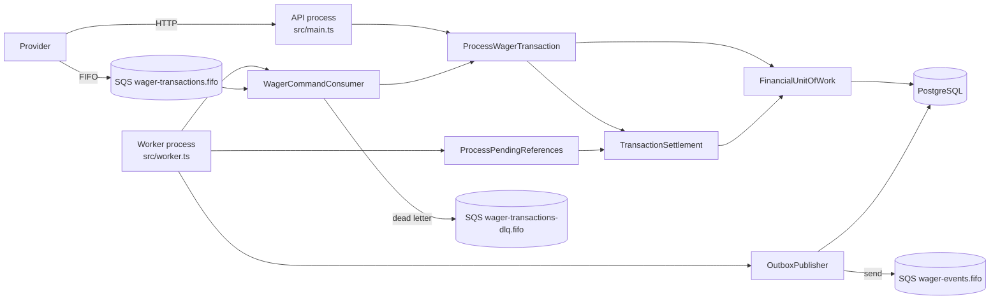
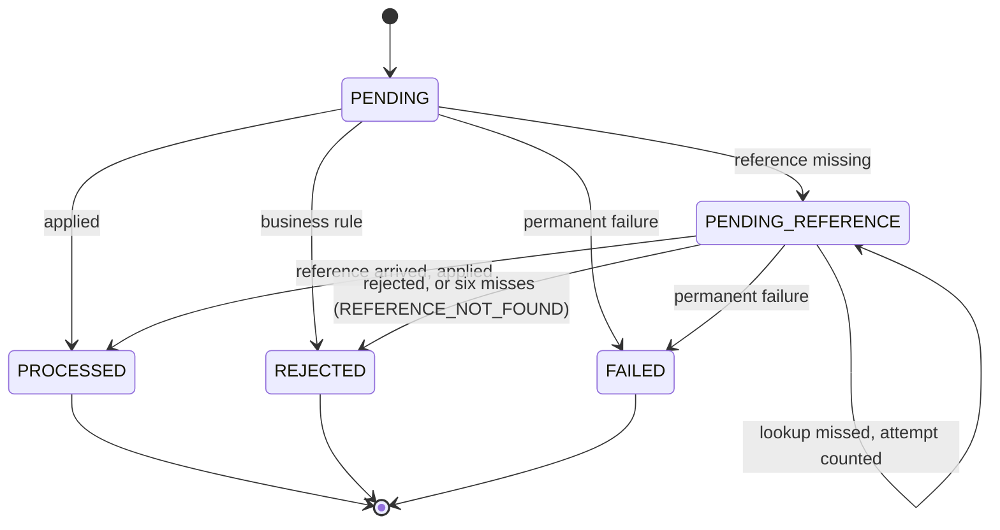
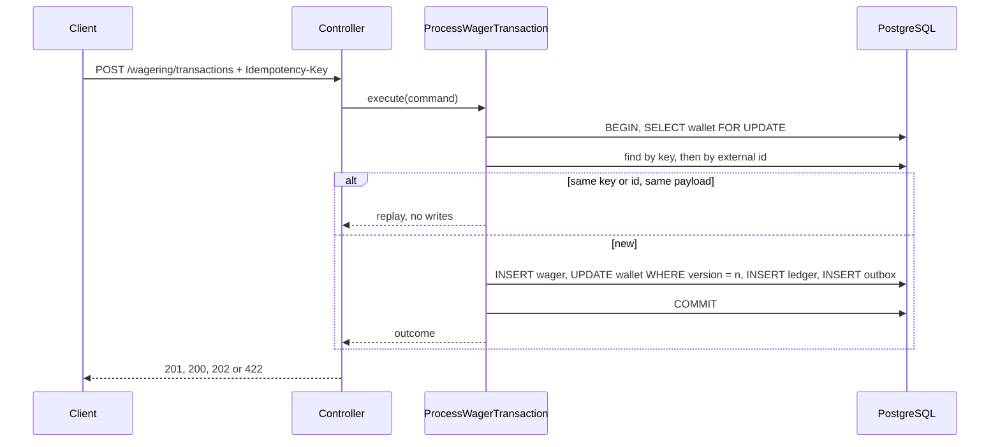
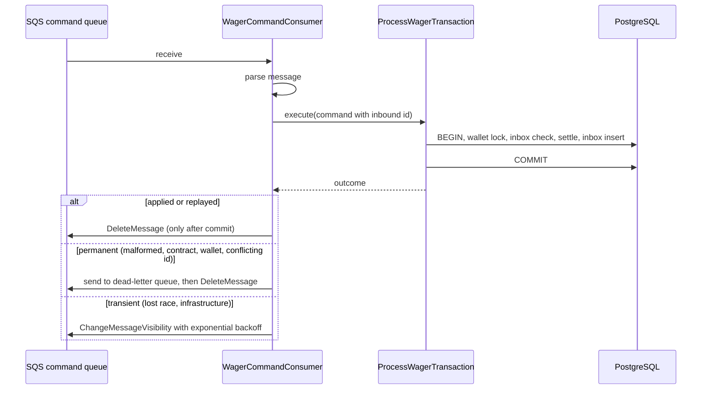
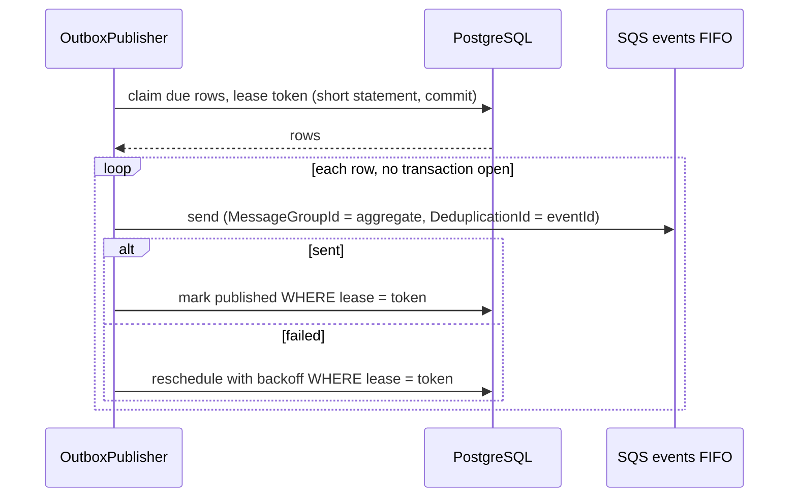

# Architecture

Distributed Wagering Processor: a financial service that applies wager operations
from game providers over HTTP and SQS, with consistent balances under concurrency,
duplicates, out-of-order references, crashes and restarts. This document describes
what is implemented and tested. Each guarantee names the test that proves it. The
requirement-by-requirement status lives in [docs/REQUIREMENTS_MATRIX.md](docs/REQUIREMENTS_MATRIX.md).

## 1. Components and boundaries

A modular monolith with three vertical modules. Each module has `domain`,
`application`, `infrastructure` and `http` folders only where it has code.

| Module      | Owns                                                                                                     |
| ----------- | -------------------------------------------------------------------------------------------------------- |
| `wallet`    | `Wallet` aggregate, `WalletLedgerEntry`, opening, queries, reconciliation                                |
| `wagering`  | `WagerTransaction` lifecycle, reference rules, the one settlement path, pending references               |
| `messaging` | Inbox, Outbox, the SQS adapter, the command consumer and the outbox publisher                            |
| `shared`    | `Money`, `DomainError`, the unit of work port, the integration event envelope, validation, observability |

`domain` imports nothing from NestJS, MikroORM or AWS. Use cases coordinate through
ports (`FinancialUnitOfWork`, the repository ports, `MessageQueue`, `OutboxTransport`).
Controllers only parse and present. Failure-to-HTTP mapping is in one filter.

`ProcessWagerTransaction` handles what is specific to an arriving request: the wallet
lock, idempotency, the inbox record and the retry after a lost race. The financial
decision is in `TransactionSettlement`, which the reference worker also calls. The
rules therefore exist in one implementation.

## 2. Domain model

**Money** (`src/shared/domain/money.ts`). An immutable value over `decimal.js`. Inputs
are decimal strings with at most 18 integer and 2 fractional digits. Currency must be
three uppercase letters. Cross-currency arithmetic throws `CURRENCY_MISMATCH`.
`equals` across currencies returns false. Decision: [ADR 0002](docs/adr/0002-money-representation.md).

**Wallet** (`src/modules/wallet/domain/wallet.ts`). One per player and currency, at
version 1 after creation. Each debit or credit validates its ledger entry before it
mutates state, so a rejected movement leaves balance and version unchanged. A debit
that the balance cannot cover is refused by `canDebit()` before any exception.
Opening with a positive balance writes a CREDIT entry and keeps version 1.

**WalletLedgerEntry** (`wallet-ledger-entry.ts`). Immutable. Requires a positive amount,
non-negative balances, and arithmetic that balances. It has no transition methods.

**WagerTransaction** (`src/modules/wagering/domain/wager-transaction.ts`). The kinds
and their rules are one table (`wager-transaction-kind.ts`):

| Kind       | Balance effect            | Ledger  | Reference                                            |
| ---------- | ------------------------- | ------- | ---------------------------------------------------- |
| `OPENING`  | credit (internal only)    | CREDIT  | none                                                 |
| `BET`      | debit                     | DEBIT   | none                                                 |
| `WIN`      | credit                    | CREDIT  | optional `BET`, not amount-bound                     |
| `LOSS`     | none                      | none    | none                                                 |
| `REFUND`   | credit                    | CREDIT  | required `BET`, amount must match                    |
| `ROLLBACK` | opposite of the reference | inverse | required `BET`, `WIN` or `REFUND`, amount must match |

Balance-affecting kinds must move a positive amount. `LOSS` may be zero.

`FAILED` is in the domain and the database, and it has a transition. No current path
reaches it, because a transaction is written atomically. It is kept for a future
permanent-failure path, and nothing claims otherwise.

## 3. Rejection taxonomy (`failureCode`)

Stable, machine-readable, and persisted with the rejected transaction:

| Code                         | Meaning                                             | Provider action                                 |
| ---------------------------- | --------------------------------------------------- | ----------------------------------------------- |
| `INSUFFICIENT_BALANCE`       | a BET the balance cannot cover                      | do not resend unchanged                         |
| `REVERSAL_WOULD_OVERDRAW`    | a reversal that would make the balance negative     | investigate; not a payload error                |
| `WALLET_PLAYER_MISMATCH`     | the player does not own the wallet                  | correct the payload                             |
| `WALLET_CURRENCY_MISMATCH`   | the currency differs from the wallet                | correct the payload                             |
| `REFERENCE_NOT_FOUND`        | the reference never arrived within the limit        | check the reference, then resend under a new id |
| `REFERENCE_NOT_PROCESSED`    | the reference was rejected or failed                | nothing to reverse                              |
| `REFERENCE_CONTEXT_MISMATCH` | another provider, player, wallet, round or currency | correct the payload                             |
| `REFERENCE_KIND_NOT_ALLOWED` | the reference is of a kind that cannot be reversed  | correct the payload                             |
| `REFERENCE_AMOUNT_MISMATCH`  | a reversal whose amount differs from its reference  | correct the payload                             |
| `REFERENCE_ALREADY_REVERSED` | a second reversal of the same kind                  | nothing to do                                   |
| `PROCESSING_FAILED`          | reserved for the permanent-failure path             | none in this build                              |

Transport outcomes are not persisted. They are the HTTP table below.

## 4. Persistence and database invariants

Migrations are versioned, reversible and deterministic (`Migration20260731000000`,
`Migration20260731000001`). There is no schema synchronization. `test/integration/schema`
covers migration from an empty database, rollback to zero tables, and re-application.

Invariants enforced by PostgreSQL, each with a constraint test that tries to break it:

- `wallets`: `UNIQUE (player_id, currency)`; `balance >= 0`; `version >= 1`; currency
  shape `^[A-Z]{3}$`; `numeric(20,2)`.
- `wallet_ledger_entries`: `UNIQUE (wallet_id, transaction_id)`; `seq` identity for
  ordering; arithmetic `CHECK` for CREDIT and DEBIT; `amount > 0`; a composite foreign
  key `(transaction_id, wallet_id)`, so an entry must belong to a transaction of the
  same wallet. Append-only: `BEFORE UPDATE OR DELETE` and `BEFORE TRUNCATE` triggers
  refuse mutation.
- `wager_transactions`: `UNIQUE (provider_id, external_transaction_id)`;
  `UNIQUE (provider_id, idempotency_key)`; kind and status are checked; a `REFUND` or
  `ROLLBACK` must carry a reference; a `BET`, `OPENING` or `LOSS` must not. Status
  shape: PROCESSED needs `processed_at` and a resulting balance; REJECTED and FAILED
  need a failure code; a held row needs its next lookup time. Composite foreign key
  `(reference_transaction_id, provider_id, wallet_id)`, so a reference must share the
  provider and the wallet. Partial unique index on `(reference_transaction_id)` where
  PROCESSED and the kind is REFUND or ROLLBACK, so each reference is reversed once, whatever
  the kind of reversal. A WIN may carry the reference of the BET it settles.
- `inbox_messages`: primary key `(consumer_name, message_id)`.
- `outbox_messages`: primary key is the stable event id.

Indexes exist for a named query each:

| Index                                                                                      | Query it serves                                |
| ------------------------------------------------------------------------------------------ | ---------------------------------------------- |
| `ledger_wallet_seq_idx (wallet_id, seq)`                                                   | ledger pages for one wallet, in sequence order |
| `wager_one_processed_reversal_per_reference` (partial)                                     | the "reversed once" rule, whatever the kind    |
| `wager_pending_reference_due_idx (reference_next_attempt_at)` (partial, PENDING_REFERENCE) | the reference worker's due scan                |
| `outbox_due_unpublished_idx (next_attempt_at)` (partial, unpublished)                      | the publisher's claim                          |

Reference lookup by `(provider_id, external_transaction_id)` uses the unique constraint's index.

## 5. Concurrency

The unit of concurrency is the wallet. Every financial operation takes the wallet's
row lock first (`SELECT ... FOR UPDATE`), then decides idempotency and balance under
it, then writes everything in one transaction. Operations on one wallet are serialized.
Operations on different wallets never wait for each other.

The lock alone is not the whole guard. The balance write is also conditional on the
version read under the lock (`UPDATE ... WHERE version = ?`), and a stale write raises
`ConcurrencyConflictError`. The unique constraints back up the rest, for example two
workers racing on identities of different wallets. A lost race rolls the unit of work
back, and a retry reads the winner, up to three attempts. No effect is applied twice,
because a rolled-back attempt committed nothing.

Measured trade-off ([ADR 0001](docs/adr/0001-pessimistic-wallet-lock.md)). With the row
lock removed and the version guard kept, a mixed hot-wallet run exhausts its retries
and fails. With both removed, the 80/80 case double-debits. The lock is what keeps a
hot wallet available.

## 6. Idempotency

The `Idempotency-Key` is required. Identity is per provider. A request is a replay when
the business payload hash matches a stored transaction found by key, or by external id.
The hash is SHA-256 over canonical JSON of the business fields, with keys sorted, and it
excludes transport metadata. A replay returns the original result, including the balance
observed at that time (`resultingBalance`), even if the wallet has changed since. A
different payload is `IDEMPOTENCY_CONFLICT`. Decision: [ADR 0003](docs/adr/0003-idempotency-scope-and-payload-hash.md).

## 7. Queue ingress, inbox and dead letters

The consumer parses `WagerTransactionRequested` and calls the same use case as HTTP. The
inbox row `(consumer_name, message_id)` is written in the same transaction. A redelivered
message with the same hash is a duplicate, and the same id with a different hash is
`MESSAGE_PAYLOAD_CONFLICT`.

Classification (`failure-classification.ts`). Permanent failures go to the dead-letter
queue. Transient ones are redelivered with visibility backoff of 2 s, 4 s, 8 s, up to 300 s.
The queue's redrive policy (`maxReceiveCount = 10`) moves a message that keeps failing to
the dead-letter queue. Ten deliveries outlast the consumer's backoff for a transient outage, so
a valid command is not dead-lettered by a short failure. The policy is provisioned by
`docker/localstack/init-sqs.sh`, and `test/integration/messaging/broker-redrive.test.ts` checks
the broker-side move on the provisioned queue.

## 8. Transactional outbox

Events are written in the same transaction as the financial change. Nothing is sent to
SQS inside it, so an event exists only if its operation committed. The publisher leases a
batch with one statement, `UPDATE ... WHERE id IN (SELECT ... FOR UPDATE SKIP LOCKED)`,
sends each event outside any transaction, then marks it published only if its lease
token still matches. A stale token is refused and counted. Delivery is at-least-once. The
event id is the SQS deduplication id and the consumers' deduplication key.
Decision: [ADR 0004](docs/adr/0004-outbox-claim-lease-at-least-once.md).

Events: `WagerTransactionProcessed` (including LOSS), `WagerTransactionRejected`,
`WagerTransactionPendingReference`, `WalletBalanceChanged` (only when the balance changes,
carrying `walletVersion`). The envelope is an abstract class (`IntegrationEvent`) with one
concrete subclass per event type. Its data holds only JSON-friendly values.

## 9. Out-of-order references

A reversal whose reference is missing is held as `PENDING_REFERENCE`, with its attempt
count and next lookup time in the row. The reference worker resolves due rows under the
wallet lock, re-reads them, and calls the shared settlement. Backoff starts at 1 s and
doubles, capped at 5 minutes. Six misses end in `REJECTED` with `REFERENCE_NOT_FOUND`,
which is announced. The schedule is in PostgreSQL, so a restarted worker resumes it.
Decision: [ADR 0005](docs/adr/0005-reference-hold-and-bounded-retries.md).

## 10. HTTP contract

| Endpoint                                          | Success                                                      | Errors                                                                                                                                                                                                    |
| ------------------------------------------------- | ------------------------------------------------------------ | --------------------------------------------------------------------------------------------------------------------------------------------------------------------------------------------------------- |
| `POST /wallets`                                   | 201 with `id`, `balance`, `version`                          | 400 `INVALID_MONEY`, `INVALID_REQUEST`; 409 `WALLET_ALREADY_EXISTS`                                                                                                                                       |
| `GET /wallets/:id`                                | 200                                                          | 404 `WALLET_NOT_FOUND`                                                                                                                                                                                    |
| `GET /wallets/:id/ledger?cursor&limit`            | 200, entries and `nextCursor`                                | 400 `INVALID_CURSOR`, `INVALID_REQUEST`; 404                                                                                                                                                              |
| `POST /wagering/transactions` + `Idempotency-Key` | 201 applied; 200 replay; 202 pending reference; 422 rejected | 400 `IDEMPOTENCY_KEY_REQUIRED`, `INVALID_TRANSACTION` (OPENING), `INVALID_MONEY`, `INVALID_REQUEST`; 404 `WALLET_NOT_FOUND`; 409 `IDEMPOTENCY_CONFLICT`; 503 with `Retry-After` for a transient lost race |
| `GET /wagering/transactions/:id`                  | 200                                                          | 404 `TRANSACTION_NOT_FOUND`                                                                                                                                                                               |
| `GET /providers/:p/wagering/transactions/:e`      | 200                                                          | 404 `TRANSACTION_NOT_FOUND`                                                                                                                                                                               |
| `POST /wallets/:id/reconciliation`                | 200 with the report                                          | 404                                                                                                                                                                                                       |
| `GET /health/live`                                | 200, dependency-free                                         | none                                                                                                                                                                                                      |
| `GET /health/ready`                               | 200 when PostgreSQL and the command queue answer             | 503 names the failing check                                                                                                                                                                               |
| `GET /metrics`                                    | 200, this process's counters                                 | none                                                                                                                                                                                                      |

Unknown routes are 404 `NOT_FOUND`. Malformed bodies are 400 `INVALID_REQUEST`. Unknown
errors are 500 `INTERNAL_ERROR` with no internal detail. A business rejection is not a
client error, so it is 422, and a provider can tell "do not resend" from "fix the payload".

Reconciliation recomputes the wallet from every ledger entry, and checks that each entry
starts where the previous one ended. A divergence is reported with its difference and
counted in `reconciliation_divergences_total`. It is never corrected.

It reads the balance and the ledger in one transaction under a shared lock on the wallet
row (`FOR SHARE`). A debit of that wallet waits until the reconciliation commits, so a debit
cannot land between the two reads and show up as a divergence that does not exist. The wait
lasts as long as one reconciliation. Other reads take no lock.

## 11. Observability

Operation logs are one JSON object per line. The fields are `time`, `level`, `operation`,
`status`, and when known `correlationId`, `messageId`, `transactionId`, `walletId`,
`providerId` and `durationMs`. The type has no field for an amount or a payload, and a
compile-time test checks that.

A failure is logged with `errorName`, the class of the thrown error, and `errorCode`, its
`code` when it has one. The message is never logged, because it can carry a payload. A failed
broker send, a failed command and a failed worker pass are logged this way. A worker loop that
fails keeps running after a pause, so one failing dependency does not end the worker.

Counters are per process (`MetricsRegistry`): `transactions_total{status}`,
`idempotent_replays_total`, `concurrency_conflicts_total`, `commands_total{result}`,
`reference_resolutions_total{status}`, `reference_exhausted_total`,
`reconciliation_divergences_total`, `outbox_published_total`,
`outbox_publish_failures_total`, `outbox_lost_lease_total`. Summaries:
`processing_latency_ms` and `outbox_lag_seconds`. Replays are not counted as transactions.

## 12. Authentication

Deferred, as the challenge permits. [ADR 0006](docs/adr/0006-authentication-deferred.md)
records the decision, the extension point (`ProviderIdentityPort`), and the largest
risk: in this build a caller can name any provider. The API must not be exposed outside a
trusted network.

## 13. Interpretations

These are choices the specification leaves open. Each one is tested.

- Idempotency is per provider. A same external id under another key replays when the
  payload matches, and conflicts when it does not.
- Zero amounts are refused for balance-affecting kinds. `LOSS` may be zero.
- A `WIN` may name its `BET` as reference. The reference is validated, but the win's
  amount is not bound to the bet's.
- A missing wallet is `404` and writes nothing over HTTP. From the queue it is permanent,
  so the message goes to the dead-letter queue.
- A currency or player mismatch is a persisted rejection, not an HTTP error, so the
  outcome is replayable and auditable.
- `OPENING` is written under the internal provider id `system`.
- A replay of a still-pending transaction returns its current state.
- **A referenced transaction is reversed at most once, whatever the kind of reversal.** Rule 4
  of the specification says "pelo mesmo tipo de operação", which would allow a REFUND and then a
  ROLLBACK of the same BET, and that credits the stake twice. This breaks the global rule that
  credits are never duplicated, so the stricter reading is adopted. Enforced in code and by the
  partial unique index `wager_one_processed_reversal_per_reference`. The specification owner
  should confirm this reading.
- A WIN on a BET that was already refunded or rolled back is rejected with
  `REFERENCE_ALREADY_REVERSED`. A WIN may carry its BET's reference (optional, not amount-bound).
  The reference-shape CHECK allows it.

## 14. Limitations

What is not claimed, and why:

- **No authentication.** See section 12.
- **Local infrastructure only.** PostgreSQL 17 and LocalStack 4.14, not AWS. The repository's
  Dockerfile image build could not run in the authoring sandbox, because its TLS proxy
  blocks package downloads. The stack was verified from clean volumes with an image built
  from the same source and the sandbox CA, outside the repository.
- **Broker redrive is configured but not exercised** (section 7).
- **Metrics are per process.** No aggregation or dashboard.
- **Fault injection is partial.** Crash after commit and before acknowledgement is a real
  process crash. Crash before commit, after the broker accepts and before the mark, and
  during reference resolution are injected around real components in the same process.
  A process-level crash before commit, and an interrupted batch during shutdown, are not
  covered.
- **Event order across concurrent publishers is not guaranteed.** Consumers order by
  `walletVersion`.
- **Reconciliation runs on demand.** There is no scheduled job.
- **No dead-letter replay tooling.**
- **No load test.** The concurrency suites prove correctness under concurrency, not throughput.
- **`FAILED` has no producer** in this build (section 2).
- **Open interpretation: a REFUND or ROLLBACK of a BET after a WIN on that BET is accepted.**
  The specification is silent. Accepting it lets a round pay its win and return its stake. It
  is recorded here so that the owner of the specification can decide.
- **Module size.** `wager-transaction.ts` is 389 lines with its types. It was reviewed: its
  members are the lifecycle and reference rules of the aggregate. Reference evaluation is
  a pure function, and it could move to its own file if the class grows.
