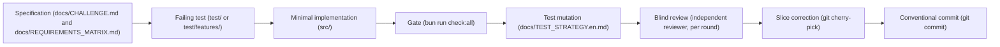
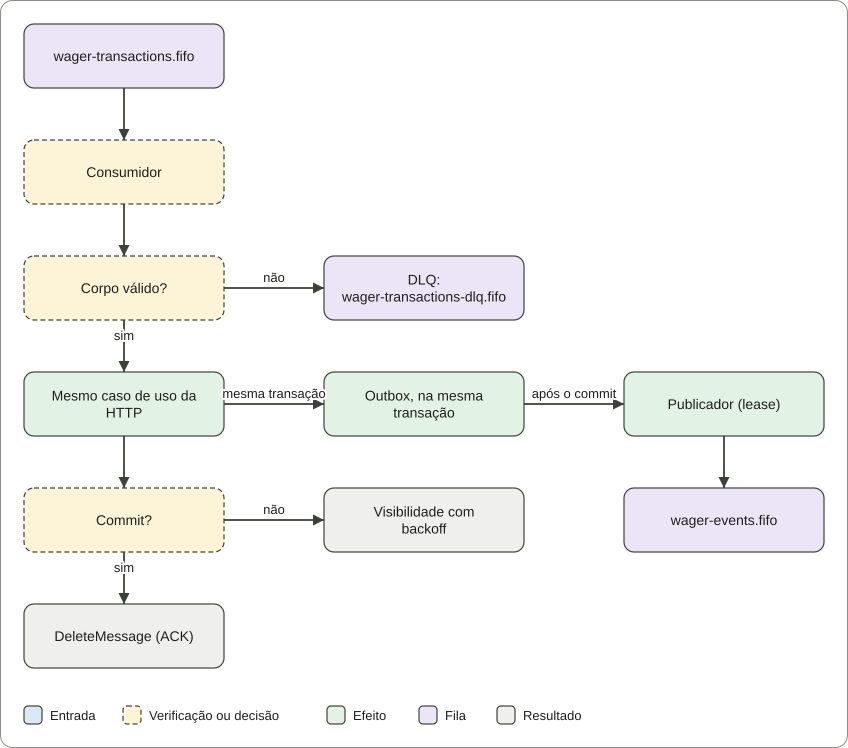

# Distributed Wagering Processor (English)

The main documentation is in Portuguese (pt-BR), which is the source of truth: see [README.md](README.md). This file is
its English translation. The challenge specification does not require a language.

Service that processes wager operations (`BET`, `WIN`, `LOSS`, `REFUND` and `ROLLBACK`) sent by game providers, over HTTP
and SQS. It keeps each wallet's balance equal to the sum of its ledger, even with concurrency, duplicate messages,
out-of-order references, failures and restarts.

Solution to the [technical challenge](docs/CHALLENGE.md). Full documentation index: [docs/README.md](docs/README.md)
(Portuguese).

- **Stack:** Bun 1.4.4, strict TypeScript, NestJS 12, MikroORM 7 (pinned to 7.x), PostgreSQL 17, AWS SQS through
  LocalStack 4.14, and Docker Compose.
- **Authentication:** API keys with roles and provider scope, with no login and no external identity provider
  ([ADR 0007](docs/adr/0007-api-key-authentication.en.md)).
- **Performance:** two measurements, in two environments. A local baseline with 13 scenarios from 1 to 8 CPUs, and a
  cloud baseline with 1, 2 and 4 CPUs. In both, the agreed step was verified for financial correctness. See
  [Measured performance](#measured-performance).

## First steps

1. Start the stack and check readiness:

   ```bash
   docker compose up --build
   curl http://localhost:3000/health/ready
   ```

2. Run the financial demonstration, which calls the API and checks every balance: `bun run demo:finance`.
3. Run the full gate, which includes real PostgreSQL and LocalStack: `bun run infra:up` and then `bun run check:all`.
4. Follow the [reviewer guide](docs/REVIEWER_GUIDE.md) (Portuguese), about 40 minutes, with what each test proves and
   what it does not.

## Where everything is

| Question                                           | Answer                                                                      | Where                                                                                                       |
| -------------------------------------------------- | --------------------------------------------------------------------------- | ----------------------------------------------------------------------------------------------------------- |
| What does the challenge ask?                       | the specification, unchanged                                                | [docs/CHALLENGE.md](docs/CHALLENGE.md)                                                                      |
| How was the work conducted?                        | development cycle, episodes, slices and reviews                             | [How the work was done](#how-the-work-was-done)                                                             |
| Where does the evaluation start?                   | a route with estimated time and what each step proves                       | [docs/REVIEWER_GUIDE.md](docs/REVIEWER_GUIDE.md) (Portuguese)                                               |
| Does each requirement have a proof?                | requirement-to-test matrix, with the status of each line                    | [docs/REQUIREMENTS_MATRIX.md](docs/REQUIREMENTS_MATRIX.md) (Portuguese)                                     |
| How is the system organised?                       | layers, flows, invariants, trade-offs and limitations                       | [ARCHITECTURE.en.md](ARCHITECTURE.en.md)                                                                    |
| Why each choice?                                   | decisions, alternatives and evidence                                        | [DECISIONS.en.md](DECISIONS.en.md) and [docs/adr/](docs/adr/README.en.md)                                   |
| How is money represented?                          | `Money`, on decimal, never `number`                                         | [src/shared/domain/money.ts](src/shared/domain/money.ts)                                                    |
| How are balance and ledger protected?              | per-wallet lock, version, immutability and balance-agreement triggers       | [src/modules/wallet/](src/modules/wallet/) and [migrations](src/shared/infrastructure/database/migrations/) |
| Where does the settlement rule live?               | settlement entity and service, called by HTTP and by the queue              | [transaction-settlement.ts](src/modules/wagering/application/transaction-settlement.ts)                     |
| How does messaging work?                           | inbox, outbox, consumer, publisher, DLQ and quarantine                      | [src/modules/messaging/](src/modules/messaging/)                                                            |
| Which tests prove what?                            | suites by type, and what each one does not replace                          | [docs/TEST_STRATEGY.en.md](docs/TEST_STRATEGY.en.md) and [test/](test/)                                     |
| The business scenarios, in readable language?      | executable Gherkin, with the Cucumber harness on Bun                        | [test/features/](test/features/)                                                                            |
| What does the API look like?                       | OpenAPI contract, checked against the real responses                        | [docs/openapi.json](docs/openapi.json)                                                                      |
| How much can the system take?                      | two measurements: local baseline (13 scenarios) and cloud (1, 2 and 4 CPUs) | [Measured performance](#measured-performance)                                                               |
| What was audited adversarially?                    | findings, experiments and the proof of each guarantee                       | [docs/audit/README.md](docs/audit/README.md) (Portuguese)                                                   |
| How is security automation configured?             | workflows and limits of the observed results                                | [docs/SECURITY_AUTOMATION.en.md](docs/SECURITY_AUTOMATION.en.md)                                            |
| What is still open?                                | owner decisions and limitations                                             | [Limitations and open decisions](#limitations-and-open-decisions)                                           |
| How does the project compare with other solutions? | what was adopted, what already existed and what was not adopted             | [Comparison with other implementations](#comparison-with-other-implementations)                             |
| How is the solution published?                     | static showcase, generated from the repository                              | [technical showcase](https://dedeusgui.github.io/backend-challenge/)                                        |

## How the project answers the evaluation (§14)

The table follows the areas and the points of the specification. Each row points to the proof and to the command that
reproduces it.

| Area (points)                   | Answer                                                                                                                                                                  | Proof                                                                                                                                                                                                                                                                         |
| ------------------------------- | ----------------------------------------------------------------------------------------------------------------------------------------------------------------------- | ----------------------------------------------------------------------------------------------------------------------------------------------------------------------------------------------------------------------------------------------------------------------------- |
| Financial correctness (20)      | `Money` in decimal; balance equal to the ledger, enforced by triggers at `COMMIT`; immutable ledger; reconciliation                                                     | `test/unit/shared/domain/money.test.ts`, `test/integration/schema/ledger-balance-trigger.test.ts`, `test/integration/schema/` (constraints and triggers)                                                                                                                      |
| Concurrency (20)                | per-wallet row lock, version as guard, bounded wait, real processes                                                                                                     | `test/concurrency/hot-wallet.test.ts`, `test/concurrency/three-processes.test.ts`, `test/integration/wagering/lock-timeout.test.ts`                                                                                                                                           |
| Idempotency (15)                | one key per provider in the database, persistent inbox, replay from the stored state, payload conflict                                                                  | `test/integration/messaging/duplicate-deliveries.test.ts`, `test/integration/messaging/inbox-message-identity.test.ts`                                                                                                                                                        |
| Messaging and failures (15)     | outbox in the same transaction, ack only after commit, DLQ before ack, quarantine, retention, return on shutdown, deadlines                                             | `test/integration/messaging/consumer-shutdown.test.ts`, `test/integration/messaging/outbox-quarantine.test.ts`, `test/integration/messaging/outbox-retention.test.ts`, `test/integration/faults/sqs-deadlines.test.ts`, `test/concurrency/process-crash-and-shutdown.test.ts` |
| Modelling and architecture (10) | domain without NestJS, MikroORM or AWS; invariants in the entities; reference bound to the bet's external id                                                            | [ARCHITECTURE.en.md](ARCHITECTURE.en.md), `test/integration/schema/reference-binding.test.ts`, `test/unit/architecture/boundaries.test.ts`                                                                                                                                    |
| Tests (10)                      | real PostgreSQL and LocalStack, no mock of the database or the queue; injected faults; executable Gherkin                                                               | [docs/TEST_STRATEGY.en.md](docs/TEST_STRATEGY.en.md), `bun run check:all`, `bun run test:features`                                                                                                                                                                            |
| Observability (5)               | JSON logs with `correlationId` and without financial values; `/metrics` and `/metrics/prometheus` per process; probes `/health/live` and `/health/ready`, kept separate | `test/unit/observability/metric-cardinality.test.ts`, `test/unit/observability/prometheus-text.test.ts`, `test/e2e/metrics-http.test.ts`, `test/e2e/health.test.ts`                                                                                                           |
| Documentation (5)               | this README, ARCHITECTURE, DECISIONS, the reviewer guide and the requirements matrix                                                                                    | [docs/REVIEWER_GUIDE.md](docs/REVIEWER_GUIDE.md) (Portuguese), [docs/REQUIREMENTS_MATRIX.md](docs/REQUIREMENTS_MATRIX.md) (Portuguese)                                                                                                                                        |
| Authentication (not scored, §2) | API keys with roles and provider scope                                                                                                                                  | [ADR 0007](docs/adr/0007-api-key-authentication.en.md), `test/e2e/authorization-adversarial.test.ts`                                                                                                                                                                          |
| Differentiator: load test       | two measurements, in two environments, with correctness and latency                                                                                                     | [Measured performance](#measured-performance)                                                                                                                                                                                                                                 |

## Inviolable restrictions from the specification (§5)

| #   | Restriction                                               | How the project meets it                                                                                                      | Proof                                                                            |
| --- | --------------------------------------------------------- | ----------------------------------------------------------------------------------------------------------------------------- | -------------------------------------------------------------------------------- |
| 1   | No `number`, `float` or `double` for money                | `Money` over decimal.js; values travel as decimal strings; `NUMERIC(20,2)` in the database                                    | `test/unit/shared/domain/money.test.ts`                                          |
| 2   | Idempotency never only in memory                          | a unique key in the database per provider (`UNIQUE`) and a persistent inbox                                                   | `test/integration/messaging/duplicate-deliveries.test.ts`                        |
| 3   | Do not rely only on SQS FIFO                              | the queue is not the guarantee: duplicates and redeliveries are absorbed by the inbox and the idempotency key in the database | `test/integration/messaging/duplicate-deliveries.test.ts`                        |
| 4   | No event published before the commit                      | the outbox is written in the same SQL transaction; the publisher reads only afterwards                                        | `test/integration/messaging/outbox-publisher.test.ts`, `test/integration/faults` |
| 5   | Ledger never overwritten or deleted                       | a trigger `BEFORE UPDATE OR DELETE OR TRUNCATE` on `wallet_ledger_entries`                                                    | `test/integration/schema/`                                                       |
| 6   | No global lock across wallets                             | `SELECT ... FOR UPDATE` per wallet                                                                                            | `test/concurrency/hot-wallet.test.ts`                                            |
| 7   | No `read → calculate → update` without control            | a row lock before the decision, with the version as a guard                                                                   | `test/concurrency/hot-wallet.test.ts`                                            |
| 8   | Correct with multiple instances                           | three independent processes over the same database and queue                                                                  | `test/concurrency/three-processes.test.ts`                                       |
| 9   | Uniqueness, immutability and non-negativity in the schema | `CHECK`, `UNIQUE`, `FK` and triggers in the migrations                                                                        | `test/integration/schema`                                                        |

All 17 migrations have `up` and `down`. The rollback test is in `test/integration/schema/migrations.test.ts`.

## How the work was done

### The development lifecycle



### Three real episodes

The project's history is shown by the technical decisions taken in the face of concrete evidence:

#### 1. Wallet balance with deferred triggers

- **What was at stake:** Enforce at the database level that a wallet balance equals the sum of its ledger entries (challenge §6.2), so that manual writes or defects outside the application cannot corrupt the accounting.
- **The question that arose:** Would constraint triggers executed at `COMMIT` add excessive latency to the concurrent write path?
- **Evidence:** Experiment 1 in [docs/audit/PERFORMANCE_COMPARISON.md](docs/audit/PERFORMANCE_COMPARISON.md) (Portuguese) measured the cost over six rounds. Median latency rose by 0.10 ms in the sequential scenario (+1.6%) and by 1.84 ms under contention with 8 simultaneous workers (+4.7%). Read time stayed at 0.50 ms with 1,000,000 ledger entries.
- **Decision:** Adopt the deferred triggers `wallets_ledger_balance_check` and `wallet_ledger_entries_balance_check` in migration 12, as documented in [ARCHITECTURE.en.md](ARCHITECTURE.en.md).
- **Proof:** Commit `c5ddca9`, [Migration20261101000012.ts](src/shared/infrastructure/database/migrations/Migration20261101000012.ts), and test [ledger-balance-trigger.test.ts](test/integration/schema/ledger-balance-trigger.test.ts).

#### 2. A test that can fail (mutation)

- **What was at stake:** Verify that the test suite breaks when critical rules are removed, avoiding loose assertions.
- **The question that arose:** Does the concurrency suite detect the removal of pessimistic locks or of the outbox lease expiration predicate?
- **Evidence:** In the mutation evidence section of [docs/TEST_STRATEGY.en.md](docs/TEST_STRATEGY.en.md), mutants were deliberately injected against [distributed-contention.test.ts](test/concurrency/distributed-contention.test.ts):
  - **Killed mutant:** Removing the wallet row lock (`FOR UPDATE`) was caught by the test without retries, which reported three lost updates. Removing the outbox lease predicate caused 61 duplicate claims.
  - **Surviving mutant:** Removing `SKIP LOCKED` from outbox claims survived. The second publisher waits on the row lock and re-evaluates the lease condition, without data corruption. Because no test measures lock wait time, the mutant is equivalent in terms of safety and was kept as a documented gap.
- **Decision:** Keep dedicated tests without retries to kill concurrency mutants, and document equivalent safety mutants in [docs/TEST_STRATEGY.en.md](docs/TEST_STRATEGY.en.md).
- **Proof:** [docs/TEST_STRATEGY.en.md](docs/TEST_STRATEGY.en.md) and [distributed-contention.test.ts](test/concurrency/distributed-contention.test.ts).

#### 3. A review finding turned into code

- **What was at stake:** Meet the operational metrics requirement of the specification (§12).
- **The question that arose:** Round 2 of the simulated review pointed out that the Prometheus retry counter was missing.
- **Evidence:** Inspecting the metric collectors confirmed the absence of a unified `retries_total` counter for queue retries, outbox retries and held reference resolution.
- **Decision:** Introduce the unified `retries_total` metric with a `subsystem` label, instrumented in the three reprocessing flows (`wager-command-consumer.ts`, `outbox-publisher.ts` and `process-pending-references.use-case.ts`), and covered by a unit test.
- **Proof:** Commit `4ee8f72` and test [retries-total.test.ts](test/unit/observability/retries-total.test.ts).

### Slices, in order

The generated log catalog [docs/HISTORICO.en.md](docs/HISTORICO.en.md) is built from `git log` since commit `f12191b`. It lists each commit with its conventional type, and the count per type. Ten representative slices:

| Date       | Commit    | What changed                                                            | Proof                                                    |
| :--------- | :-------- | :---------------------------------------------------------------------- | :------------------------------------------------------- |
| 2026-10-31 | `211392e` | `Money` value object with exact decimal arithmetic and no `number`      | `test/unit/shared/domain/money.test.ts`                  |
| 2026-10-31 | `2358842` | `Wallet` aggregate and append-only ledger entries                       | `test/unit/wallet/domain/wallet.test.ts`                 |
| 2026-10-31 | `5843be4` | Balance and idempotency invariants under real concurrency               | `test/concurrency/hot-wallet.test.ts`                    |
| 2026-10-31 | `fd5710d` | SQS command consumer and transactional outbox publisher                 | `test/integration/messaging/outbox-publisher.test.ts`    |
| 2026-10-31 | `0a1e1f0` | Fault injection and recovery at critical transaction boundaries         | `test/integration/faults/fault-injection.test.ts`        |
| 2026-10-31 | `6ff6891` | API key authentication with provider scope and roles                    | `test/e2e/authorization-adversarial.test.ts`             |
| 2026-11-01 | `ef390fe` | Port separation into `application/ports` and inbound/outbound structure | `test/unit/architecture/boundaries.test.ts`              |
| 2026-11-01 | `3620d74` | Executable Gherkin feature suite running under Bun with Cucumber        | `test/features/`                                         |
| 2026-11-01 | `4c58edb` | Bounded wallet lock wait time (`lock_timeout`)                          | `test/integration/wagering/lock-timeout.test.ts`         |
| 2026-11-01 | `c5ddca9` | Deferred triggers preventing commit with balance divergent from ledger  | `test/integration/schema/ledger-balance-trigger.test.ts` |
| 2026-11-01 | `4ee8f72` | Unified Prometheus counter `retries_total` required by §12              | `test/unit/observability/retries-total.test.ts`          |

### Reviews

Systematic reviews identified defects and guided corrective slices before delivery:

| Round                                                                         | Estimated score            | Highest severity findings                                                                                                                                                                                                                     | Status and commit                                                                                                                                                                |
| :---------------------------------------------------------------------------- | :------------------------- | :-------------------------------------------------------------------------------------------------------------------------------------------------------------------------------------------------------------------------------------------- | :------------------------------------------------------------------------------------------------------------------------------------------------------------------------------- |
| Invariant Review ([docs/INVARIANT_REVIEW.en.md](docs/INVARIANT_REVIEW.en.md)) | 80/100 (internal estimate) | Duplicate credit risk on multiple WINs or REFUND after result; missing database constraints for currency and round; unauthenticated API endpoints                                                                                             | Resolved: unique index in `ce1cb62`; schema constraints in `f9eb95b`; authentication in `6ff6891`                                                                                |
| Adversarial Audit ([docs/audit/FINDINGS.md](docs/audit/FINDINGS.md))          | 85/100 (internal estimate) | Malformed envelope halted outbox; `idempotencyKey` missing from inbox message identity; slow batch exposed messages in flight; test fault hooks in production code; held transaction error stalled worker; local host clock used for timeouts | Resolved: migration 9 in `2905535`; inbox identity in `2ec4d5e`; heartbeat in `b398e22`; test composition in `489df8b`; terminal state in `c8ffbcc`; database clock in `fc3862c` |
| Simulated Quality Review (code and test quality audit)                        | 90/100 (target estimate)   | Direct database write allowed balance divergent from ledger; infrastructure coupling in ports; missing `retries_total` counter (§12); missing executable Gherkin suite                                                                        | Resolved: migration 12 in `c5ddca9`; ports in `ef390fe`; metric in `4ee8f72`; BDD suite in `3620d74`                                                                             |

### How agent work was controlled

AI-assisted development was conducted under strict delegation and continuous human supervision. Artificial intelligence does not guarantee correctness on its own. Architectural design, interpretation of the specification's rules, and final approval of the code were exclusive responsibilities of the human author.

- **Scoped briefs:** each task started from a brief written by the author, with an explicit objective, the allowed files and measurable acceptance criteria.
- **Isolated worktrees:** agents worked in dedicated Git worktrees and branches, with no permission to push or to change shared branches.
- **Diff inspection and quality gate:** the human coordinator inspected every diff and ran the full gate (`bun run check:all`) against real PostgreSQL and LocalStack instances before accepting any work.
- **Selective integration:** approved slices were integrated into the history with `git cherry-pick`. Agents implemented slices and tests; the human author checked the behaviour, refined the decisions and decided what entered the repository.

### What the proof does not cover

Known limits on how far the automated proofs reach:

- **Temporal order of test writing:** the Git history does not prove that each test failed before the code was written. The order is required by [CLAUDE.md](CLAUDE.md), and the technical evidence of test sensitivity is in the mutation tests ([docs/TEST_STRATEGY.en.md](docs/TEST_STRATEGY.en.md)).
- **Gherkin scenarios tagged `@bloqueado`:** two scenarios in [test/features/mensageria.feature](test/features/mensageria.feature) (lines 71 and 91) are outside the BDD harness run. Scenario line 71 (DLQ redrive after ten failures) is covered by the integration test [test/integration/messaging/broker-redrive.test.ts](test/integration/messaging/broker-redrive.test.ts). Scenario line 91 (SIGTERM shutdown during batch processing) is covered by the real-process test [test/concurrency/process-crash-and-shutdown.test.ts](test/concurrency/process-crash-and-shutdown.test.ts).
- **HTTP API process crash:** `test/concurrency/process-crash-and-shutdown.test.ts` sends `SIGKILL` while a ledger insert holds the transaction open, then verifies full rollback and that a retry applies the wager once. A process crash after commit but before the HTTP response is not yet injected at the operating-system level ([docs/TEST_STRATEGY.en.md](docs/TEST_STRATEGY.en.md)).
- **Equivalent outbox wait mutant:** the suite does not detect the removal of the `SKIP LOCKED` clause in the outbox query (mutant M3 in [docs/TEST_STRATEGY.en.md](docs/TEST_STRATEGY.en.md)), because it only introduces ordered waiting without breaking data integrity, and no test measures lock wait times.
- **Load test after migration 12:** the full 13-scenario load test suite was not rerun after the balance-agreement triggers of migration 12 were added ([ARCHITECTURE.en.md](ARCHITECTURE.en.md)).

## Architecture at a glance

These diagrams are the same SVG files used on the static showcase. They show the flows that are implemented. The
guarantees and failure points are explained in [ARCHITECTURE.en.md](ARCHITECTURE.en.md).

### 1. BET received over HTTP

Authentication and provider identity, validation of the operation, idempotency, and the transactional decision.
[Open the SVG at full size](docs/diagrams/bet-over-http.svg).



### 2. Command received from SQS

Queue consumption, financial processing shared with the HTTP route, handling of redeliveries, and message
acknowledgement. [Open the SVG at full size](docs/diagrams/queued-command.svg).



### 3. Outcomes, states and entities

The transitions and the records involved in the decision on a financial operation.
[Open the SVG at full size](docs/diagrams/outcome-entities.svg).



The diagrams are explanatory. The proof of the invariants is in the database constraints and triggers, in the code, and
in the integration, concurrency and fault tests.

## Guarantees

| Guarantee                                            | How it is enforced                                                                    | Where it is proven                                                                                |
| ---------------------------------------------------- | ------------------------------------------------------------------------------------- | ------------------------------------------------------------------------------------------------- |
| Money is never a `number`                            | `Money` over `decimal.js`, `NUMERIC(20,2)` columns                                    | `test/unit/shared/domain/money.test.ts`                                                           |
| Balance never negative, not even under a race        | per-wallet row lock, version as guard, `CHECK` in the database                        | `test/concurrency/hot-wallet.test.ts`                                                             |
| Balance equal to the sum of the ledger               | constraint trigger deferred to `COMMIT`; immutable ledger; reconciliation on read     | `test/integration/schema/ledger-balance-trigger.test.ts`, `test/e2e/queries-http.test.ts`         |
| Reference entry only for the right bet               | composite foreign key with the bet's external id                                      | `test/integration/schema/reference-binding.test.ts`                                               |
| One effect, however many deliveries                  | idempotency key per provider, inbox, `UNIQUE` in the database                         | `test/integration/messaging/duplicate-deliveries.test.ts`                                         |
| Event only after commit                              | outbox in the same transaction; publisher with lease                                  | `test/integration/faults`, `test/integration/messaging/outbox-publisher.test.ts`                  |
| Three processes, no duplicate effect                 | real processes, one database, one queue                                               | `test/concurrency/three-processes.test.ts`                                                        |
| Recovery after a death midway through the path       | worker killed before and after commit, with redelivery                                | `test/concurrency/process-crash-and-shutdown.test.ts`                                             |
| Unprocessed message returns to the queue on shutdown | visibility returned before the next processing                                        | `test/integration/messaging/consumer-shutdown.test.ts`                                            |
| Event that never publishes does not block the queue  | quarantine after N attempts, with operator requeue                                    | `test/integration/messaging/outbox-quarantine.test.ts`, `scripts/outbox-requeue.ts`               |
| Waits have deadlines                                 | `lock_timeout` and `statement_timeout` per transaction; deadline on SQS and readiness | `test/integration/wagering/lock-timeout.test.ts`, `test/integration/faults/sqs-deadlines.test.ts` |

The full list, with the interpretation of each ambiguous rule of the specification, is in
[ARCHITECTURE.en.md](ARCHITECTURE.en.md) and [docs/INVARIANT_REVIEW.en.md](docs/INVARIANT_REVIEW.en.md).

## Run

Requirements: Docker with Compose and, to develop or test, Bun **1.4.4**.

```bash
docker compose up --build
curl http://localhost:3000/health/ready
# {"status":"ok","checks":{"database":"up","sqs":"up"}}
```

Compose starts PostgreSQL and LocalStack, which provisions the queues `wager-transactions.fifo`,
`wager-transactions-dlq.fifo` and `wager-events.fifo`. It runs the migrations once, and only then starts the API
(port 3000) and the worker.

Every published port binds `127.0.0.1`: the database, LocalStack and the API are reachable only from this machine. To
expose another interface, set `PUBLISH_HOST`, and do it only on a network you control. The worker publishes no port; its
internal health and metrics surface (port 3001) stays on the Compose network.

To create an operator key and read the metrics:

```bash
docker compose exec api bun run auth:create -- --name operations --role OPERATOR
# key: wgr_...   (shown once; only the hash is stored)
curl -H "authorization: Bearer wgr_..." http://localhost:3000/metrics
```

The financial demonstration runs on the host and creates its own keys. **It requires the stack to be running**, because
it calls the API, and the stack is what applies the migrations to the database. Without the stack, the demonstration
fails when it creates the first key:

```bash
docker compose up --build        # in one terminal
bun install --frozen-lockfile
bun run demo:finance
```

### Local development without the application containers

```bash
cp .env.example .env
bun install --frozen-lockfile
bun run infra:up        # PostgreSQL and LocalStack, with health checks
bun run db:migrate
bun run dev             # API, with restart on change
bun run src/worker.ts   # worker, in another terminal
```

### Three demonstrations

Three scenarios show the guarantees. Each one prints its own result and needs only the commands below.

1. **Financial processing.** Start the stack (`docker compose up --build`), then run `bun run demo:finance`. It opens a
   wallet with 100.00, runs a BET, a WIN, a BET and its REFUND, and a ROLLBACK of the WIN. It checks every balance, the
   refusal of a second ROLLBACK, the replay of a BET, the ledger sum and the reconciliation.
2. **Concurrency.** `bun test test/concurrency/three-processes.test.ts -t "fifty identical requests"`. Fifty identical
   requests run in parallel over three API processes and one database. One debit is applied, and the others are replays
   of the same transaction.
3. **Recovery.** `bun test test/concurrency/three-processes.test.ts -t "crashes after commit and before ACK"`. A worker
   process exits with code 137 after its command has committed and before the message is acknowledged. A restarted
   worker takes the message back. The queue is drained, the balance is 75.00, the ledger sums to 75.00, and there is
   exactly one debit for the command.

## Protected mode (optional)

The default mode has no rate limit. The protected mode puts an Nginx edge in front of the API, which limits requests per
client address and refuses the excess with 429. In this mode the API publishes no port of its own, and the edge is the
only entry point. The public port is the same, 3000.

```bash
docker compose -f docker-compose.yml -f docker-compose.protected.yml up --build
bun run test:edge        # 12 cases against the running stack
docker compose -f docker-compose.yml -f docker-compose.protected.yml down
```

The limits are `EDGE_WRITE_RATE` (20 per second), `EDGE_WRITE_BURST` (40), `EDGE_READ_RATE` (50 per second),
`EDGE_READ_BURST` (100) and `EDGE_MAX_CONNECTIONS` (50). A refusal is `429` with `Retry-After` and a JSON body. Health
checks are not limited. `bun run edge:check` starts the stack, runs the suite and stops it. `bun run bench:edge <label>`
measures the cost of the edge against the API. What this protection is **not**, and its measured cost, are in
[ARCHITECTURE.en.md](ARCHITECTURE.en.md), section 15.

## Comparison with other implementations

This solution was compared with other public implementations of the same challenge. The comparison was made by reading
their code, without running it or copying third-party code: the ideas were reimplemented, each with a test. The names of
the other projects do not appear in the repository.

| Practice                                                          | Status                       | Where it is                                                                                                                                                                    |
| ----------------------------------------------------------------- | ---------------------------- | ------------------------------------------------------------------------------------------------------------------------------------------------------------------------------ |
| Wallet lock with bounded wait and `statement_timeout`             | adopted                      | `src/shared/infrastructure/database/mikro-orm-financial-unit-of-work.ts`, `test/integration/wagering/lock-timeout.test.ts`                                                     |
| Outbox quarantine after N attempts, with operator requeue         | adopted                      | `test/integration/messaging/outbox-quarantine.test.ts`, `scripts/outbox-requeue.ts`                                                                                            |
| Balance-to-ledger agreement trigger, deferred to commit           | adopted, with measured cost  | migration 12, `test/integration/schema/ledger-balance-trigger.test.ts`, [PERFORMANCE_COMPARISON](docs/audit/PERFORMANCE_COMPARISON.md) (Portuguese)                            |
| Reversal reference bound to the bet's external id                 | adopted                      | migration 14, `test/integration/schema/reference-binding.test.ts`                                                                                                              |
| Visibility returned when the consumer shuts down                  | adopted                      | `test/integration/messaging/consumer-shutdown.test.ts`                                                                                                                         |
| Explicit deadlines for SQS calls and for readiness                | adopted                      | `test/integration/faults/sqs-deadlines.test.ts`                                                                                                                                |
| Retention of published events                                     | adopted                      | `test/integration/messaging/outbox-retention.test.ts`                                                                                                                          |
| DLQ sent before the original message is acked                     | already existed              | `test/integration/messaging/wager-command-consumer.test.ts`                                                                                                                    |
| Metrics in Prometheus format, with no new dependency              | adopted                      | `GET /metrics/prometheus`, `test/unit/observability/prometheus-text.test.ts`                                                                                                   |
| Hash chain in the ledger                                          | not adopted                  | Immutability by trigger and reconciliation already exist. A chain would only detect tampering by someone who already has write access, and role separation does not exist yet. |
| Minimal database role, with no `UPDATE` or `DELETE` on the ledger | not adopted                  | Requires separating roles in Compose, which is an operations decision. Immutability already holds for any role, through the trigger.                                           |
| Double-entry with house accounts                                  | not adopted                  | The specification does not ask for house accounts. The ledger of entries is already auditable.                                                                                 |
| Circuit breaker on queue calls                                    | not adopted                  | No gain in §14. Deadlines and readiness cover the case of a slow or unavailable dependency.                                                                                    |
| Keycloak or OIDC                                                  | not adopted                  | Outside the specification. The decision is in [ADR 0007](docs/adr/0007-api-key-authentication.en.md).                                                                          |
| Grafana dashboard                                                 | not adopted in this delivery | It would require a service and a dashboard, which §12 makes optional. See [Limitations and open decisions](#limitations-and-open-decisions).                                   |
| Sending to the queue inside the outbox transaction                | rejected                     | Holds a connection and a row lock during the broker call. The publisher uses a lease.                                                                                          |
| Money as an integer of fractional units (`bigint`)                | rejected                     | `decimal.js` with `NUMERIC(20,2)` is exact and readable. [ADR 0002](docs/adr/0002-money-representation.en.md).                                                                 |

Beyond the alternatives above: two workers contending for the same wallet, with one of them killed in the middle of the
contention (`test/concurrency/distributed-contention.test.ts`).

## Measured performance

Beyond proving financial integrity under concurrency, the project measures performance with **open load, explicit limits
and reconciliation of every wallet**. The results below come from recorded runs, not from a production capacity estimate.

**Version caveat:** the load campaigns were measured **before** migration 12, which added the balance-to-ledger agreement
triggers. Those triggers were measured in isolation (`docs/audit/PERFORMANCE_COMPARISON.md`), but the full load run was
not repeated with them.

### Two baselines, two environments

I, Guilherme de Deus, measured the local baseline on my own machine. The cloud runs were measured on a VM of the Claude
Code cloud environment, by an agent. The software versions are the same (Bun 1.4.4, PostgreSQL 17 and LocalStack 4.14),
but the machines are not. So the numbers show the trend within each environment, not that one is better than the other.

| Item        | Local baseline (my machine)                                       | Cloud baseline (Claude Code VM)                                        |
| ----------- | ----------------------------------------------------------------- | ---------------------------------------------------------------------- |
| Measured by | Guilherme de Deus, on his own machine                             | An agent of Claude Code, in the cloud environment                      |
| Processor   | AMD Ryzen 7 7735HS, 8 cores and 16 threads (SMT)                  | Intel Xeon @ 2.10 GHz, 4 vCPUs                                         |
| Memory      | 22 GiB                                                            | 15.7 GiB                                                               |
| System      | Linux 7.2.6                                                       | Linux 6.18.44                                                          |
| Docker      | 29.9.2                                                            | not recorded in the report                                             |
| Topology    | 1 to 3 APIs, 1 or 2 workers                                       | 3 APIs, 2 workers                                                      |
| Stack CPUs  | 1, 2, 4 and 8                                                     | 1, 2 and 4                                                             |
| Generator   | on the free CPUs; CPUs `n` and `n+1` are threads of the same core | on the free CPUs; with 4 stack CPUs, it shares the CPUs with the stack |
| Records     | [docs/load/local/](docs/load/local/)                              | [docs/load/results/](docs/load/results/)                               |
| Report      | [LOAD_TEST_BASELINE.en.md](docs/LOAD_TEST_BASELINE.en.md)         | [LOAD_TEST_RESULTS.md](docs/LOAD_TEST_RESULTS.md)                      |

### Cloud baseline: 1, 2 and 4 CPUs

| CPUs given to the stack | Highest rate that passed every limit | Next step                                 |
| ----------------------: | -----------------------------------: | ----------------------------------------- |
|                       1 |                            100 req/s | 125 req/s: failed on latency              |
|                       2 |                            200 req/s | 300 req/s: failed on latency              |
|                       4 |                            400 req/s | Not measured: the ramp ended at 400 req/s |

Each step lasted 20 seconds. To pass, a step had to meet, at the same time, p95 ≤ 500 ms, p99 ≤ 1,000 ms, zero lost
requests, an error rate ≤ 0.1%, the outbox drained, and the financial invariants. With four CPUs, **400 req/s was the
limit of the test, not the capacity limit of the system**.

There was also a paired experiment on the same host, with two CPUs: at 100 req/s, p99 fell from **120/134 ms** (two
runs of the initial version) to **31/32 ms** (two runs after changes to the query and the lock path). The comparison does
not isolate the effect of a single change, but the files let you audit both states and repeat the experiment.

### Local baseline: 13 scenarios

Measured on my own machine, with the stack at 1, 2, 4 or 8 CPUs, 1 to 3 APIs and 1 or 2 workers. Each scenario is a
folder in `docs/load/local/`. The agreed rate is the highest that passed every limit; the first failing rate is the first
step of the ramp that did not pass. The p99 is at the agreed step, and utilisation is the stack's net CPU divided by the
CPUs assigned to it.

| Scenario               | CPUs | Agreed (req/s) | First failing (req/s) | p99 at the agreed step (ms) | CPU utilisation |
| ---------------------- | ---: | -------------: | --------------------: | --------------------------: | --------------: |
| `apis1-workers2-cpus1` |    1 |            150 |                   200 |                         146 |             71% |
| `apis1-workers2-cpus2` |    2 |            300 |                   400 |                         245 |             79% |
| `apis1-workers2-cpus4` |    4 |            400 |                   500 |                          50 |             52% |
| `apis1-workers2-cpus8` |    8 |            500 |                   600 |                         109 |             29% |
| `apis2-workers2-cpus1` |    1 |            150 |                   200 |                         161 |             83% |
| `apis2-workers2-cpus2` |    2 |            300 |                   400 |                         539 |             92% |
| `apis2-workers2-cpus4` |    4 |            500 |                   600 |                          74 |             78% |
| `apis2-workers2-cpus8` |    8 |            600 |                   800 |                          65 |             41% |
| `apis3-workers1-cpus2` |    2 |            200 |                   300 |                         308 |             66% |
| `apis3-workers2-cpus1` |    1 |            125 |                   150 |                         659 |             81% |
| `apis3-workers2-cpus2` |    2 |            200 |                   300 |                         339 |             68% |
| `apis3-workers2-cpus4` |    4 |            500 |                   600 |                         603 |             84% |
| `apis3-workers2-cpus8` |    8 |            800 |                  1000 |                         603 |             63% |

Across all 13 scenarios, at the agreed step there was no lost request, no 5xx error, no financial violation, no duplicate
and no incorrect answer. The outbox drained in at most 0.2 s, and the generator lag p99 stayed at most 1.8 ms. Every first
failure was on latency: p95 and p99 above their limits.

With 1 and 2 CPUs, more APIs did not raise the agreed rate. With 4 and 8 CPUs, they did, and the highest rate was 800 req/s,
with 3 APIs and 8 CPUs.

These are LocalStack measurements on this machine, not AWS SQS and not the cloud runs. The difference from the cloud
numbers is not an improvement, because the machines are different. Method, reading and limits are in
[docs/LOAD_TEST_BASELINE.en.md](docs/LOAD_TEST_BASELINE.en.md), and the raw JSON records of the 13 scenarios are in
[docs/load/local/](docs/load/local/).

**Sources, environment and caveats:** [full report with method and criteria](docs/LOAD_TEST_RESULTS.md),
[local baseline, with 13 scenarios, correctness and concurrency](docs/LOAD_TEST_BASELINE.en.md),
[history of the paired experiments](docs/LOAD_TEST_HISTORY.en.md) and [JSON records of the runs](docs/load/). These are
LocalStack measurements, not AWS SQS; there is no long soak test and no validated production SLO.

## Tests

| Command                    | What it is for                                                                                                                    |
| -------------------------- | --------------------------------------------------------------------------------------------------------------------------------- |
| `bun run check:fast`       | typecheck, lint, format and unit tests, with no infrastructure                                                                    |
| `bun run check:all`        | the full gate: everything above, plus infrastructure, integration, concurrency, e2e and Gherkin. This is what CI runs             |
| `bun run test:integration` | real PostgreSQL and LocalStack: schema, persistence, messaging, faults                                                            |
| `bun run test:containers`  | optional local pilot with temporary containers; details and limits in [docs/TEST_STRATEGY.en.md](docs/TEST_STRATEGY.en.md)        |
| `bun run test:concurrency` | parallel connections, three API processes, a worker killed or stopped                                                             |
| `bun run test:e2e`         | the HTTP application, with API keys                                                                                               |
| `bun run test:features`    | the Gherkin scenarios of `test/features/`, run by Cucumber on Bun                                                                 |
| `bun run test:infra`       | the Compose configuration, read by `docker compose config` itself                                                                 |
| `bun run test:edge`        | protected mode, against the running stack                                                                                         |
| `bun run test:load`        | optional load test, per CPU count; see [docs/LOAD_TEST_RESULTS.md](docs/LOAD_TEST_RESULTS.md)                                     |
| `bun run load:consolidate` | consolidated table of the load scenarios in `docs/load/local`; see [docs/LOAD_TEST_BASELINE.en.md](docs/LOAD_TEST_BASELINE.en.md) |

No integration, concurrency or e2e test replaces PostgreSQL or the queue with a mock. Each concurrency test checks that
exactly one operation has the effect, and that the others are replays, conflicts or rejections.

### Other commands

| Command                                                                | What it is for                                                           |
| ---------------------------------------------------------------------- | ------------------------------------------------------------------------ |
| `bun run typecheck`                                                    | `tsc --noEmit`: checks the types without emitting files                  |
| `bun run lint`                                                         | oxlint over `src` and `test`                                             |
| `bun run format` and `bun run format:check`                            | prettier: formats, or only verifies (`check:fast` runs the verification) |
| `bun run test:unit`                                                    | unit tests, without infrastructure                                       |
| `bun run auth:create -- --name <name> --role PROVIDER --provider <id>` | creates a provider key; with `--role OPERATOR`, creates an operator key  |
| `bun run auth:revoke -- --client <clientId>`                           | revokes an API key                                                       |
| `bun run outbox:requeue -- <eventId>`                                  | returns a quarantined event to the publishing queue                      |
| `bun run db:migrate`                                                   | applies the migrations to the configured database                        |
| `bun run start`                                                        | starts the API from the source, without reloading                        |
| `bun run edge:up` and `bun run edge:down`                              | starts and stops protected mode                                          |
| `bun run edge:check`                                                   | starts protected mode, runs `test:edge`, and stops it                    |
| `bun run bench:edge`                                                   | measures the edge overhead (`test/edge/overhead.ts`)                     |
| `bun run site:build`                                                   | generates the static showcase in `site/` from the repository files       |

## Endpoints

Monetary amounts are always `{ "amount": "25.00", "currency": "BRL" }`. Every route requires
`Authorization: Bearer <key>`, except the health and documentation routes (`/health/live`, `/health/ready`,
`/openapi.json` and `/docs`). An operator key opens and reads wallets. A provider key submits and reads the operations of
its own provider only. Keys are created with the `auth` command, which prints each one once:

```bash
docker compose exec api bun run auth:create -- --name operations --role OPERATOR
docker compose exec api bun run auth:create -- --name provider-a --role PROVIDER --provider provider-a
```

| Method and path                                                           | Purpose                                                                  | Who                            |
| ------------------------------------------------------------------------- | ------------------------------------------------------------------------ | ------------------------------ |
| `POST /wallets`                                                           | opens a wallet, with an optional opening balance (201; 409 if it exists) | operator                       |
| `GET /wallets/:walletId`                                                  | balance, version and currency                                            | operator                       |
| `GET /wallets/:walletId/ledger?cursor=&limit=`                            | ledger entries in order, with an opaque `nextCursor`                     | operator                       |
| `POST /wallets/:walletId/reconciliation`                                  | recomputes the balance from the ledger and reports any divergence        | operator                       |
| `POST /wagering/transactions`                                             | submits an operation, with `Idempotency-Key` (201, 200, 202 or 422)      | provider (its own) or operator |
| `GET /wagering/transactions/:transactionId`                               | one transaction, by internal id                                          | provider (its own) or operator |
| `GET /providers/:providerId/wagering/transactions/:externalTransactionId` | the same, by the provider's own id                                       | provider (its own) or operator |
| `GET /health/live`, `GET /health/ready`                                   | the process is up; PostgreSQL and the queue respond                      | public                         |
| `GET /metrics`                                                            | counters and summaries of this process, as JSON                          | operator                       |
| `GET /metrics/prometheus`                                                 | the same, in Prometheus text format (`text/plain; version=0.0.4`)        | operator                       |
| `GET /openapi.json`, `GET /docs`                                          | the OpenAPI 3.1 contract and the Swagger UI, served by the API itself    | public                         |

The failure codes are stable and are listed in [ARCHITECTURE.en.md](ARCHITECTURE.en.md). The full contract is in
[docs/openapi.json](docs/openapi.json).

Example of submitting a bet. The `Idempotency-Key` header is required, and it is the source of truth for idempotency:

```bash
curl -X POST localhost:3000/wagering/transactions \
  -H 'content-type: application/json' -H 'Idempotency-Key: provider-a:transaction-123' \
  -H "authorization: Bearer $PROVIDER_A_KEY" \
  -d '{"providerId":"provider-a","externalTransactionId":"transaction-123","playerId":"0192f28f-5dc0-7d58-bdb2-814ad6a0f4a1","walletId":"<wallet id>","roundId":"round-987","gameId":"fortune-chimp","kind":"BET","money":{"amount":"25.00","currency":"BRL"}}'
```

A rejected operation returns 422 with a `failureCode`. `ARCHITECTURE.en.md` section 3 lists the codes, and section 10
gives the status of each error.

## Queue

The worker consumes `WagerTransactionRequested` messages from `wager-transactions.fifo`, in the body shape of the
specification, and calls the same use case as HTTP. A message is acknowledged only after its transaction commits.
Permanent failures go to `wager-transactions-dlq.fifo`. The worker publishes `WagerTransactionProcessed`,
`WagerTransactionRejected`, `WagerTransactionFailed`, `WalletBalanceChanged` and `WagerTransactionPendingReference` to
`wager-events.fifo`.

An external consumer orders a wallet's balance changes by `walletVersion`, not by arrival order. The contract of this
guarantee is in [ARCHITECTURE.en.md](ARCHITECTURE.en.md).

## Limitations and open decisions

The full list is in [ARCHITECTURE.en.md](ARCHITECTURE.en.md). The most important ones:

- **API keys, not an identity provider.** Keys last until they are revoked, with no rotation or login. The API speaks
  plain HTTP, so a deployment must put TLS in front of it. See [ADR 0007](docs/adr/0007-api-key-authentication.en.md).
- **Rate limiting only in protected mode, and per address.** It is not protection against a distributed attack.
- **Local infrastructure.** LocalStack stands in for SQS. No AWS deployment was made.
- **Load measured before the agreement triggers.** Migration 12 added the cost of one trigger per wallet write. It was
  measured in isolation; the full load run was not repeated.
- **The image was not built inside the repository in this sandbox.** The sandbox's TLS proxy blocks `bun install` during
  the build. The image was built from a copy of the Dockerfile that only adds the sandbox CA, and the stack was run from
  it. See [ARCHITECTURE.en.md](ARCHITECTURE.en.md).
- **Interpretations of the specification confirmed on 2026-11-01** are in
  [ARCHITECTURE.en.md](ARCHITECTURE.en.md). The most consequential: an unnamed WIN does not block the REFUND of its BET.
- **Win re-sent under a new external id.** If a provider re-sends a `WIN` with a different external id, without naming the
  BET, the balance receives a second credit. The rule and the limitation are in [ARCHITECTURE.en.md](ARCHITECTURE.en.md).
- **Decisions confirmed on 2026-11-01:** F-03, F-10 (D4), F-13 and D1 to D4: uniform 404 for another provider and
  missing transactions, auditable `FAILED` and an additional event, optional result references, individual ROLLBACK with no
  cascade, REFUND only for a PROCESSED BET with no result, and one effective reversal per reference (an additional
  interpretation). Only D5 remains open. See [docs/AUDITORIA_FINAL.en.md](docs/AUDITORIA_FINAL.en.md). F-06 (direct
  balance write) was closed by migration 12.
- **Grafana: not adopted in this delivery.** The Prometheus text format is already served at `GET /metrics/prometheus`,
  with no new dependency. A Grafana dashboard would require one more service, which §12 makes optional.

## Repository layout

```text
src/
  main.ts                 API entry point (HTTP)
  worker.ts               worker entry point: SQS consumer, outbox publisher, pending references
  migrate.ts              one-shot schema migration
  app.module.ts           composition, shared by production and tests
  config/                 environment reading, failing fast
  health/                 liveness and readiness probes, with deadlines
  metrics/                the process's metrics endpoint
  worker/                 worker loops and the internal HTTP surface
  modules/
    wallet/               Wallet, ledger, opening, queries, reconciliation
    wagering/             WagerTransaction, settlement, references, HTTP
    messaging/            inbox, outbox, consumer (application/inbound), publisher (application/outbound),
                          ports (application/ports), SQS adapters and persistence
    auth/                 API keys, roles and provider scope
  shared/                 Money, errors, unit-of-work port, migrations, events, validation, observability
docker/
  localstack/             queue provisioning
  edge/                   the protected mode's Nginx template and forwarding headers
docker-compose.protected.yml  the protected mode, as an override of docker-compose.yml
scripts/                  outbox quarantine (outbox-requeue.ts), showcase (build-site.ts) and diagrams (export-diagrams.ts)
test/
  unit/                   domain, pure logic, architecture, OpenAPI contract, configuration, observability
  integration/            schema, persistence, use cases, messaging, faults (faults/)
  concurrency/            parallel connections and real processes
  e2e/                    HTTP, adversarial authorization, OpenAPI contract against real responses
  features/               Gherkin scenarios, with the steps in features/steps/
  edge/                   protected mode, and the measurement of the edge's cost
  infra/                  Compose configuration
  load/                   optional load test
  demo/                   financial demonstration
docs/                     guides, matrix, ADRs, OpenAPI contract, audit, load reports, showcase
```

## Documents

Start with the [documentation index](docs/README.md) (Portuguese). The main ones:

- [docs/REVIEWER_GUIDE.md](docs/REVIEWER_GUIDE.md) (Portuguese): evaluation route, with what each step proves.
- [ARCHITECTURE.en.md](ARCHITECTURE.en.md): architecture, invariants, flows, failures, trade-offs and limitations.
- [DECISIONS.en.md](DECISIONS.en.md): each decision with its alternatives and evidence.
- [docs/REQUIREMENTS_MATRIX.md](docs/REQUIREMENTS_MATRIX.md) (Portuguese): requirement to test.
- [docs/AUDITORIA_FINAL.en.md](docs/AUDITORIA_FINAL.en.md): status of the audit items and the owner's decisions.
- [docs/audit/README.md](docs/audit/README.md) (Portuguese): adversarial audit, with the findings and the proof of each guarantee.
- [docs/TEST_STRATEGY.en.md](docs/TEST_STRATEGY.en.md): what each suite proves and what it does not replace.
- [docs/FLOW_MATRIX.en.md](docs/FLOW_MATRIX.en.md): flow matrix, by input and by output.
- [docs/openapi.json](docs/openapi.json): HTTP contract.
- [docs/LOAD_TEST_RESULTS.md](docs/LOAD_TEST_RESULTS.md), [docs/LOAD_TEST_BASELINE.en.md](docs/LOAD_TEST_BASELINE.en.md) and
  [docs/LOAD_TEST_HISTORY.en.md](docs/LOAD_TEST_HISTORY.en.md): load tests.
- [docs/DOMAIN_GLOSSARY.md](docs/DOMAIN_GLOSSARY.md) (Portuguese): domain glossary.
- [docs/adr/README.en.md](docs/adr/README.en.md): index of the recorded decisions.
- [docs/CHALLENGE.md](docs/CHALLENGE.md): the specification, unchanged.
- Static showcase published at https://dedeusgui.github.io/backend-challenge/. It is generated by `bun run site:build`
  from the repository files, and does not depend on any service.
