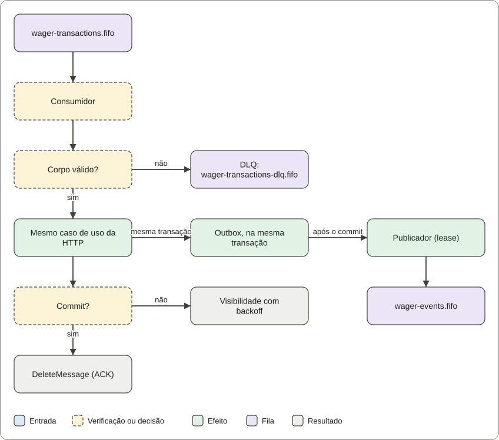

# Distributed Wagering Processor

Serviço financeiro que processa operações de apostas (`BET`, `WIN`, `LOSS`, `REFUND`, `ROLLBACK`) enviadas por
provedores de jogos, por HTTP e por fila SQS. Mantém o saldo de cada carteira igual ao seu ledger, mesmo com
concorrência, mensagens duplicadas, referências fora de ordem, falhas e reinícios.

Este repositório é a solução do [desafio técnico da Jungle Gaming](docs/CHALLENGE.md), cópia fiel do enunciado.
Versão em inglês (referência): [README.en.md](README.en.md). Índice completo da documentação: [docs/README.md](docs/README.md).

- **Stack:** Bun 1.4.4, TypeScript estrito, NestJS 12, MikroORM 7 (pinado em 7.x), PostgreSQL 17,
  AWS SQS via LocalStack 4.14, Docker Compose.
- **Não é:** um sistema de login, um IdP externo nem um painel. A autenticação é por chave de API (ver
  [ADR 0007](docs/adr/0007-api-key-authentication.md)).

## Arquitetura em um olhar

Os diagramas abaixo são os **mesmos arquivos SVG versionados** utilizados na vitrine estática. Eles
representam os fluxos implementados, não uma arquitetura hipotética. A explicação das
garantias e dos pontos de falha está em [ARCHITECTURE.md](ARCHITECTURE.md); os testes
correspondentes estão na [matriz de requisitos](docs/REQUIREMENTS_MATRIX.md).

### 1. BET recebida por HTTP

Autenticação e identidade do provedor, validação da operação, idempotência e decisão
transacional. [Abrir SVG em tamanho original](docs/diagrams/bet-over-http.svg).



### 2. Comando recebido pela SQS

Consumo da fila, processamento financeiro compartilhado com a rota HTTP, tratamento de
reentregas e confirmação da mensagem. [Abrir SVG em tamanho original](docs/diagrams/queued-command.svg).



### 3. Resultados, estados e entidades

Visão das transições e dos registros envolvidos na decisão sobre uma operação financeira.
[Abrir SVG em tamanho original](docs/diagrams/outcome-entities.svg).



Estes diagramas são explicativos: a prova das invariantes está nas constraints do banco,
no código e nos testes de integração, concorrência e falhas. A
[vitrine técnica](https://dedeusgui.github.io/backend-challenge/) reúne os mesmos fluxos
com a metodologia e as limitações dos resultados publicados.

## Restrições invioláveis do enunciado (§5)

Cada restrição da [especificação](docs/CHALLENGE.md) tem um mecanismo no código ou no banco e um teste que a prova.
Os números seguem a §5 do enunciado.

| #   | Restrição                                             | Como o projeto atende                                                                                            | Prova                                                                            |
| --- | ----------------------------------------------------- | ---------------------------------------------------------------------------------------------------------------- | -------------------------------------------------------------------------------- |
| 1   | Nada de `number`, `float` ou `double` para dinheiro   | `Money` sobre decimal.js; valores trafegam como string decimal; `NUMERIC(20,2)` no banco                         | `test/unit/shared/domain/money.test.ts`                                          |
| 2   | Idempotência nunca só em memória                      | chave única no banco por provedor (`UNIQUE`) e inbox persistente                                                 | `test/integration/messaging/duplicate-deliveries.test.ts`                        |
| 3   | Não confiar só no SQS FIFO                            | a fila não é a garantia: duplicatas e reentregas são absorvidas pela inbox e pela chave de idempotência no banco | `test/integration/messaging/duplicate-deliveries.test.ts`                        |
| 4   | Nenhum evento publicado antes do commit               | o outbox é gravado na mesma transação SQL; o publicador lê só depois                                             | `test/integration/messaging/outbox-publisher.test.ts`, `test/integration/faults` |
| 5   | Ledger nunca sobrescrito nem excluído                 | trigger `BEFORE UPDATE OR DELETE OR TRUNCATE` no `wallet_ledger_entries`                                         | `test/integration/schema/schema-constraints.test.ts`                             |
| 6   | Nenhum lock global entre carteiras                    | `SELECT ... FOR UPDATE` por carteira                                                                             | `test/concurrency/hot-wallet.test.ts`                                            |
| 7   | Nada de `read → calculate → update` sem controle      | lock de linha antes da decisão, com versão como guarda                                                           | `test/concurrency/hot-wallet.test.ts`                                            |
| 8   | Correto com múltiplas instâncias                      | três processos independentes sobre o mesmo banco e a mesma fila                                                  | `test/concurrency/three-processes.test.ts`                                       |
| 9   | Unicidade, imutabilidade e não-negatividade no schema | `CHECK`, `UNIQUE`, `FK` e trigger nas migrações                                                                  | `test/integration/schema`                                                        |

As migrações são versionadas e reversíveis: as 12 têm `up` e `down`, e o teste de reversão está em
`test/integration/schema/migrations.test.ts`. O código roda em TypeScript estrito (`"strict": true` no `tsconfig.json`).

## Por onde começar (avaliador)

1. **Rode a stack** (seção seguinte) e faça a demonstração financeira: `bun run demo:finance`.
2. **Leia o guia do avaliador:** [docs/REVIEWER_GUIDE.md](docs/REVIEWER_GUIDE.md), com o caminho de leitura de
   aproximadamente 40 minutos, o que cada teste prova e o que não prova.
3. **Confira as garantias contra o código:** [docs/REQUIREMENTS_MATRIX.md](docs/REQUIREMENTS_MATRIX.md) liga cada
   requisito ao teste que o prova. Uma linha só é `PASSING` depois que o teste roda e passa.
4. **Veja a arquitetura e as decisões:** [ARCHITECTURE.md](ARCHITECTURE.md), começando pela tabela de decisões.
   O [glossário do domínio](docs/DOMAIN_GLOSSARY.md) define os termos.
5. **Contrato HTTP:** [docs/openapi.json](docs/openapi.json). Ele é verificado contra as rotas e contra as respostas
   reais da API.

## Como rodar

Requisitos: Docker com Compose e, para desenvolver ou testar, Bun **1.4.4**.

```bash
docker compose up --build
curl http://localhost:3000/health/ready
# {"status":"ok","checks":{"database":"up","sqs":"up"}}
```

O Compose sobe PostgreSQL e LocalStack, cria as filas `wager-transactions.fifo`, `wager-transactions-dlq.fifo` e
`wager-events.fifo`, aplica as migrações uma vez, e só então sobe a API (porta 3000) e o worker.

Todas as portas publicadas ligam em `127.0.0.1`: o banco, o LocalStack e a API ficam acessíveis apenas desta
máquina. Para expor em outra interface, defina `PUBLISH_HOST`, e faça isso só numa rede que você controla. O worker
não publica porta; sua superfície interna de saúde e métricas (porta 3001) fica só na rede do Compose.

Para criar uma chave de operador e fazer uma consulta:

```bash
docker compose exec api bun run auth:create -- --name operations --role OPERATOR
# key: wgr_...   (mostrada uma vez; só o hash é guardado)
curl -H "authorization: Bearer wgr_..." http://localhost:3000/metrics
```

A demonstração financeira roda no host e cria as próprias chaves. Ela usa o banco de desenvolvimento publicado em
`127.0.0.1` e não precisa de `.env`:

```bash
bun install --frozen-lockfile
bun run demo:finance
```

### Desenvolvimento sem os contêineres da aplicação

```bash
cp .env.example .env
bun install --frozen-lockfile
bun run infra:up        # PostgreSQL e LocalStack, com healthcheck
bun run db:migrate
bun run dev             # API, com reinício ao salvar
bun run src/worker.ts   # worker, em outro terminal
```

## Modo protegido (opcional)

Uma borda Nginx fica na frente da API e limita as requisições por endereço de cliente. Nesse modo, a API e o
PostgreSQL não publicam porta, e a borda é a única entrada, na mesma porta 3000.

```bash
docker compose -f docker-compose.yml -f docker-compose.protected.yml up --build
bun run test:edge        # 12 casos contra a stack em execução
docker compose -f docker-compose.yml -f docker-compose.protected.yml down
```

Os limites são `EDGE_WRITE_RATE` (20 por segundo), `EDGE_WRITE_BURST` (40), `EDGE_READ_RATE` (50 por segundo),
`EDGE_READ_BURST` (100) e `EDGE_MAX_CONNECTIONS` (50). Uma recusa é `429` com `Retry-After` e corpo JSON. Health não
é limitado. O que essa proteção **não** é, e o custo medido, estão em [ARCHITECTURE.md §15](ARCHITECTURE.md).

## Garantias

| Garantia                                          | Como é imposta                                                    | Onde está provada                                                                |
| ------------------------------------------------- | ----------------------------------------------------------------- | -------------------------------------------------------------------------------- |
| Dinheiro nunca é `number`                         | `Money` sobre `decimal.js`, colunas `NUMERIC(20,2)`               | `test/unit/shared/domain/money.test.ts`                                          |
| Saldo nunca negativo, nem por corrida             | trava de linha por carteira, versão como guarda, `CHECK` no banco | `test/concurrency/hot-wallet.test.ts`                                            |
| Saldo = soma do ledger                            | ledger imutável (trigger), reconciliação em leitura               | `test/integration/schema`, `test/e2e/queries-http.test.ts`                       |
| Um efeito, qualquer que seja o número de entregas | chave de idempotência por provedor, inbox, `UNIQUE` no banco      | `test/integration/messaging/duplicate-deliveries.test.ts`                        |
| Evento só depois do commit                        | outbox na mesma transação; publicador com lease                   | `test/integration/faults`, `test/integration/messaging/outbox-publisher.test.ts` |
| Três processos, sem efeito duplicado              | processos reais, um banco, uma fila                               | `test/concurrency/three-processes.test.ts`                                       |
| Recuperação após morte no meio do caminho         | worker morto antes e depois do commit, com reentrega              | `test/concurrency/process-crash-and-shutdown.test.ts`                            |

A lista completa, com a interpretação de cada regra ambígua do enunciado, está em
[ARCHITECTURE.md §13](ARCHITECTURE.md) e [docs/INVARIANT_REVIEW.md](docs/INVARIANT_REVIEW.md).

## Evidências de desempenho

Além de provar a integridade financeira sob concorrência, o projeto mede desempenho com
**carga aberta, limites explícitos e reconciliação de todas as carteiras**. Os resultados
abaixo são de execuções registradas, não de uma estimativa de capacidade em produção.

| CPUs destinadas à stack | Maior taxa que passou todos os limites | Próximo degrau                             |
| ----------------------: | -------------------------------------: | ------------------------------------------ |
|                       1 |                              100 req/s | 125 req/s: falhou por latência             |
|                       2 |                              200 req/s | 300 req/s: falhou por latência             |
|                       4 |                              400 req/s | Não medido: a rampa terminava em 400 req/s |

Cada degrau durou 20 segundos. Para passar, precisava cumprir simultaneamente p95 ≤ 500 ms,
p99 ≤ 1.000 ms, zero requisições perdidas, taxa de erro ≤ 0,1%, drenagem da outbox
e invariantes financeiras. Com quatro CPUs, **400 req/s foi o limite do ensaio,
não o limite de capacidade do sistema**.

Houve também um experimento pareado no mesmo host, com duas CPUs: a 100 req/s,
o p99 caiu de **120/134 ms** (duas execuções da versão inicial) para **31/32 ms**
(duas execuções após alterações na consulta e no caminho do lock). A comparação
não isola o efeito de uma única mudança, mas os arquivos permitem auditar os dois
estados e repetir o experimento.

**Fontes, ambiente e ressalvas:** [relatório com metodologia e critérios](docs/LOAD_TEST_RESULTS.md),
[histórico dos experimentos pareados](docs/LOAD_TEST_HISTORY.md) e
[registros JSON das execuções](docs/load/). São medições com LocalStack, não AWS SQS;
não há soak test prolongado nem SLO de produção validado.

## Testes

| Comando                    | Para que serve                                                                                          |
| -------------------------- | ------------------------------------------------------------------------------------------------------- |
| `bun run check:fast`       | tipos, lint, formato e testes unitários, sem infraestrutura                                             |
| `bun run check:all`        | o gate completo: tudo acima, mais infraestrutura, integração, concorrência e e2e. É o que o CI roda     |
| `bun run test:integration` | PostgreSQL e LocalStack reais: esquema, persistência, mensageria, falhas                                |
| `bun run test:concurrency` | conexões paralelas, três processos da API, worker morto ou parado                                       |
| `bun run test:e2e`         | a aplicação HTTP, com chaves de API                                                                     |
| `bun run test:infra`       | a configuração do Compose, lida pelo próprio `docker compose config`                                    |
| `bun run test:edge`        | modo protegido, contra a stack em execução                                                              |
| `bun run test:load`        | teste de carga opcional, por número de CPUs; ver [docs/LOAD_TEST_RESULTS.md](docs/LOAD_TEST_RESULTS.md) |

Nenhum teste de integração, concorrência ou e2e substitui PostgreSQL ou a fila por mock. Cada teste de concorrência
verifica que exatamente uma operação tem o efeito, e que as outras são replays, conflitos ou rejeições.

### Outros comandos

| Comando                                                                | Para que serve                                                        |
| ---------------------------------------------------------------------- | --------------------------------------------------------------------- |
| `bun run typecheck`                                                    | `tsc --noEmit`: checa os tipos sem gerar arquivos                     |
| `bun run lint`                                                         | oxlint sobre `src` e `test`                                           |
| `bun run format` e `bun run format:check`                              | prettier: formata, ou só verifica (o `check:fast` roda a verificação) |
| `bun run test:unit`                                                    | testes unitários, sem infraestrutura                                  |
| `bun run auth:create -- --name <nome> --role PROVIDER --provider <id>` | cria chave de provedor; com `--role OPERATOR`, cria chave de operador |
| `bun run auth:revoke -- --client <clientId>`                           | revoga uma chave de API                                               |
| `bun run start`                                                        | sobe a API a partir do código, sem recarregar                         |
| `bun run edge:up` e `bun run edge:down`                                | sobe e derruba o modo protegido                                       |
| `bun run edge:check`                                                   | sobe o modo protegido, roda `test:edge` e derruba                     |
| `bun run bench:edge`                                                   | mede o overhead da borda (`test/edge/overhead.ts`)                    |

## Endpoints

Todas as rotas exigem `Authorization: Bearer <chave>`, exceto `/health/live` e `/health/ready`. Valores monetários são
sempre `{ "amount": "25.00", "currency": "BRL" }`.

| Método e caminho                                                          | Para que serve                                                    | Quem                             |
| ------------------------------------------------------------------------- | ----------------------------------------------------------------- | -------------------------------- |
| `POST /wallets`                                                           | abre carteira, com saldo inicial opcional (201; 409 se já existe) | operador                         |
| `GET /wallets/:walletId`                                                  | saldo, versão e moeda                                             | operador                         |
| `GET /wallets/:walletId/ledger?cursor=&limit=`                            | lançamentos em ordem, com `nextCursor` opaco                      | operador                         |
| `POST /wallets/:walletId/reconciliation`                                  | recalcula o saldo pelo ledger e informa divergência               | operador                         |
| `POST /wagering/transactions`                                             | submete uma operação, com `Idempotency-Key` (201, 200, 202, 422)  | provedor (o próprio) ou operador |
| `GET /wagering/transactions/:transactionId`                               | uma transação pelo id interno                                     | provedor (o próprio) ou operador |
| `GET /providers/:providerId/wagering/transactions/:externalTransactionId` | a mesma, pelo id do provedor                                      | provedor (o próprio) ou operador |
| `GET /health/live`, `GET /health/ready`                                   | processo vivo; PostgreSQL e fila respondem                        | público                          |
| `GET /metrics`                                                            | contadores e resumos deste processo                               | operador                         |

Os códigos de falha são estáveis e estão em [ARCHITECTURE.md §3](ARCHITECTURE.md). A tabela de status HTTP está em
[ARCHITECTURE.md §10](ARCHITECTURE.md), e o contrato completo está em [docs/openapi.json](docs/openapi.json).

## Fila

O worker consome `WagerTransactionRequested` de `wager-transactions.fifo`, no formato do enunciado, e chama o mesmo
caso de uso da HTTP. A mensagem só é confirmada depois do commit. Falhas permanentes vão para
`wager-transactions-dlq.fifo`. O worker publica `WagerTransactionProcessed`, `WagerTransactionRejected`, `WagerTransactionFailed`,
`WalletBalanceChanged` e `WagerTransactionPendingReference` em `wager-events.fifo`.

Um consumidor externo ordena as alterações de saldo de uma carteira por `walletVersion`, não pela ordem de chegada.
O contrato dessa garantia está em [ARCHITECTURE.md §8](ARCHITECTURE.md).

## Limitações principais

A lista completa está em [ARCHITECTURE.md §14](ARCHITECTURE.md). As mais importantes:

- **Chaves de API, não um provedor de identidade.** As chaves valem até serem revogadas, sem rotação nem login. A API
  fala HTTP simples; um deploy precisa colocar TLS na frente. Ver [ADR 0007](docs/adr/0007-api-key-authentication.md).
- **Limite de taxa só no modo protegido, e por endereço.** Não protege contra ataque distribuído.
- **Infraestrutura local.** LocalStack substitui o SQS. Nenhum deploy na AWS foi feito.
- **A imagem não foi construída dentro do repositório nesta sandbox.** O proxy TLS da sandbox impede o `bun install`
  no build. A imagem foi construída a partir de uma cópia do Dockerfile que só acrescenta a CA da sandbox, e a stack
  foi executada a partir dela. Ver [ARCHITECTURE.md §14](ARCHITECTURE.md).
- **Interpretações do enunciado que dependem de confirmação do dono** estão em
  [ARCHITECTURE.md §13](ARCHITECTURE.md). A mais consequente: um `WIN` sem referência não bloqueia o `REFUND` da
  sua `BET`.

## Estrutura do repositório

```text
src/
  main.ts                 entrada HTTP da API
  worker.ts               entrada do worker: consumidor SQS, publicador do outbox, referências pendentes
  migrate.ts              migração única do esquema
  app.module.ts           composição, compartilhada por produção e testes
  config/                 leitura de variáveis, com falha rápida
  health/ metrics/        probes e endpoint de métricas
  worker/                 laços do worker e a superfície HTTP interna
  modules/
    wallet/               Wallet, ledger, abertura, consultas, reconciliação
    wagering/             WagerTransaction, liquidação, referências, HTTP
    messaging/            inbox, outbox, adaptadores SQS, consumidor, publicador
    auth/                 chaves de API, papéis e escopo de provedor
  shared/                 Money, erros, porta de unidade de trabalho, eventos, validação, observabilidade
test/
  unit/                   domínio, lógica pura, contrato OpenAPI, configuração
  integration/            esquema, persistência, casos de uso, mensageria, falhas
  concurrency/            conexões paralelas e processos reais
  e2e/                    HTTP, autorização adversarial, contrato OpenAPI contra respostas reais
  edge/                   modo protegido
  infra/                  configuração do Compose
  load/                   teste de carga opcional
  demo/                   demonstração financeira
docs/                     guias, matriz, ADRs, contrato OpenAPI, relatórios de carga
```

## Documentos

- [docs/REVIEWER_GUIDE.md](docs/REVIEWER_GUIDE.md): guia de avaliação, em português.
- [ARCHITECTURE.md](ARCHITECTURE.md): arquitetura técnica atual, decisões, limitações.
- [DECISIONS.md](DECISIONS.md): cada decisão com seus casos e evidências.
- [docs/REQUIREMENTS_MATRIX.md](docs/REQUIREMENTS_MATRIX.md): requisito a teste.
- [docs/AUDITORIA_FINAL.md](docs/AUDITORIA_FINAL.md): auditoria desta rodada, com o que foi validado e o que ficou de fora.
- [docs/TEST_STRATEGY.md](docs/TEST_STRATEGY.md): o que cada suíte prova e o que não substitui.
- [docs/openapi.json](docs/openapi.json): contrato HTTP.
- [docs/LOAD_TEST_RESULTS.md](docs/LOAD_TEST_RESULTS.md) e [docs/LOAD_TEST_HISTORY.md](docs/LOAD_TEST_HISTORY.md): carga.
- [docs/DOMAIN_GLOSSARY.md](docs/DOMAIN_GLOSSARY.md): glossário do domínio.
- [docs/adr/README.md](docs/adr/README.md): índice das decisões registradas.
- [docs/CHALLENGE.md](docs/CHALLENGE.md): o enunciado, sem alterações.
- Vitrine estática: `bun run site:build` gera `site/`, uma página que não depende de serviço. A publicação no GitHub Pages está preparada em `.github/workflows/pages.yml`, e depende de uma configuração do repositório; ver [docs/AUDITORIA_FINAL.md](docs/AUDITORIA_FINAL.md).
