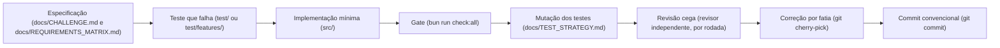

# Distributed Wagering Processor

Serviço que processa apostas (`BET`, `WIN`, `LOSS`, `REFUND` e `ROLLBACK`) enviadas por provedores de jogos, por HTTP e
por SQS. Mantém o saldo de cada carteira igual à soma do seu ledger, mesmo com concorrência, mensagens duplicadas,
referências fora de ordem, falhas e reinícios.

Solução do [desafio técnico](docs/CHALLENGE.md). Versão em inglês: [README.en.md](README.en.md). Índice completo da
documentação: [docs/README.md](docs/README.md).

- **Stack:** Bun 1.4.4, TypeScript estrito, NestJS 12, MikroORM 7 (pinado em 7.x), PostgreSQL 17, AWS SQS via
  LocalStack 4.14 e Docker Compose.
- **Autenticação:** chaves de API com papéis e escopo de provedor, sem login nem provedor de identidade externo
  ([ADR 0007](docs/adr/0007-api-key-authentication.md)).
- **Desempenho:** duas medições, em dois ambientes. Baseline local, com 13 cenários de 1 a 8 CPUs, e baseline de nuvem,
  com 1, 2 e 4 CPUs. Nos dois, o passo acordado foi verificado quanto à correção financeira. Ver
  [Desempenho medido](#desempenho-medido).

## Primeiros passos

1. Suba a stack e confira a prontidão:

   ```bash
   docker compose up --build
   curl http://localhost:3000/health/ready
   ```

2. Rode a demonstração financeira, que chama a API e confere cada saldo: `bun run demo:finance`.
3. Rode o gate completo, que inclui PostgreSQL e LocalStack reais: `bun run infra:up` e depois `bun run check:all`.
4. Siga o [roteiro do avaliador](docs/REVIEWER_GUIDE.md), de cerca de 40 minutos, com o que cada teste prova e o que não prova.

## Onde está cada coisa

| Pergunta                                        | Resposta                                                                | Onde                                                                                                     |
| ----------------------------------------------- | ----------------------------------------------------------------------- | -------------------------------------------------------------------------------------------------------- |
| O que o desafio pede?                           | o enunciado, sem alterações                                             | [docs/CHALLENGE.md](docs/CHALLENGE.md)                                                                   |
| Como o trabalho foi conduzido?                  | ciclo de desenvolvimento, episódios, fatias e revisões                  | [Como o trabalho foi conduzido](#como-o-trabalho-foi-conduzido)                                          |
| Por onde começar a avaliação?                   | roteiro com tempo estimado e o que cada passo prova                     | [docs/REVIEWER_GUIDE.md](docs/REVIEWER_GUIDE.md)                                                         |
| Cada requisito tem uma prova?                   | matriz de requisito para teste, com o status de cada linha              | [docs/REQUIREMENTS_MATRIX.md](docs/REQUIREMENTS_MATRIX.md)                                               |
| Como o sistema é organizado?                    | camadas, fluxos, invariantes, trade-offs e limitações                   | [ARCHITECTURE.md](ARCHITECTURE.md)                                                                       |
| Por que cada escolha?                           | decisões, alternativas e evidência                                      | [DECISIONS.md](DECISIONS.md) e [docs/adr/](docs/adr/README.md)                                           |
| Como o dinheiro é representado?                 | `Money`, sobre decimal, sem `number`                                    | [src/shared/domain/money.ts](src/shared/domain/money.ts)                                                 |
| Como saldo e ledger são protegidos?             | trava por carteira, versão, triggers de imutabilidade e de concordância | [src/modules/wallet/](src/modules/wallet/) e [migrações](src/shared/infrastructure/database/migrations/) |
| Onde mora a regra de liquidação?                | entidade e serviço de liquidação, chamados pela HTTP e pela fila        | [transaction-settlement.ts](src/modules/wagering/application/transaction-settlement.ts)                  |
| Como a mensageria funciona?                     | inbox, outbox, consumidor, publicador, DLQ e quarentena                 | [src/modules/messaging/](src/modules/messaging/)                                                         |
| Quais testes provam o quê?                      | suítes por tipo, e o que cada uma não substitui                         | [docs/TEST_STRATEGY.md](docs/TEST_STRATEGY.md) e [test/](test/)                                          |
| Os cenários de negócio, em linguagem legível?   | Gherkin executável, com o harness do Cucumber sobre Bun                 | [test/features/](test/features/)                                                                         |
| Como é a API?                                   | contrato OpenAPI, verificado contra as respostas reais                  | [docs/openapi.json](docs/openapi.json)                                                                   |
| Quanto o sistema aguenta?                       | duas medições: baseline local (13 cenários) e de nuvem (1, 2 e 4 CPUs)  | [Desempenho medido](#desempenho-medido)                                                                  |
| O que foi auditado de forma adversarial?        | achados, experimentos e a prova de cada garantia                        | [docs/audit/README.md](docs/audit/README.md)                                                             |
| Como a automação de segurança está configurada? | workflows e limites dos resultados observados                           | [docs/SECURITY_AUTOMATION.md](docs/SECURITY_AUTOMATION.md)                                               |
| O que ainda está em aberto?                     | decisões do dono e limitações                                           | [Limitações e decisões em aberto](#limitações-e-decisões-em-aberto)                                      |
| Como o projeto se compara a outras soluções?    | o que foi adotado, o que já existia e o que não foi adotado             | [Comparação com outras implementações](#comparação-com-outras-implementações)                            |
| Como a solução está publicada?                  | vitrine estática, gerada a partir do repositório                        | [vitrine técnica](https://dedeusgui.github.io/backend-challenge/)                                        |

## Como o projeto responde à avaliação (§14)

A tabela segue as áreas e os pontos do enunciado. Cada linha aponta para a prova e para o comando que a reproduz.

| Área (pontos)                 | Resposta                                                                                                                                                     | Prova                                                                                                                                                                                                                                                                         |
| ----------------------------- | ------------------------------------------------------------------------------------------------------------------------------------------------------------ | ----------------------------------------------------------------------------------------------------------------------------------------------------------------------------------------------------------------------------------------------------------------------------- |
| Correção financeira (20)      | `Money` em decimal; saldo igual ao ledger imposto por triggers no `COMMIT`; ledger imutável; reconciliação                                                   | `test/unit/shared/domain/money.test.ts`, `test/integration/schema/ledger-balance-trigger.test.ts`, `test/integration/schema/` (constraints e triggers)                                                                                                                        |
| Concorrência (20)             | trava de linha por carteira, versão como guarda, espera limitada, processos reais                                                                            | `test/concurrency/hot-wallet.test.ts`, `test/concurrency/three-processes.test.ts`, `test/integration/wagering/lock-timeout.test.ts`                                                                                                                                           |
| Idempotência (15)             | chave única por provedor no banco, inbox persistente, replay pelo estado gravado, conflito de payload                                                        | `test/integration/messaging/duplicate-deliveries.test.ts`, `test/integration/messaging/inbox-message-identity.test.ts`                                                                                                                                                        |
| Mensageria e falhas (15)      | outbox na mesma transação, ack só após o commit, DLQ antes do ack, quarentena, retenção, devolução no encerramento, prazos                                   | `test/integration/messaging/consumer-shutdown.test.ts`, `test/integration/messaging/outbox-quarantine.test.ts`, `test/integration/messaging/outbox-retention.test.ts`, `test/integration/faults/sqs-deadlines.test.ts`, `test/concurrency/process-crash-and-shutdown.test.ts` |
| Modelagem e arquitetura (10)  | domínio sem NestJS, MikroORM nem AWS; invariantes nas entidades; referência amarrada ao id externo da aposta                                                 | [ARCHITECTURE.md](ARCHITECTURE.md), `test/integration/schema/reference-binding.test.ts`, `test/unit/architecture/boundaries.test.ts`                                                                                                                                          |
| Testes (10)                   | PostgreSQL e LocalStack reais, sem mock de banco nem de fila; falhas injetadas; Gherkin executável                                                           | [docs/TEST_STRATEGY.md](docs/TEST_STRATEGY.md), `bun run check:all`, `bun run test:features`                                                                                                                                                                                  |
| Observabilidade (5)           | logs JSON com `correlationId` e sem valores financeiros; `/metrics` e `/metrics/prometheus` por processo; probes `/health/live` e `/health/ready`, separados | `test/unit/observability/metric-cardinality.test.ts`, `test/unit/observability/prometheus-text.test.ts`, `test/e2e/metrics-http.test.ts`, `test/e2e/health.test.ts`                                                                                                           |
| Documentação (5)              | este README, ARCHITECTURE, DECISIONS, guia do avaliador e matriz de requisitos                                                                               | [docs/REVIEWER_GUIDE.md](docs/REVIEWER_GUIDE.md), [docs/REQUIREMENTS_MATRIX.md](docs/REQUIREMENTS_MATRIX.md)                                                                                                                                                                  |
| Autenticação (não pontua, §2) | chaves de API com papéis e escopo de provedor                                                                                                                | [ADR 0007](docs/adr/0007-api-key-authentication.md), `test/e2e/authorization-adversarial.test.ts`                                                                                                                                                                             |
| Diferencial: teste de carga   | duas medições, em dois ambientes, com correção e latência                                                                                                    | [Desempenho medido](#desempenho-medido)                                                                                                                                                                                                                                       |

## Restrições invioláveis do enunciado (§5)

| #   | Restrição                                             | Como o projeto atende                                                                                            | Prova                                                                            |
| --- | ----------------------------------------------------- | ---------------------------------------------------------------------------------------------------------------- | -------------------------------------------------------------------------------- |
| 1   | Nada de `number`, `float` ou `double` para dinheiro   | `Money` sobre decimal.js; valores trafegam como string decimal; `NUMERIC(20,2)` no banco                         | `test/unit/shared/domain/money.test.ts`                                          |
| 2   | Idempotência nunca só em memória                      | chave única no banco por provedor (`UNIQUE`) e inbox persistente                                                 | `test/integration/messaging/duplicate-deliveries.test.ts`                        |
| 3   | Não confiar só no SQS FIFO                            | a fila não é a garantia: duplicatas e reentregas são absorvidas pela inbox e pela chave de idempotência no banco | `test/integration/messaging/duplicate-deliveries.test.ts`                        |
| 4   | Nenhum evento publicado antes do commit               | o outbox é gravado na mesma transação SQL; o publicador lê só depois                                             | `test/integration/messaging/outbox-publisher.test.ts`, `test/integration/faults` |
| 5   | Ledger nunca sobrescrito nem excluído                 | trigger `BEFORE UPDATE OR DELETE OR TRUNCATE` em `wallet_ledger_entries`                                         | `test/integration/schema/`                                                       |
| 6   | Nenhum lock global entre carteiras                    | `SELECT ... FOR UPDATE` por carteira                                                                             | `test/concurrency/hot-wallet.test.ts`                                            |
| 7   | Nada de `read → calculate → update` sem controle      | lock de linha antes da decisão, com versão como guarda                                                           | `test/concurrency/hot-wallet.test.ts`                                            |
| 8   | Correto com múltiplas instâncias                      | três processos independentes sobre o mesmo banco e a mesma fila                                                  | `test/concurrency/three-processes.test.ts`                                       |
| 9   | Unicidade, imutabilidade e não-negatividade no schema | `CHECK`, `UNIQUE`, `FK` e triggers nas migrações                                                                 | `test/integration/schema`                                                        |

Todas as 17 migrações têm `up` e `down`. O teste de reversão está em `test/integration/schema/migrations.test.ts`.

## Como o trabalho foi conduzido

### O ciclo de desenvolvimento



### Três episódios reais

A história do projeto é demonstrada pelas decisões técnicas tomadas diante de evidências concretas:

#### 1. Saldo com triggers adiados

- **O que estava em jogo:** Garantir no banco que o saldo da carteira coincida com a soma do ledger (desafio §6.2), impedindo que escritas manuais ou desvios fora da aplicação corrompam a contabilidade.
- **Pergunta que surgiu:** Triggers de restrição executados no `COMMIT` adicionariam latência excessiva no caminho concorrente de escrita?
- **Evidência:** O experimento 1 em [docs/audit/PERFORMANCE_COMPARISON.md](docs/audit/PERFORMANCE_COMPARISON.md) mediu o custo em seis rodadas. A mediana de latência subiu 0.10 ms no cenário sequencial (+1.6%) e 1.84 ms sob contenção com 8 trabalhadores simultâneos (+4.7%). O tempo por leitura manteve-se em 0.50 ms com 1,000,000 de lançamentos.
- **Decisão:** Adotar os triggers adiados `wallets_ledger_balance_check` e `wallet_ledger_entries_balance_check` na migração 12, conforme documentado em [ARCHITECTURE.md](ARCHITECTURE.md).
- **Prova:** Commit `c5ddca9`, [Migration20261101000012.ts](src/shared/infrastructure/database/migrations/Migration20261101000012.ts) e teste [ledger-balance-trigger.test.ts](test/integration/schema/ledger-balance-trigger.test.ts).

#### 2. Um teste que pode falhar (mutação)

- **O que estava em jogo:** Comprovar a sensibilidade dos testes diante de regressões reais, sem depender apenas de testes que passam.
- **Pergunta que surgiu:** A suíte de concorrência detecta a remoção de travas pessimistas e falhas de expiração de lease?
- **Evidência:** Na seção de evidência de mutação em [docs/TEST_STRATEGY.md](docs/TEST_STRATEGY.md), mutantes foram injetados intencionalmente contra [distributed-contention.test.ts](test/concurrency/distributed-contention.test.ts):
  - **Mutante eliminado:** A remoção do bloqueio de linha da carteira (`FOR UPDATE`) foi eliminada pelo teste sem retentativas, que acusou três disputas perdidas. A remoção do predicado de lease da outbox provocou 61 reivindicações duplicadas.
  - **Mutante que sobreviveu:** A remoção de `SKIP LOCKED` na outbox sobreviveu. O segundo publicador aguarda o primeiro e reavalia a condição de lease, sem corromper dados contábeis. Como nenhum teste mede tempo de bloqueio, o mutante é equivalente em termos de segurança e foi mantido como lacuna documentada.
- **Decisão:** Manter casos de teste específicos sem retentativa para eliminar mutantes de concorrência e documentar mutantes equivalentes em [docs/TEST_STRATEGY.md](docs/TEST_STRATEGY.md).
- **Prova:** [docs/TEST_STRATEGY.md](docs/TEST_STRATEGY.md) e [distributed-contention.test.ts](test/concurrency/distributed-contention.test.ts).

#### 3. Um achado de revisão que virou código

- **O que estava em jogo:** Cumprir o requisito de métricas operacionais da especificação (§12).
- **Pergunta que surgiu:** A segunda rodada da revisão simulada apontou a ausência do contador Prometheus de retentativas.
- **Evidência:** O exame dos coletores confirmou a falta da métrica `retries_total` para monitorar retentativas de consumo de fila, publicação de outbox e resolução de referências retidas.
- **Decisão:** Introduzir a métrica unificada `retries_total` com rótulo `subsystem` instrumentada nos três fluxos de reprocessamento (`wager-command-consumer.ts`, `outbox-publisher.ts` e `process-pending-references.use-case.ts`) e coberta por teste unitário.
- **Prova:** Commit `4ee8f72` e teste [retries-total.test.ts](test/unit/observability/retries-total.test.ts).

### Fatias, em ordem

O catálogo [docs/HISTORICO.md](docs/HISTORICO.md), gerado do `git log` desde o commit `f12191b`, lista cada commit com seu tipo convencional e a contagem por tipo. Dez fatias representativas do desenvolvimento:

| Data       | Commit    | O que mudou                                                           | Prova                                                    |
| :--------- | :-------- | :-------------------------------------------------------------------- | :------------------------------------------------------- |
| 2026-10-31 | `211392e` | Objeto de valor `Money` com aritmética decimal exata sem `number`     | `test/unit/shared/domain/money.test.ts`                  |
| 2026-10-31 | `2358842` | Agregado `Wallet` e lançamentos imutáveis no ledger                   | `test/unit/wallet/domain/wallet.test.ts`                 |
| 2026-10-31 | `5843be4` | Garantia de saldo e idempotência sob concorrência real                | `test/concurrency/hot-wallet.test.ts`                    |
| 2026-10-31 | `fd5710d` | Consumidor de comandos SQS e publicador transacional de outbox        | `test/integration/messaging/outbox-publisher.test.ts`    |
| 2026-10-31 | `0a1e1f0` | Injeção de falhas e recuperação em pontos críticos da transação       | `test/integration/faults/fault-injection.test.ts`        |
| 2026-10-31 | `6ff6891` | Autenticação por chaves de API com escopo de provedor e papéis        | `test/e2e/authorization-adversarial.test.ts`             |
| 2026-11-01 | `ef390fe` | Separação de portas em `application/ports` e direção inbound/outbound | `test/unit/architecture/boundaries.test.ts`              |
| 2026-11-01 | `3620d74` | Especificações Gherkin executáveis sob Bun com Cucumber               | `test/features/`                                         |
| 2026-11-01 | `4c58edb` | Limite de tempo de espera por trava de carteira (`lock_timeout`)      | `test/integration/wagering/lock-timeout.test.ts`         |
| 2026-11-01 | `c5ddca9` | Triggers adiados impedindo commit com saldo divergente do ledger      | `test/integration/schema/ledger-balance-trigger.test.ts` |
| 2026-11-01 | `4ee8f72` | Contador Prometheus `retries_total` exigido pelo enunciado            | `test/unit/observability/retries-total.test.ts`          |

### As revisões

As revisões sistemáticas do projeto identificaram falhas e direcionaram correções antes do encerramento:

| Rodada                                                                        | Nota estimada               | Achados de maior severidade                                                                                                                                                                                                                            | Status e commit                                                                                                                                                      |
| :---------------------------------------------------------------------------- | :-------------------------- | :----------------------------------------------------------------------------------------------------------------------------------------------------------------------------------------------------------------------------------------------------- | :------------------------------------------------------------------------------------------------------------------------------------------------------------------- |
| Revisão de Invariantes ([docs/INVARIANT_REVIEW.md](docs/INVARIANT_REVIEW.md)) | 80/100 (estimativa interna) | Risco de crédito duplicado em dois WINs ou REFUND após resultado; ausência de restrições relacionais de moeda e rodada no banco; API sem controle de acesso por provedor                                                                               | Resolvido: índice único em `ce1cb62`; restrições de schema em `f9eb95b`; autenticação em `6ff6891`                                                                   |
| Auditoria Adversarial ([docs/audit/FINDINGS.md](docs/audit/FINDINGS.md))      | 85/100 (estimativa interna) | Envelope malformado bloqueava outbox; `idempotencyKey` ausente na identificação de mensagem na inbox; lote lento tornava mensagens visíveis; hooks de teste no código de produção; retenção com erro travava o worker; relógio local usado para prazos | Resolvido: migração 9 em `2905535`; chave em `2ec4d5e`; heartbeat em `b398e22`; composição em `489df8b`; estado terminal em `c8ffbcc`; relógio do banco em `fc3862c` |
| Revisão Simulada (auditoria de qualidade do código e dos testes)              | 90/100 (meta estimada)      | Escrita direta no banco aceitava saldo divergente do ledger; acoplamento em portas de infraestrutura; métrica `retries_total` ausente (§12); falta de suíte Gherkin executável                                                                         | Resolvido: migração 12 em `c5ddca9`; portas em `ef390fe`; métrica em `4ee8f72`; suíte BDD em `3620d74`                                                               |

### Como o trabalho com agentes foi controlado

O trabalho com agentes seguiu delegação estrita e supervisão contínua do autor humano. A inteligência artificial não garante correção por si só. Toda decisão de arquitetura, interpretação das regras do enunciado e aprovação final de código foram prerrogativas exclusivas do autor humano.

- **Instruções com escopo fechado:** o autor escreveu documentos de especificação com objetivo delimitado, lista explícita de arquivos autorizados e critérios objetivos de aceitação.
- **Ambientes de trabalho isolados:** cada agente atuou em um worktree próprio do Git e branch dedicado, sem permissão para executar push ou modificar branches compartilhados.
- **Inspeção de código e gate de qualidade:** o coordenador humano inspecionou o diff de cada alteração e executou a validação completa (`bun run check:all`) contra instâncias reais de PostgreSQL e LocalStack antes de aceitar o trabalho.
- **Integração seletiva:** as alterações aprovadas foram integradas ao histórico por cherry-pick manual. Os agentes implementaram fatias e testes; o autor humano validou o comportamento, refinou as decisões e determinou o que entrava no repositório.

### O que a prova não cobre

Limitações conhecidas e honestas quanto à abrangência das provas automatizadas:

- **Ordem temporal de escrita dos testes:** o histórico do Git não prova que cada teste falhou antes da escrita do código. A ordem é exigida pelo [CLAUDE.md](CLAUDE.md), e a comprovação técnica dessa sensibilidade reside nos testes de mutação ([docs/TEST_STRATEGY.md](docs/TEST_STRATEGY.md)).
- **Cenários Gherkin com tag `@bloqueado`:** dois cenários em [test/features/mensageria.feature](test/features/mensageria.feature) (linhas 71 e 91) ficam fora da execução do harness de BDD. O cenário da linha 71 (redrive para a DLQ após dez falhas) é coberto pelo teste de integração [test/integration/messaging/broker-redrive.test.ts](test/integration/messaging/broker-redrive.test.ts). O cenário da linha 91 (encerramento com SIGTERM durante processamento de lote) é coberto pelo teste com processos reais [test/concurrency/process-crash-and-shutdown.test.ts](test/concurrency/process-crash-and-shutdown.test.ts).
- **Interrupção de processo da API HTTP:** `test/concurrency/process-crash-and-shutdown.test.ts` mata com `SIGKILL` a API enquanto a gravação do ledger mantém a transação aberta; verifica rollback completo e que a repetição aplica a operação uma vez. Uma queda depois do commit e antes da resposta HTTP ainda não é injetada em nível de processo de sistema operacional ([docs/TEST_STRATEGY.md](docs/TEST_STRATEGY.md)).
- **Mutante equivalente de espera na outbox:** a suíte não detecta a ausência da cláusula `SKIP LOCKED` na busca da outbox (mutante M3 em [docs/TEST_STRATEGY.md](docs/TEST_STRATEGY.md)), pois ela apenas introduz espera ordenada sem quebrar a integridade dos dados, e nenhum teste afere tempos de bloqueio.
- **Teste de carga após migração 12:** a bateria completa de teste de carga com 13 cenários não foi reexecutada após a adição dos triggers de concordância da migração 12 ([ARCHITECTURE.md](ARCHITECTURE.md)).

## Arquitetura em um olhar

Os diagramas abaixo são os mesmos arquivos SVG usados na vitrine estática. Eles mostram os fluxos implementados. A
explicação das garantias e dos pontos de falha está em [ARCHITECTURE.md](ARCHITECTURE.md).

### 1. BET recebida por HTTP

Autenticação e identidade do provedor, validação da operação, idempotência e decisão transacional.
[Abrir SVG em tamanho original](docs/diagrams/bet-over-http.svg).


### 2. Comando recebido pela SQS

Consumo da fila, processamento financeiro compartilhado com a rota HTTP, tratamento de reentregas e confirmação da
mensagem. [Abrir SVG em tamanho original](docs/diagrams/queued-command.svg).


### 3. Resultados, estados e entidades

Transições e registros envolvidos na decisão sobre uma operação financeira.
[Abrir SVG em tamanho original](docs/diagrams/outcome-entities.svg).


Os diagramas são explicativos. A prova das invariantes está nas constraints e triggers do banco, no código e nos testes
de integração, concorrência e falhas.

## Garantias

| Garantia                                             | Como é imposta                                                                            | Onde está provada                                                                                 |
| ---------------------------------------------------- | ----------------------------------------------------------------------------------------- | ------------------------------------------------------------------------------------------------- |
| Dinheiro nunca é `number`                            | `Money` sobre `decimal.js`, colunas `NUMERIC(20,2)`                                       | `test/unit/shared/domain/money.test.ts`                                                           |
| Saldo nunca negativo, nem por corrida                | trava de linha por carteira, versão como guarda, `CHECK` no banco                         | `test/concurrency/hot-wallet.test.ts`                                                             |
| Saldo igual à soma do ledger                         | trigger de restrição postergado até o `COMMIT`; ledger imutável; reconciliação em leitura | `test/integration/schema/ledger-balance-trigger.test.ts`, `test/e2e/queries-http.test.ts`         |
| Lançamento de referência só para a aposta certa      | chave estrangeira composta com o id externo da aposta                                     | `test/integration/schema/reference-binding.test.ts`                                               |
| Um efeito, qualquer que seja o número de entregas    | chave de idempotência por provedor, inbox, `UNIQUE` no banco                              | `test/integration/messaging/duplicate-deliveries.test.ts`                                         |
| Evento só depois do commit                           | outbox na mesma transação; publicador com lease                                           | `test/integration/faults`, `test/integration/messaging/outbox-publisher.test.ts`                  |
| Três processos, sem efeito duplicado                 | processos reais, um banco, uma fila                                                       | `test/concurrency/three-processes.test.ts`                                                        |
| Recuperação após morte no meio do caminho            | worker morto antes e depois do commit, com reentrega                                      | `test/concurrency/process-crash-and-shutdown.test.ts`                                             |
| Mensagem não processada volta à fila no encerramento | visibilidade devolvida antes do próximo processamento                                     | `test/integration/messaging/consumer-shutdown.test.ts`                                            |
| Evento que nunca publica não bloqueia a fila         | quarentena após N tentativas, com requeue do operador                                     | `test/integration/messaging/outbox-quarantine.test.ts`, `scripts/outbox-requeue.ts`               |
| Esperas têm prazo                                    | `lock_timeout` e `statement_timeout` por transação; prazo no SQS e na readiness           | `test/integration/wagering/lock-timeout.test.ts`, `test/integration/faults/sqs-deadlines.test.ts` |

A lista completa, com a interpretação de cada regra ambígua do enunciado, está em
[ARCHITECTURE.md](ARCHITECTURE.md) e em [docs/INVARIANT_REVIEW.md](docs/INVARIANT_REVIEW.md).

## Como rodar

Requisitos: Docker com Compose e, para desenvolver ou testar, Bun **1.4.4**.

```bash
docker compose up --build
curl http://localhost:3000/health/ready
# {"status":"ok","checks":{"database":"up","sqs":"up"}}
```

O Compose sobe PostgreSQL e LocalStack, cria as filas `wager-transactions.fifo`, `wager-transactions-dlq.fifo` e
`wager-events.fifo`, aplica as migrações uma vez, e só então sobe a API (porta 3000) e o worker.

Todas as portas publicadas ligam em `127.0.0.1`: o banco, o LocalStack e a API ficam acessíveis apenas desta máquina.
Para expor em outra interface, defina `PUBLISH_HOST`, e faça isso só numa rede que você controla. O worker não publica
porta; sua superfície interna de saúde e métricas (porta 3001) fica só na rede do Compose.

Para criar uma chave de operador e consultar as métricas:

```bash
docker compose exec api bun run auth:create -- --name operations --role OPERATOR
# key: wgr_...   (mostrada uma vez; só o hash é guardado)
curl -H "authorization: Bearer wgr_..." http://localhost:3000/metrics
```

A demonstração financeira roda no host e cria as próprias chaves. **Ela exige a stack em execução**, porque chama a API,
e é a stack que aplica as migrações ao banco. Sem a stack, a demonstração falha ao criar a primeira chave:

```bash
docker compose up --build        # em um terminal
bun install --frozen-lockfile
bun run demo:finance
```

### Desenvolvimento sem os contêineres da aplicação

```bash
cp .env.example .env
bun install --frozen-lockfile
bun run infra:up        # PostgreSQL e LocalStack, com healthcheck
bun run db:migrate
bun run dev             # API, com reinício ao salvar
bun run src/worker.ts   # worker, em outro terminal
```

### Três demonstrações

Três cenários mostram as garantias. Cada um imprime o próprio resultado e precisa apenas dos comandos abaixo.

1. **Processamento financeiro.** Suba a stack (`docker compose up --build`) e rode `bun run demo:finance`. Ele abre uma
   carteira com 100,00, executa um BET, um WIN, um BET e seu REFUND, e um ROLLBACK do WIN. Confere cada saldo, a recusa
   de um segundo ROLLBACK, o replay de um BET, a soma do ledger e a reconciliação.
2. **Concorrência.** `bun test test/concurrency/three-processes.test.ts -t "fifty identical requests"`. Cinquenta
   requisições idênticas rodam em paralelo sobre três processos da API e um banco. Um débito é aplicado, e as outras são
   replays da mesma transação.
3. **Recuperação.** `bun test test/concurrency/three-processes.test.ts -t "crashes after commit and before ACK"`. Um
   processo worker termina com código 137 depois que o comando foi confirmado e antes do ACK da mensagem. Um worker
   reiniciado recebe a mensagem de volta. A fila é esvaziada, o saldo é 75,00, o ledger soma 75,00, e existe exatamente
   um débito para o comando.

## Modo protegido (opcional)

O modo padrão não tem limite de taxa. O modo protegido põe uma borda Nginx na frente da API, que limita as requisições
por endereço de cliente e recusa o excedente com 429. Nesse modo, a API não publica porta própria, e a borda é a única
entrada, na mesma porta 3000.

```bash
docker compose -f docker-compose.yml -f docker-compose.protected.yml up --build
bun run test:edge        # 12 casos contra a stack em execução
docker compose -f docker-compose.yml -f docker-compose.protected.yml down
```

Os limites são `EDGE_WRITE_RATE` (20 por segundo), `EDGE_WRITE_BURST` (40), `EDGE_READ_RATE` (50 por segundo),
`EDGE_READ_BURST` (100) e `EDGE_MAX_CONNECTIONS` (50). Uma recusa é `429` com `Retry-After` e corpo JSON. Health não é
limitado. `bun run edge:check` sobe a stack, roda a suíte e derruba. `bun run bench:edge <rótulo>` mede o custo da borda
contra a API. O que essa proteção **não** é, e o custo medido, estão em [ARCHITECTURE.md](ARCHITECTURE.md), seção 15.

## Comparação com outras implementações

Esta solução foi comparada com outras implementações públicas do mesmo desafio. A comparação foi feita por leitura do
código, sem executar nem copiar código de terceiros: as ideias foram reimplementadas, cada uma com teste. Os nomes dos
outros projetos não aparecem no repositório.

| Prática                                                         | Situação                  | Onde está                                                                                                                                                                |
| --------------------------------------------------------------- | ------------------------- | ------------------------------------------------------------------------------------------------------------------------------------------------------------------------ |
| Trava de carteira com espera limitada e `statement_timeout`     | adotada                   | `src/shared/infrastructure/database/mikro-orm-financial-unit-of-work.ts`, `test/integration/wagering/lock-timeout.test.ts`                                               |
| Quarentena da outbox após N tentativas, com requeue do operador | adotada                   | `test/integration/messaging/outbox-quarantine.test.ts`, `scripts/outbox-requeue.ts`                                                                                      |
| Trigger de concordância saldo × ledger, diferido até o commit   | adotada, com custo medido | migração 12, `test/integration/schema/ledger-balance-trigger.test.ts`, [PERFORMANCE_COMPARISON](docs/audit/PERFORMANCE_COMPARISON.md)                                    |
| Referência de estorno amarrada ao id externo da aposta          | adotada                   | migração 14, `test/integration/schema/reference-binding.test.ts`                                                                                                         |
| Devolução da visibilidade no encerramento do consumidor         | adotada                   | `test/integration/messaging/consumer-shutdown.test.ts`                                                                                                                   |
| Prazos explícitos para chamadas SQS e para a readiness          | adotada                   | `test/integration/faults/sqs-deadlines.test.ts`                                                                                                                          |
| Retenção de eventos publicados                                  | adotada                   | `test/integration/messaging/outbox-retention.test.ts`                                                                                                                    |
| DLQ enviada antes do ack da mensagem original                   | já existia                | `test/integration/messaging/wager-command-consumer.test.ts`                                                                                                              |
| Métricas em formato Prometheus, sem dependência nova            | adotada                   | `GET /metrics/prometheus`, `test/unit/observability/prometheus-text.test.ts`                                                                                             |
| Cadeia de hash no ledger                                        | não adotada               | Já há imutabilidade por trigger e reconciliação. A cadeia só traria detecção de adulteração por quem já tem acesso de escrita, e a separação de papéis ainda não existe. |
| Papel de banco mínimo, sem `UPDATE` nem `DELETE` no ledger      | não adotada               | Exige separar papéis no Compose, que é uma decisão de operação. A imutabilidade já vale para qualquer papel, pelo trigger.                                               |
| Partida dobrada com contas de casa                              | não adotada               | O enunciado não pede contas de casa. O ledger de lançamentos já é auditável.                                                                                             |
| Circuit breaker nas chamadas à fila                             | não adotada               | Sem ganho na §14. Prazos e readiness cobrem o caso de dependência lenta ou fora do ar.                                                                                   |
| Keycloak ou OIDC                                                | não adotada               | Fora do enunciado. A decisão está no [ADR 0007](docs/adr/0007-api-key-authentication.md).                                                                                |
| Dashboard Grafana                                               | não adotado nesta entrega | Exigiria um serviço e um painel, que a §12 torna opcionais. Ver [Limitações e decisões em aberto](#limitações-e-decisões-em-aberto).                                     |
| Enviar à fila dentro da transação do outbox                     | descartada                | Segura uma conexão e uma trava de linha durante a chamada ao broker. O publicador usa lease.                                                                             |
| Dinheiro como inteiro de unidades fracionárias (`bigint`)       | descartada                | `decimal.js` com `NUMERIC(20,2)` é exato e legível. [ADR 0002](docs/adr/0002-money-representation.md).                                                                   |

Além das alternativas acima: dois workers disputando a mesma carteira, com um deles morto no meio da disputa
(`test/concurrency/distributed-contention.test.ts`).

## Desempenho medido

Além de provar a integridade financeira sob concorrência, o projeto mede desempenho com **carga aberta, limites
explícitos e reconciliação de todas as carteiras**. Os resultados abaixo são de execuções registradas, não de uma
estimativa de capacidade em produção.

**Ressalva de versão:** as campanhas de carga foram medidas **antes** da migração 12, que adicionou os triggers de
concordância entre saldo e ledger. Esses triggers foram medidos isoladamente (`docs/audit/PERFORMANCE_COMPARISON.md`),
mas a carga completa não foi refeita com eles.

### Dois baselines, dois ambientes

Eu, Guilherme de Deus, medi o baseline local na minha máquina. A nuvem foi medida em uma VM do ambiente de nuvem do
Claude Code, por um agente. As versões de software são as mesmas (Bun 1.4.4, PostgreSQL 17 e LocalStack 4.14), mas as
máquinas não são. Por isso os números servem para ler a tendência dentro de cada ambiente, não para dizer que um é
melhor que o outro.

| Item          | Baseline local (minha máquina)                                   | Baseline de nuvem (VM do Claude Code)                        |
| ------------- | ---------------------------------------------------------------- | ------------------------------------------------------------ |
| Quem mediu    | Guilherme de Deus, na própria máquina                            | Um agente do Claude Code, no ambiente de nuvem               |
| Processador   | AMD Ryzen 7 7735HS, 8 núcleos e 16 threads (SMT)                 | Intel Xeon @ 2,10 GHz, 4 vCPUs                               |
| Memória       | 22 GiB                                                           | 15,7 GiB                                                     |
| Sistema       | Linux 7.2.6                                                      | Linux 6.18.44                                                |
| Docker        | 29.9.2                                                           | não registrado no relatório                                  |
| Topologia     | 1 a 3 APIs, 1 ou 2 workers                                       | 3 APIs, 2 workers                                            |
| CPUs da stack | 1, 2, 4 e 8                                                      | 1, 2 e 4                                                     |
| Gerador       | nas CPUs livres; as CPUs `n` e `n+1` são threads do mesmo núcleo | nas CPUs livres; com 4 CPUs na stack, divide as CPUs com ela |
| Registros     | [docs/load/local/](docs/load/local/)                             | [docs/load/results/](docs/load/results/)                     |
| Relatório     | [LOAD_TEST_BASELINE.md](docs/LOAD_TEST_BASELINE.md)              | [LOAD_TEST_RESULTS.md](docs/LOAD_TEST_RESULTS.md)            |

### Baseline de nuvem: 1, 2 e 4 CPUs

| CPUs destinadas à stack | Maior taxa que passou todos os limites | Próximo degrau                             |
| ----------------------: | -------------------------------------: | ------------------------------------------ |
|                       1 |                              100 req/s | 125 req/s: falhou por latência             |
|                       2 |                              200 req/s | 300 req/s: falhou por latência             |
|                       4 |                              400 req/s | Não medido: a rampa terminava em 400 req/s |

Cada degrau durou 20 segundos. Para passar, precisava cumprir simultaneamente p95 ≤ 500 ms, p99 ≤ 1.000 ms, zero
requisições perdidas, taxa de erro ≤ 0,1%, drenagem da outbox e invariantes financeiras. Com quatro CPUs, **400 req/s
foi o limite do ensaio, não o limite de capacidade do sistema**.

Houve também um experimento pareado no mesmo host, com duas CPUs: a 100 req/s, o p99 caiu de **120/134 ms** (duas
execuções da versão inicial) para **31/32 ms** (duas execuções após alterações na consulta e no caminho do lock). A
comparação não isola o efeito de uma única mudança, mas os arquivos permitem auditar os dois estados e repetir o
experimento.

### Baseline local: 13 cenários

Medido na minha máquina, com a stack em 1, 2, 4 ou 8 CPUs, de 1 a 3 APIs e 1 ou 2 workers. Cada cenário é uma pasta em
`docs/load/local/`. A taxa acordada é a maior que passou todos os limites; a primeira falha é o primeiro degrau da
rampa que não passou. O p99 é do passo acordado, e a utilização é a CPU líquida da stack dividida pelas CPUs destinadas
a ela.

| Cenário                | CPUs | Acordada (req/s) | Primeira falha (req/s) | p99 no passo acordado (ms) | Utilização da CPU |
| ---------------------- | ---: | ---------------: | ---------------------: | -------------------------: | ----------------: |
| `apis1-workers2-cpus1` |    1 |              150 |                    200 |                        146 |               71% |
| `apis1-workers2-cpus2` |    2 |              300 |                    400 |                        245 |               79% |
| `apis1-workers2-cpus4` |    4 |              400 |                    500 |                         50 |               52% |
| `apis1-workers2-cpus8` |    8 |              500 |                    600 |                        109 |               29% |
| `apis2-workers2-cpus1` |    1 |              150 |                    200 |                        161 |               83% |
| `apis2-workers2-cpus2` |    2 |              300 |                    400 |                        539 |               92% |
| `apis2-workers2-cpus4` |    4 |              500 |                    600 |                         74 |               78% |
| `apis2-workers2-cpus8` |    8 |              600 |                    800 |                         65 |               41% |
| `apis3-workers1-cpus2` |    2 |              200 |                    300 |                        308 |               66% |
| `apis3-workers2-cpus1` |    1 |              125 |                    150 |                        659 |               81% |
| `apis3-workers2-cpus2` |    2 |              200 |                    300 |                        339 |               68% |
| `apis3-workers2-cpus4` |    4 |              500 |                    600 |                        603 |               84% |
| `apis3-workers2-cpus8` |    8 |              800 |                   1000 |                        603 |               63% |

Em todos os 13 cenários, no passo acordado, não houve requisição perdida, erro 5xx, violação financeira, duplicata nem
resposta incorreta. A outbox drenou em até 0,2 s, e o atraso do gerador ficou em até 1,8 ms no p99. Toda primeira falha
foi por latência: p95 e p99 acima do limite.

Com 1 e 2 CPUs, mais APIs não aumentaram a taxa acordada. Com 4 e 8 CPUs, aumentaram, e a maior taxa foi 800 req/s, com
3 APIs e 8 CPUs.

São medições com LocalStack, nesta máquina, não da nuvem nem de AWS SQS. A diferença em relação aos números da nuvem não
é melhoria, porque as máquinas são diferentes. Método, leitura e limites estão em
[docs/LOAD_TEST_BASELINE.md](docs/LOAD_TEST_BASELINE.md), e os registros JSON dos 13 cenários estão em
[docs/load/local/](docs/load/local/).

**Fontes, ambiente e ressalvas:** [relatório com metodologia e critérios](docs/LOAD_TEST_RESULTS.md),
[baseline local, com 13 cenários, correção e concorrência](docs/LOAD_TEST_BASELINE.md),
[histórico dos experimentos pareados](docs/LOAD_TEST_HISTORY.md) e [registros JSON das execuções](docs/load/). São
medições com LocalStack, não AWS SQS; não há soak test prolongado nem SLO de produção validado.

## Testes

| Comando                    | Para que serve                                                                                                              |
| -------------------------- | --------------------------------------------------------------------------------------------------------------------------- |
| `bun run check:fast`       | tipos, lint, formato e testes unitários, sem infraestrutura                                                                 |
| `bun run check:all`        | o gate completo: tudo acima, mais infraestrutura, integração, concorrência, e2e e Gherkin. É o que o CI roda                |
| `bun run test:integration` | PostgreSQL e LocalStack reais: esquema, persistência, mensageria, falhas                                                    |
| `bun run test:containers`  | piloto local opcional com containers efêmeros; detalhes e limites em [docs/TEST_STRATEGY.md](docs/TEST_STRATEGY.md)         |
| `bun run test:concurrency` | conexões paralelas, três processos da API, worker morto ou parado                                                           |
| `bun run test:e2e`         | a aplicação HTTP, com chaves de API                                                                                         |
| `bun run test:features`    | os cenários Gherkin de `test/features/`, executados pelo Cucumber sobre Bun                                                 |
| `bun run test:infra`       | a configuração do Compose, lida pelo próprio `docker compose config`                                                        |
| `bun run test:edge`        | modo protegido, contra a stack em execução                                                                                  |
| `bun run test:load`        | teste de carga opcional, por número de CPUs; ver [docs/LOAD_TEST_RESULTS.md](docs/LOAD_TEST_RESULTS.md)                     |
| `bun run load:consolidate` | tabela consolidada dos cenários de carga em `docs/load/local`; ver [docs/LOAD_TEST_BASELINE.md](docs/LOAD_TEST_BASELINE.md) |

Nenhum teste de integração, concorrência ou e2e substitui PostgreSQL ou a fila por mock. Cada teste de concorrência
verifica que exatamente uma operação tem o efeito, e que as outras são replays, conflitos ou rejeições.

### Outros comandos

| Comando                                                                | Para que serve                                                          |
| ---------------------------------------------------------------------- | ----------------------------------------------------------------------- |
| `bun run typecheck`                                                    | `tsc --noEmit`: checa os tipos sem gerar arquivos                       |
| `bun run lint`                                                         | oxlint sobre `src` e `test`                                             |
| `bun run format` e `bun run format:check`                              | prettier: formata, ou só verifica (o `check:fast` roda a verificação)   |
| `bun run test:unit`                                                    | testes unitários, sem infraestrutura                                    |
| `bun run auth:create -- --name <nome> --role PROVIDER --provider <id>` | cria chave de provedor; com `--role OPERATOR`, cria chave de operador   |
| `bun run auth:revoke -- --client <clientId>`                           | revoga uma chave de API                                                 |
| `bun run outbox:requeue -- <eventId>`                                  | devolve um evento em quarentena à fila de publicação                    |
| `bun run db:migrate`                                                   | aplica as migrações no banco configurado                                |
| `bun run start`                                                        | sobe a API a partir do código, sem recarregar                           |
| `bun run edge:up` e `bun run edge:down`                                | sobe e derruba o modo protegido                                         |
| `bun run edge:check`                                                   | sobe o modo protegido, roda `test:edge` e derruba                       |
| `bun run bench:edge`                                                   | mede o overhead da borda (`test/edge/overhead.ts`)                      |
| `bun run site:build`                                                   | gera a vitrine estática em `site/` a partir dos arquivos do repositório |

## Endpoints

Valores monetários são sempre `{ "amount": "25.00", "currency": "BRL" }`. Todas as rotas exigem
`Authorization: Bearer <chave>`, exceto os de saúde e de documentação (`/health/live`, `/health/ready`,
`/openapi.json` e `/docs`). Um cliente de operador abre e lê carteiras. Uma chave de provedor envia e lê as operações do
próprio provedor. As chaves são criadas pelo comando `auth`, que mostra cada uma uma vez:

```bash
docker compose exec api bun run auth:create -- --name operations --role OPERATOR
docker compose exec api bun run auth:create -- --name provider-a --role PROVIDER --provider provider-a
```

| Método e caminho                                                          | Para que serve                                                        | Quem                             |
| ------------------------------------------------------------------------- | --------------------------------------------------------------------- | -------------------------------- |
| `POST /wallets`                                                           | abre carteira, com saldo inicial opcional (201; 409 se já existe)     | operador                         |
| `GET /wallets/:walletId`                                                  | saldo, versão e moeda                                                 | operador                         |
| `GET /wallets/:walletId/ledger?cursor=&limit=`                            | lançamentos em ordem, com `nextCursor` opaco                          | operador                         |
| `POST /wallets/:walletId/reconciliation`                                  | recalcula o saldo pelo ledger e informa divergência                   | operador                         |
| `POST /wagering/transactions`                                             | submete uma operação, com `Idempotency-Key` (201, 200, 202 ou 422)    | provedor (o próprio) ou operador |
| `GET /wagering/transactions/:transactionId`                               | uma transação pelo id interno                                         | provedor (o próprio) ou operador |
| `GET /providers/:providerId/wagering/transactions/:externalTransactionId` | a mesma, pelo id do provedor                                          | provedor (o próprio) ou operador |
| `GET /health/live`, `GET /health/ready`                                   | processo vivo; PostgreSQL e fila respondem                            | público                          |
| `GET /metrics`                                                            | contadores e resumos deste processo, em JSON                          | operador                         |
| `GET /metrics/prometheus`                                                 | o mesmo, em formato texto do Prometheus (`text/plain; version=0.0.4`) | operador                         |
| `GET /openapi.json`, `GET /docs`                                          | contrato OpenAPI 3.1 e Swagger UI, servido pela própria API           | público                          |

Os códigos de falha são estáveis e estão em [ARCHITECTURE.md](ARCHITECTURE.md). O contrato completo está em
[docs/openapi.json](docs/openapi.json).

Exemplo de envio de uma aposta. O cabeçalho `Idempotency-Key` é obrigatório e é a fonte da verdade da idempotência:

```bash
curl -X POST localhost:3000/wagering/transactions \
  -H 'content-type: application/json' -H 'Idempotency-Key: provider-a:transaction-123' \
  -H "authorization: Bearer $PROVIDER_A_KEY" \
  -d '{"providerId":"provider-a","externalTransactionId":"transaction-123","playerId":"0192f28f-5dc0-7d58-bdb2-814ad6a0f4a1","walletId":"<id da carteira>","roundId":"round-987","gameId":"fortune-chimp","kind":"BET","money":{"amount":"25.00","currency":"BRL"}}'
```

Uma operação recusada volta com 422 e um `failureCode`. `ARCHITECTURE.md` seção 3 lista os códigos, e a seção 10 dá o
status de cada erro.

## Fila

O worker consome `WagerTransactionRequested` de `wager-transactions.fifo`, no formato do enunciado, e chama o mesmo caso
de uso da HTTP. A mensagem só é confirmada depois do commit. Falhas permanentes vão para
`wager-transactions-dlq.fifo`. O worker publica `WagerTransactionProcessed`, `WagerTransactionRejected`,
`WagerTransactionFailed`, `WalletBalanceChanged` e `WagerTransactionPendingReference` em `wager-events.fifo`.

Um consumidor externo ordena as alterações de saldo de uma carteira por `walletVersion`, não pela ordem de chegada. O
contrato dessa garantia está em [ARCHITECTURE.md](ARCHITECTURE.md).

## Limitações e decisões em aberto

A lista completa está em [ARCHITECTURE.md](ARCHITECTURE.md). As mais importantes:

- **Chaves de API, não um provedor de identidade.** As chaves valem até serem revogadas, sem rotação nem login. A API
  fala HTTP simples; um deploy precisa colocar TLS na frente. Ver [ADR 0007](docs/adr/0007-api-key-authentication.md).
- **Limite de taxa só no modo protegido, e por endereço.** Não protege contra ataque distribuído.
- **Infraestrutura local.** LocalStack substitui o SQS. Nenhum deploy na AWS foi feito.
- **Carga medida antes dos triggers de concordância.** A migração 12 adicionou o custo de um trigger por escrita de
  carteira. Ele foi medido isoladamente; a carga completa não foi refeita.
- **A imagem não foi construída dentro do repositório nesta sandbox.** O proxy TLS da sandbox impede o `bun install`
  no build. A imagem foi construída a partir de uma cópia do Dockerfile que só acrescenta a CA da sandbox, e a stack foi
  executada a partir dela. Ver [ARCHITECTURE.md](ARCHITECTURE.md).
- **Interpretações do enunciado confirmadas em 2026-11-01** estão em [ARCHITECTURE.md](ARCHITECTURE.md). A mais
  consequente: um `WIN` sem referência não bloqueia o `REFUND` da sua `BET`.
- **Ganho reenviado sob outro id externo.** Se o provedor reenvia um `WIN` com outro id externo, sem nomear a BET, o
  saldo recebe um segundo crédito. A regra e a limitação estão em [ARCHITECTURE.md](ARCHITECTURE.md).
- **Decisões confirmadas em 2026-11-01:** F-03, F-10 (D4), F-13 e D1 a D4: 404 uniforme para transação de outro provedor e
  transação inexistente, `FAILED` auditável e evento adicional, resultados com referência opcional, ROLLBACK individual sem
  cascata, REFUND só para BET PROCESSED sem resultado e uma reversão efetiva por referência (interpretação adicional).
  Apenas D5 permanece aberta. Ver
  [docs/AUDITORIA_FINAL.md](docs/AUDITORIA_FINAL.md). O F-06 (escrita direta de saldo) foi fechado pela migração 12.
- **Grafana: não adotado nesta entrega.** O formato texto do Prometheus já está em `GET /metrics/prometheus`, sem
  dependência nova. Um painel Grafana exigiria um serviço a mais, que a §12 torna opcional.

## Estrutura do repositório

```text
src/
  main.ts                 entrada HTTP da API
  worker.ts               entrada do worker: consumidor SQS, publicador do outbox, referências pendentes
  migrate.ts              migração única do esquema
  app.module.ts           composição, compartilhada por produção e testes
  config/                 leitura de variáveis, com falha rápida
  health/                 probes de liveness e readiness, com prazo
  metrics/                endpoint de métricas do processo
  worker/                 laços do worker e a superfície HTTP interna
  modules/
    wallet/               Wallet, ledger, abertura, consultas, reconciliação
    wagering/             WagerTransaction, liquidação, referências, HTTP
    messaging/            inbox, outbox, consumidor (application/inbound), publicador (application/outbound),
                          portas (application/ports), adaptadores SQS e persistência
    auth/                 chaves de API, papéis e escopo de provedor
  shared/                 Money, erros, porta de unidade de trabalho, migrações, eventos, validação, observabilidade
docker/
  localstack/             provisionamento das filas
  edge/                   template do Nginx do modo protegido e cabeçalhos de encaminhamento
docker-compose.protected.yml  sobreposição do modo protegido
scripts/                  quarentena da outbox (outbox-requeue.ts), vitrine (build-site.ts) e diagramas (export-diagrams.ts)
test/
  unit/                   domínio, lógica pura, arquitetura, contrato OpenAPI, configuração, observabilidade
  integration/            esquema, persistência, casos de uso, mensageria, falhas (faults/)
  concurrency/            conexões paralelas e processos reais
  e2e/                    HTTP, autorização adversarial, contrato OpenAPI contra respostas reais
  features/               cenários Gherkin, com os passos em features/steps/
  edge/                   modo protegido, e medição do custo da borda
  infra/                  configuração do Compose
  load/                   teste de carga opcional
  demo/                   demonstração financeira
docs/                     guias, matriz, ADRs, contrato OpenAPI, auditoria, relatórios de carga, vitrine
```

## Documentos

Comece pelo [índice da documentação](docs/README.md). Os principais:

- [docs/REVIEWER_GUIDE.md](docs/REVIEWER_GUIDE.md): roteiro de avaliação, com o que cada passo prova.
- [ARCHITECTURE.md](ARCHITECTURE.md): arquitetura, invariantes, fluxos, falhas, trade-offs e limitações.
- [DECISIONS.md](DECISIONS.md): cada decisão com alternativas e evidência.
- [docs/REQUIREMENTS_MATRIX.md](docs/REQUIREMENTS_MATRIX.md): requisito para teste.
- [docs/AUDITORIA_FINAL.md](docs/AUDITORIA_FINAL.md): situação dos itens da auditoria e decisões do dono.
- [docs/audit/README.md](docs/audit/README.md): auditoria adversarial, com os achados e a prova de cada garantia.
- [docs/TEST_STRATEGY.md](docs/TEST_STRATEGY.md): o que cada suíte prova e o que não substitui.
- [docs/FLOW_MATRIX.md](docs/FLOW_MATRIX.md): matriz de fluxos, por entrada e por saída.
- [docs/openapi.json](docs/openapi.json): contrato HTTP.
- [docs/LOAD_TEST_RESULTS.md](docs/LOAD_TEST_RESULTS.md), [docs/LOAD_TEST_BASELINE.md](docs/LOAD_TEST_BASELINE.md) e
  [docs/LOAD_TEST_HISTORY.md](docs/LOAD_TEST_HISTORY.md): carga.
- [docs/DOMAIN_GLOSSARY.md](docs/DOMAIN_GLOSSARY.md): glossário do domínio.
- [docs/adr/README.md](docs/adr/README.md): índice das decisões registradas.
- [docs/CHALLENGE.md](docs/CHALLENGE.md): o enunciado, sem alterações.
- Vitrine estática publicada em https://dedeusgui.github.io/backend-challenge/. Ela é gerada por `bun run site:build` a
  partir dos arquivos do repositório, e não depende de serviço.
