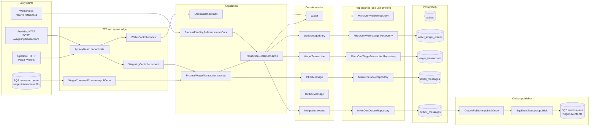
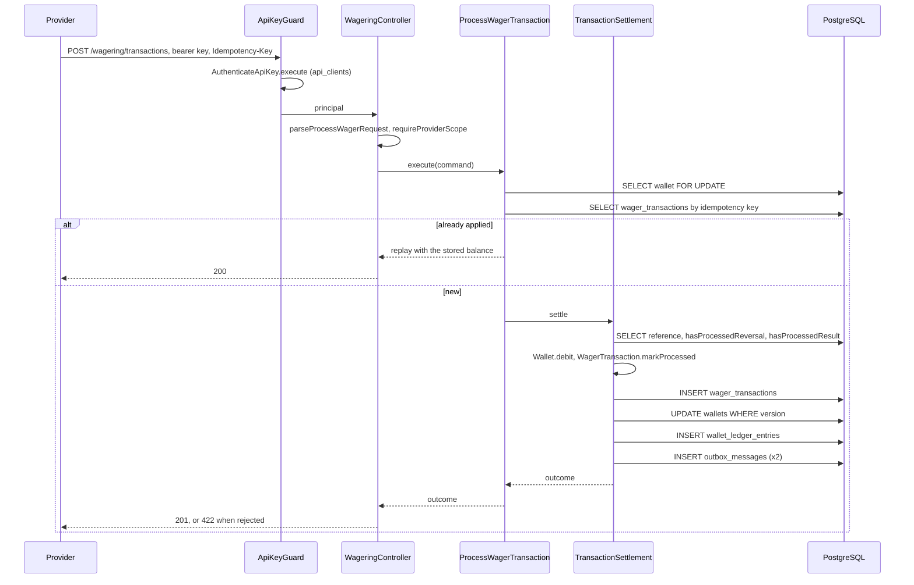
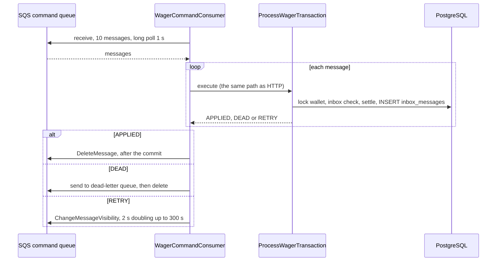
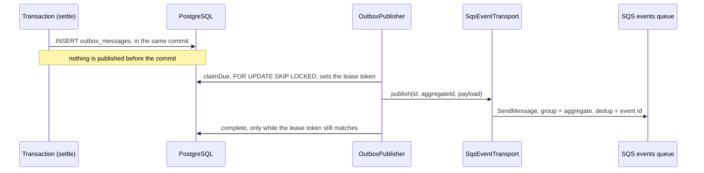
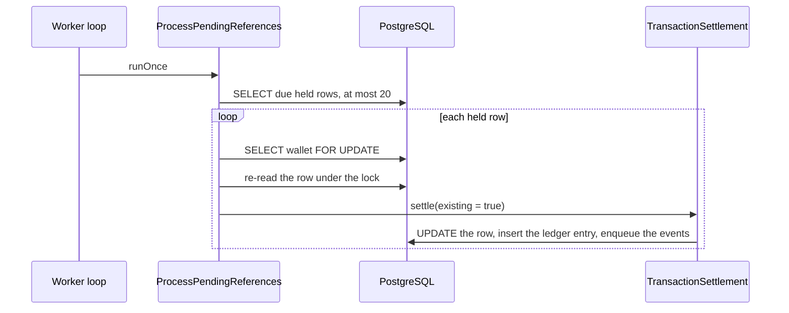
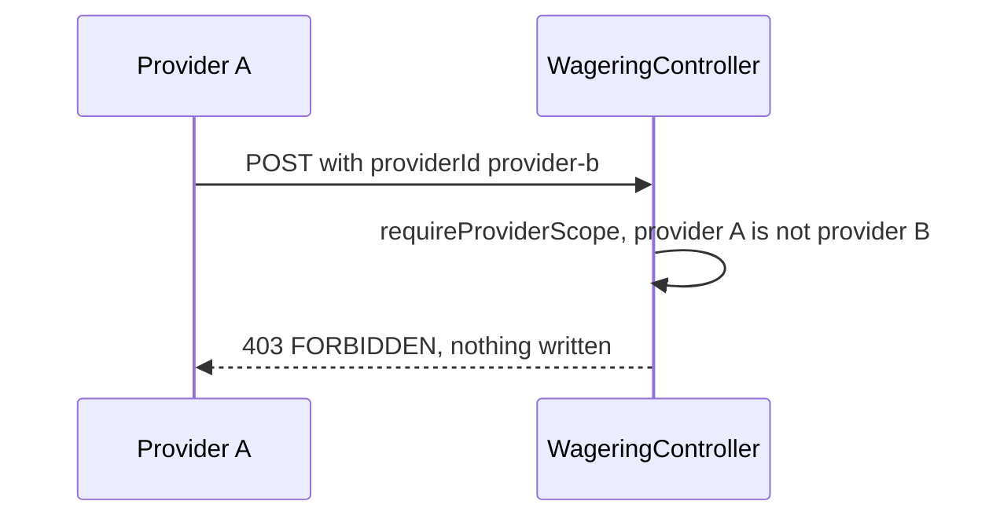

# Entity map

Every entity of the code, the table it is stored in, the classes and methods that work with it,
and the path a piece of data takes through the system. Names are the names in the code. The
inventory was generated from `src/` for this document, and each entry was checked against the file.

Read it in this order: the overview graph, then the table of entities, then the section of the
entity you are following. The last section has the flows as sequence diagrams.

## Overview

Three entry points reach the same financial code. A provider's HTTP request and a queued command
both go through `ProcessWagerTransaction`, and the reference timer goes through `TransactionSettlement`
directly. Every path ends in the same tables. The outbox row is written in the same transaction, and
a separate loop publishes it to the events queue.

## Table of entities

| Entity                     | Kind               | Table                     | Record class              | Repository                                                                                | Domain class and rules                                                                                                                  |
| -------------------------- | ------------------ | ------------------------- | ------------------------- | ----------------------------------------------------------------------------------------- | --------------------------------------------------------------------------------------------------------------------------------------- |
| `Wallet`                   | aggregate root     | `wallets`                 | `WalletRecord`            | `MikroOrmWalletRepository`                                                                | `Wallet`: `open`, `debit`, `credit`, `canDebit`                                                                                         |
| `WalletLedgerEntry`        | immutable entry    | `wallet_ledger_entries`   | `WalletLedgerEntryRecord` | `MikroOrmWalletLedgerRepository`                                                          | `WalletLedgerEntry`: `create`, `isBalanced`                                                                                             |
| `WagerTransaction`         | aggregate          | `wager_transactions`      | `WagerTransactionRecord`  | `MikroOrmWagerTransactionRepository`                                                      | `WagerTransaction`: `create`, `evaluateReference`, `markProcessed`, `reject`, `markPendingReference`                                    |
| `InboxMessage`             | consumer record    | `inbox_messages`          | `InboxMessageRecord`      | `MikroOrmInboxRepository`                                                                 | `InboxMessage`: `receive`, `matchesPayload`, `markProcessed`                                                                            |
| `OutboxMessage`            | publication record | `outbox_messages`         | `OutboxMessageRecord`     | `MikroOrmOutboxRepository` (enqueue), `MikroOrmOutboxStore` (claim, complete, reschedule) | `OutboxMessage`: `enqueue`, `markPublished`, `scheduleRetry`                                                                            |
| `ApiClient`                | identity           | `api_clients`             | `ApiClientRecord`         | `MikroOrmApiClientRepository`                                                             | `Principal`: `canOperateFor`; `api-key`: `generateApiKey`, `hashApiKey`                                                                 |
| Integration events         | value, not stored  | in `outbox_messages`      | none                      | `MikroOrmOutboxRepository.enqueue`                                                        | `IntegrationEvent`, `WagerTransactionProcessed`, `WagerTransactionRejected`, `WagerTransactionPendingReference`, `WalletBalanceChanged` |
| Commands                   | input, not stored  | none                      | none                      | none                                                                                      | `ProcessWagerCommand`, `OpenWalletCommand`, `CreateApiClientInput`                                                                      |
| Queue message              | input, not stored  | `wager-transactions.fifo` | none                      | `SqsQueue`                                                                                | `parseWagerCommandMessage`, `ReceivedMessage`                                                                                           |
| Value objects and policies | not stored         | none                      | none                      | none                                                                                      | `Money`, `LedgerDirection`, `KIND_RULES`, `FAILURE_CODES`, `ReferenceEvaluation`, `referenceRetryDelayMs`, `wagerPayloadHash`           |
| Errors                     | not stored         | none                      | none                      | none                                                                                      | `DomainError`, application errors, `RequestValidationError`, mapped by `toErrorResponse`                                                |

The six tables are the only storage. Everything else is passed in memory or in a message.

## 1. Wallet

**Table:** `wallets`. **Record:** `WalletRecord`. **Repository:** `MikroOrmWalletRepository`.

| Method                  | Who calls it                                                             | Effect                                                    |
| ----------------------- | ------------------------------------------------------------------------ | --------------------------------------------------------- |
| `findById`              | `WalletQueries.getWallet`, `WalletQueries.listLedger`                    | read without a lock                                       |
| `findForShare`          | `WalletQueries.reconcile`                                                | `SELECT ... FOR SHARE`, so a debit waits for the read     |
| `findForUpdate`         | `ProcessWagerTransaction.process`, `ProcessPendingReferences.resolveOne` | `SELECT ... FOR UPDATE`, the wallet lock                  |
| `insert`                | `OpenWallet.execute`                                                     | one row, with the `(player_id, currency)` unique key      |
| `save(wallet, version)` | `TransactionSettlement.applyBalanceChange`                               | `UPDATE ... WHERE version = expected`, one row or refused |

**Domain:** `Wallet.open` creates the wallet, and returns the opening ledger entry when the initial
balance is positive. `Wallet.canDebit` and `Wallet.debit` refuse an overdraft. `Wallet.credit` adds.
Both validate before they mutate, and both bump `version` once.

**Flow of a balance change:**

1. The lock is taken in `findForUpdate`, before anything else in the transaction.
2. `Wallet.debit` or `Wallet.credit` returns the new state and a `WalletLedgerEntry`.
3. `save` writes the new balance and version, guarded by the old version.
4. `WalletBalanceChanged` is enqueued in the outbox, in the same transaction.

**Read by:** `WalletController.get`, `WalletController.ledger`, `WalletController.reconcile`.

## 2. WalletLedgerEntry

**Table:** `wallet_ledger_entries`. **Record:** `WalletLedgerEntryRecord`. **Repository:** `MikroOrmWalletLedgerRepository`.

| Method                            | Who calls it                                                     | Effect                                                          |
| --------------------------------- | ---------------------------------------------------------------- | --------------------------------------------------------------- |
| `append`                          | `OpenWallet.execute`, `TransactionSettlement.applyBalanceChange` | one `INSERT`. Updates and deletes are refused by a trigger      |
| `listByWallet`                    | tests and diagnostics                                            | all entries of one wallet, in order                             |
| `listPageAfter(walletId, seq, n)` | `WalletQueries.listLedger`                                       | keyset page by `seq`                                            |
| `summarize(walletId, currency)`   | `WalletQueries.reconcile`                                        | the sum of the entries, and whether the balance chain is intact |

**Domain:** `WalletLedgerEntry.create` checks the arithmetic (`balanceBefore ± amount = balanceAfter`),
a positive amount, and non-negative balances. `isBalanced` checks the same rule on a stored entry.

**Flow:** an entry is created in the same transaction as the balance change it records, and it is
never changed afterwards. A reversal is a new entry in the other direction.

## 3. WagerTransaction

**Table:** `wager_transactions`. **Record:** `WagerTransactionRecord`. **Repository:** `MikroOrmWagerTransactionRepository`.

| Method                      | Who calls it                                                                   | Effect                                                     |
| --------------------------- | ------------------------------------------------------------------------------ | ---------------------------------------------------------- |
| `findByIdempotencyKey`      | `ProcessWagerTransaction.process`                                              | the replay check, by `(provider_id, idempotency_key)`      |
| `findByExternalId`          | `TransactionSettlement.settle` (the reference), `WagerQueries.getByExternalId` | the reference, by `(provider_id, external_transaction_id)` |
| `findById`                  | `WagerQueries.getById`                                                         | one row                                                    |
| `findDueForReferenceLookup` | `ProcessPendingReferences.runOnce`                                             | held rows whose next lookup is due, at most 20             |
| `hasProcessedReversal(id)`  | `TransactionSettlement.settle`                                                 | is the reference already reversed (REFUND or ROLLBACK)     |
| `hasProcessedResult(id)`    | `TransactionSettlement.settle`                                                 | does the BET already have a result (WIN or LOSS)           |
| `insert`                    | `OpenWallet.execute`, `TransactionSettlement.save`                             | one row, with the idempotency and external-id unique keys  |
| `update`                    | `TransactionSettlement.save`, `TransactionSettlement.holdOrRecordMiss`         | state change of an existing row                            |

**Domain:** `WagerTransaction.create` checks the shape against `KIND_RULES`. `evaluateReference`
returns `READY`, `WAIT` or `REJECT` with a failure code. `markProcessed`, `reject`,
`markPendingReference` and `recordReferenceMiss` move the state machine. `ledgerDirectionFor`
gives the direction of the ledger effect. `requiresUnsettledReference` says whether the BET must
have no result yet.

**Flow of one transaction, in the order the code runs:**

1. `ProcessWagerTransaction.execute` builds the transaction, and refuses `OPENING`.
2. `process` takes the wallet lock (`findForUpdate`).
3. For a queue message, `isInboundRecorded` checks the inbox. A repeat with another payload is a conflict.
4. `findByIdempotencyKey` finds an earlier answer. If there is one, `replay` returns it.
5. Otherwise `settleNew` calls `TransactionSettlement.settle`.
6. `settle` loads the reference, checks the wallet, evaluates the reference, checks the reversal
   and the result rules, and then applies or rejects.
7. `save` inserts or updates the row.
8. For a queue message, `recordInbound` writes the inbox row. This is the last write before the commit.

**Read by:** `WageringController.getById`, `ProvidersController.getByExternalId`.

## 4. InboxMessage

**Table:** `inbox_messages`. **Record:** `InboxMessageRecord`. **Repository:** `MikroOrmInboxRepository`.

| Method                          | Who calls it                                | Effect                                                      |
| ------------------------------- | ------------------------------------------- | ----------------------------------------------------------- |
| `find(consumerName, messageId)` | `ProcessWagerTransaction.isInboundRecorded` | was this message already applied, and with which payload    |
| `insert`                        | `ProcessWagerTransaction.recordInbound`     | one row, with the primary key `(consumer_name, message_id)` |

**Domain:** `InboxMessage.receive` builds the record with the payload hash. `matchesPayload` detects a
reused message id with a different payload, which is refused as `MessagePayloadConflictError`.

**Flow:** the inbox row is written in the same transaction as the wager. A redelivery after a crash
finds the row, and does nothing. HTTP requests have no inbox row.

## 5. OutboxMessage

**Table:** `outbox_messages`. **Record:** `OutboxMessageRecord`.
**Repositories:** `MikroOrmOutboxRepository` (write), `MikroOrmOutboxStore` (publish).

| Method                               | Who calls it                                  | Effect                                                                   |
| ------------------------------------ | --------------------------------------------- | ------------------------------------------------------------------------ |
| `enqueue`                            | `TransactionSettlement`, `OpenWallet.execute` | one row, in the transaction of the financial change                      |
| `claimDue(now, lease, token, limit)` | `OutboxPublisher.publishOnce`                 | `UPDATE ... FOR UPDATE SKIP LOCKED`, sets the lease token                |
| `complete(message, token, at)`       | `OutboxPublisher.deliver`                     | marks published, only while the lease token still matches                |
| `reschedule(message, token)`         | `OutboxPublisher.deliver`                     | records a failed send and the next attempt, only while the token matches |

**Domain:** `OutboxMessage.enqueue` takes the envelope of an event. `markPublished` records the time.
`scheduleRetry` counts a failure and sets the next attempt.

**Flow of an event:**

1. A financial use case calls `enqueue` inside its transaction.
2. The transaction commits. Nothing is published yet.
3. `OutboxPublisher.publishOnce` claims up to 20 due rows with a lease token.
4. `deliver` sends each one through `SqsEventTransport.publish` to the events queue. The message group is the aggregate id, and the deduplication id is the event id.
5. If the send succeeds, `complete` marks the row published, if the lease still holds. If it fails,
   `reschedule` schedules a retry.

## 6. ApiClient and Principal

**Table:** `api_clients`. **Record:** `ApiClientRecord`. **Repository:** `MikroOrmApiClientRepository`.

| Method                      | Who calls it                  | Effect                                            |
| --------------------------- | ----------------------------- | ------------------------------------------------- |
| `insert`                    | `CreateApiClient.execute`     | one row, with the hash of the key                 |
| `findActiveByKeyHash(hash)` | `AuthenticateApiKey.execute`  | the client holding the hash, unless it is revoked |
| `revoke(clientId, at)`      | `src/auth.ts` (`auth:revoke`) | sets `revoked_at` once                            |

**Domain:** `Principal` holds `clientId`, `name`, `role` and, for a provider, `providerId`.
`canOperateFor(principal, providerId)` decides scope. `generateApiKey` and `hashApiKey` are the only
code that touches the key.

**Flow of one request:**

1. `ApiKeyGuard.canActivate` reads the `Authorization` header.
2. `AuthenticateApiKey.execute` parses the bearer token, hashes it, and calls `findActiveByKeyHash`.
3. A missing or unknown key is `401`. A key whose role may not do the route is `403`.
4. The controller calls `requireProviderScope` for a provider route, once it knows the provider.
5. The principal is attached to the request, and is never written to a table.

## 7. Integration events

**Classes:** `IntegrationEvent` (abstract, with `toJSON`), `WagerTransactionProcessed.from`,
`WagerTransactionRejected.from`, `WagerTransactionPendingReference.from`, `WalletBalanceChanged.from`.
**Stored in:** `outbox_messages`, as the envelope. **Published to:** `wager-events.fifo`.

| Event                              | Created by                                                                                     | When                                    |
| ---------------------------------- | ---------------------------------------------------------------------------------------------- | --------------------------------------- |
| `WagerTransactionProcessed`        | `TransactionSettlement.applyBalanceChange`, `finishWithoutBalanceChange`, `OpenWallet.execute` | any applied transaction, including LOSS |
| `WagerTransactionRejected`         | `TransactionSettlement.reject`                                                                 | any rejection, with its `failureCode`   |
| `WagerTransactionPendingReference` | `TransactionSettlement.holdOrRecordMiss`                                                       | the first miss of a reference           |
| `WalletBalanceChanged`             | `TransactionSettlement.applyBalanceChange`, `OpenWallet.execute`                               | only when a balance changed             |

**Flow:** the event is built from the state after the change, enqueued in the same transaction, and
published by the outbox publisher. A consumer of the events queue is not part of this build.

## 8. Commands and the queue message

| Name                  | Where it is built                                                     | Where it is consumed              |
| --------------------- | --------------------------------------------------------------------- | --------------------------------- |
| `ProcessWagerCommand` | `parseProcessWagerRequest` (HTTP), `parseWagerCommandMessage` (queue) | `ProcessWagerTransaction.execute` |
| `OpenWalletCommand`   | `parseOpenWalletRequest`                                              | `OpenWallet.execute`              |
| `ReceivedMessage`     | `SqsQueue.receive`                                                    | `WagerCommandConsumer.settle`     |

**Flow of a queued command:** `WagerCommandConsumer.pollOnce` receives up to 10 messages.
`attempt` parses each body and calls `ProcessWagerTransaction.execute`, which is the same path as HTTP.
The outcome decides the message: `APPLIED` is acknowledged after the commit, `DEAD` goes to the
dead-letter queue and is acknowledged, and `RETRY` gets a longer visibility timeout.

## 9. Value objects, policies and errors

| Name                     | Where it lives                                     | Used by                                                 |
| ------------------------ | -------------------------------------------------- | ------------------------------------------------------- |
| `Money`                  | `src/shared/domain/money.ts`                       | every amount, and the `numeric(20,2)` column            |
| `LedgerDirection`        | `src/shared/domain/ledger-direction.ts`            | ledger entries, `KIND_RULES`                            |
| `KIND_RULES`             | `wager-transaction-kind.ts`                        | `WagerTransaction.create`, `evaluateReference`          |
| `FAILURE_CODES`          | `failure-code.ts`                                  | `WagerTransaction.reject`, the HTTP body                |
| `ReferenceEvaluation`    | `wager-transaction.ts` (`READY`, `WAIT`, `REJECT`) | `TransactionSettlement.settle`                          |
| `referenceRetryDelayMs`  | `reference-retry-policy.ts`                        | `TransactionSettlement.holdOrRecordMiss`                |
| `wagerPayloadHash`       | `wager-payload-hash.ts`                            | `ProcessWagerTransaction`, the inbox                    |
| `LedgerCursor`           | `ledger-cursor.ts`                                 | `WalletQueries.listLedger`                              |
| `OperationLog`           | `structured-log.ts`                                | every controller and worker loop                        |
| `DomainError`            | `domain-error.ts`                                  | the domain, mapped by `toErrorResponse`                 |
| application errors       | `application-errors.ts`                            | repositories and use cases, mapped by `toErrorResponse` |
| `RequestValidationError` | `src/shared/validation/request-validation.ts`      | every request parser, mapped to `400`                   |

## 10. Workers, processes and metrics

| Name                      | Where it lives                                          | Role                                                                                  |
| ------------------------- | ------------------------------------------------------- | ------------------------------------------------------------------------------------- |
| `runWorker`, `StopSignal` | `src/worker/run-worker.ts`                              | the three loops and the graceful stop                                                 |
| `createWorkerRuntime`     | `src/worker/worker-runtime.ts`                          | builds the collaborators of a worker process                                          |
| `SqsQueue`                | `src/modules/messaging/infrastructure/sqs/sqs-queue.ts` | `send`, `receive`, `acknowledge`, `changeVisibility`, `pendingCount`, `countInFlight` |
| `MetricsRegistry`         | `src/shared/observability/metrics.ts`                   | counters and summaries, per process                                                   |
| `HealthService`           | `src/health/health.service.ts`                          | `databaseIsUp`, `sqsIsUp`, `ready`                                                    |

## 11. The rest of the HTTP surface

| Controller            | Route                                                                     | Calls                                   |
| --------------------- | ------------------------------------------------------------------------- | --------------------------------------- |
| `WalletController`    | `POST /wallets`                                                           | `OpenWallet.execute`                    |
| `WalletController`    | `GET /wallets/:walletId`                                                  | `WalletQueries.getWallet`               |
| `WalletController`    | `GET /wallets/:walletId/ledger`                                           | `WalletQueries.listLedger`              |
| `WalletController`    | `POST /wallets/:walletId/reconciliation`                                  | `WalletQueries.reconcile`               |
| `WageringController`  | `POST /wagering/transactions`                                             | `ProcessWagerTransaction.execute`       |
| `WageringController`  | `GET /wagering/transactions/:transactionId`                               | `WagerQueries.getById`                  |
| `ProvidersController` | `GET /providers/:providerId/wagering/transactions/:externalTransactionId` | `WagerQueries.getByExternalId`          |
| `HealthController`    | `GET /health/live`, `GET /health/ready`                                   | `HealthService.ready`, nothing for live |
| `MetricsController`   | `GET /metrics`                                                            | `MetricsRegistry.snapshot`              |

## Sequence diagrams

### A BET over HTTP

### A command from the queue

### An event, from commit to the events queue

### A held reference, resolved later

### A provider scope refusal

## Where to change what

- A new kind of operation: `KIND_RULES` in `wager-transaction-kind.ts`, the CHECK in a new migration,
  and a test in `test/unit/wagering` and `test/integration/wagering`.
- A new event: a class that extends `IntegrationEvent`, enqueued in `TransactionSettlement` or
  `OpenWallet`, and a test in `test/integration/messaging`.
- A new table: a migration, a record class, a repository, and a constraint probe in
  `test/integration/schema/schema-constraints.test.ts`.
