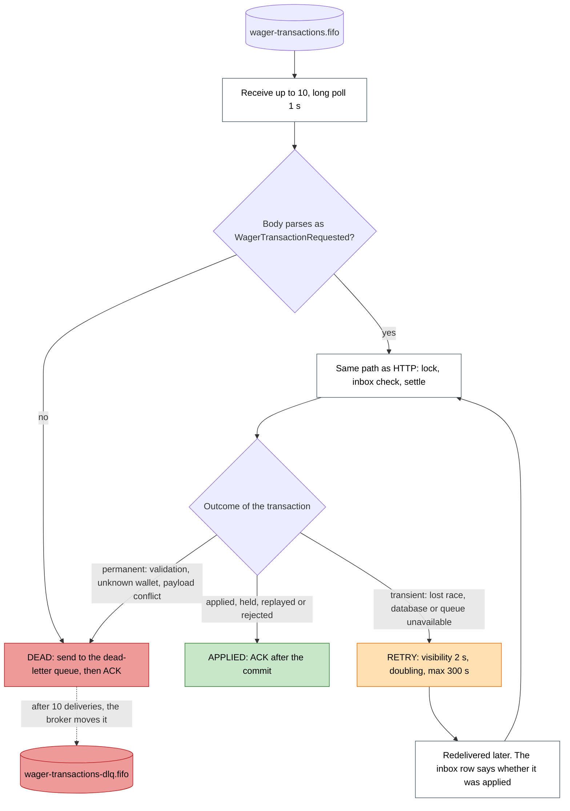
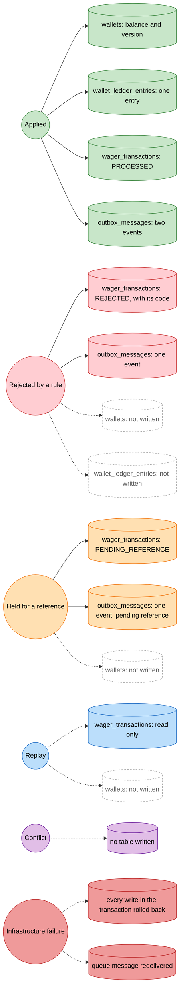
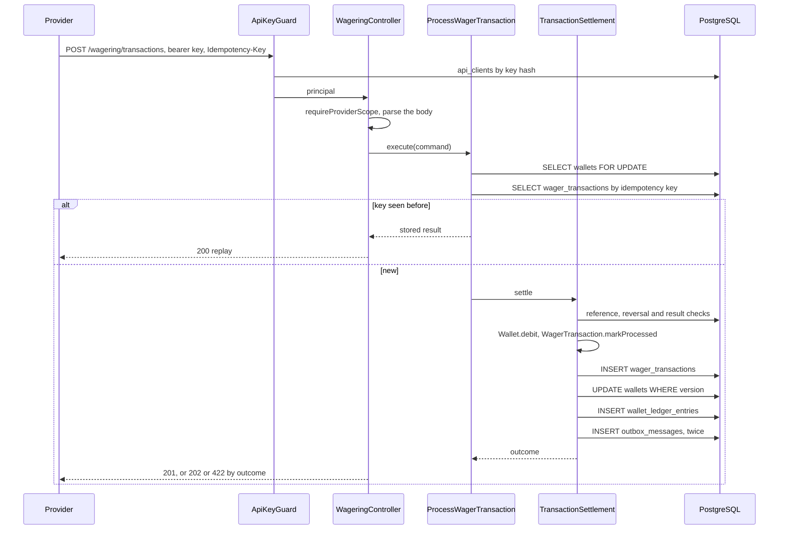
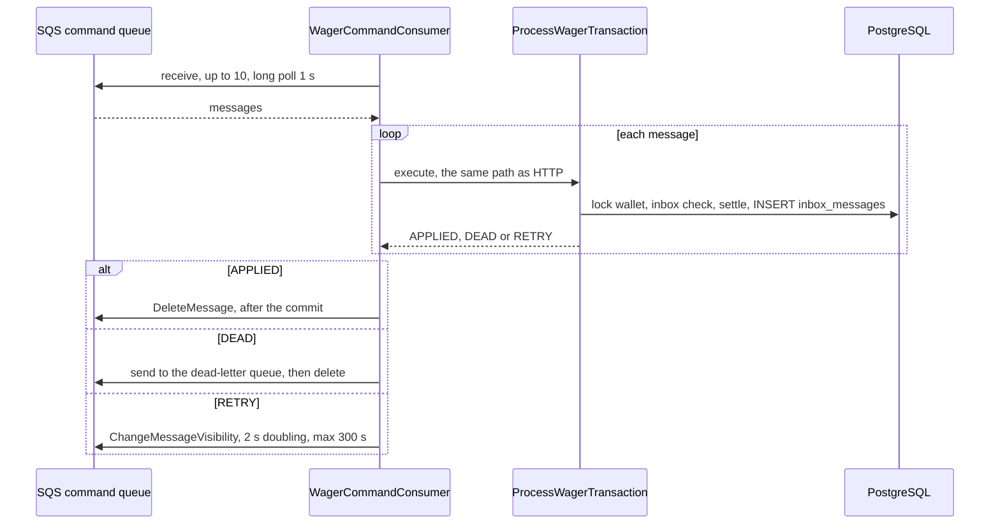
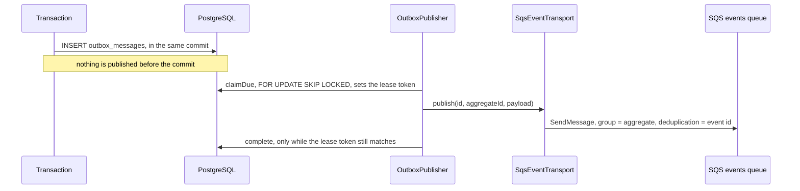
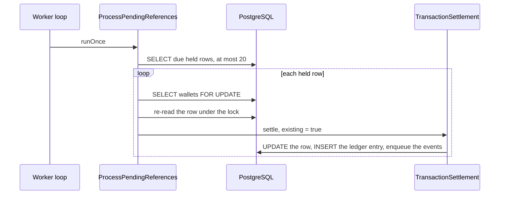
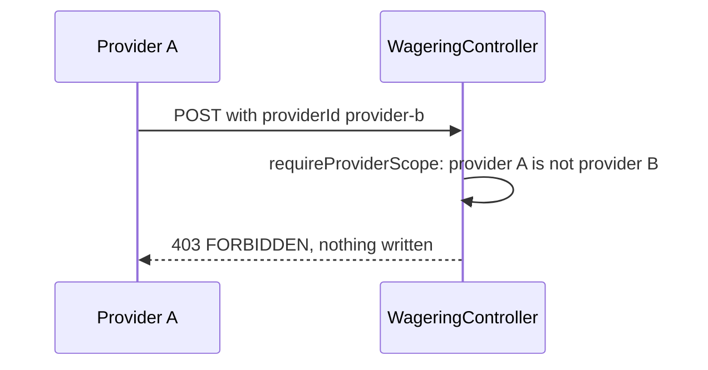

# Matriz de fluxos

> **Apêndice.** Uma referência para o revisor que rastreia uma operação através do código. A visão geral está em
> [ARCHITECTURE.md](../ARCHITECTURE.md), seções 1 e 5.

Um documento único para o fluxo de dados através do sistema: qual entidade cada etapa acessa, qual
função a executa, o que a etapa decide e qual resposta ou registro cada desfecho deixa para trás.
Os diagramas são coloridos por desfecho, permitindo ao leitor acompanhar uma requisição desde seu ponto de entrada até
a resposta, e verificar quais entidades aquele desfecho grava.

Substitui o mapa de entidades anterior. O inventário foi gerado a partir de `src/`, e o nome de cada
função foi verificado contra seu arquivo.

## Como ler este documento

1. **Cores.** Todo desfecho terminal possui uma cor. A mesma cor é utilizada para as entidades
   que esse desfecho grava.
2. **Tabela de respostas.** Cada desfecho mapeia para um status HTTP e um código de falha, ou para uma
   disposição na fila.
3. **Diagramas.** Losangos são decisões. Retângulos são etapas. Retângulos coloridos são desfechos.
4. **Matriz.** As linhas são funções, na ordem em que executam. As colunas são as entidades. Uma célula informa
   o que a função faz com aquela entidade.
5. **Entidades.** Cada entidade possui sua tabela, sua classe de registro, seu repositório, sua classe de domínio e
   as funções que a gravam e leem.

| Cor               | Desfecho                                                           | Estilo nos diagramas |
| ----------------- | ------------------------------------------------------------------ | -------------------- |
| Verde             | aplicada: saldo, ledger e outbox foram alterados                   | `applied`            |
| Azul              | replay: o resultado armazenado retornou, nada mudou                | `replay`             |
| Âmbar             | retida: aguardando uma referência, nada mudou ainda                | `held`               |
| Vermelho          | recusada por regra de negócio: uma linha é gravada, saldo não move | `rejected`           |
| Roxo              | conflito: mesma chave com outro payload, nada gravado              | `conflict`           |
| Cinza             | negada antes do domínio: autenticação, escopo ou validação         | `denied`             |
| Vermelho escuro   | falha de infraestrutura: a transação sofre rollback                | `failure`            |
| Branco, tracejado | uma entidade não tocada por este desfecho                          | `untouched`          |

## Tabela de respostas

| Desfecho                                        | Cor             | Status HTTP             | Código no corpo ou código de falha                                                                                                                                                                                                                                                                                           | Disposição na fila (SQS)         | Gravado                                                  |
| ----------------------------------------------- | --------------- | ----------------------- | ---------------------------------------------------------------------------------------------------------------------------------------------------------------------------------------------------------------------------------------------------------------------------------------------------------------------------- | -------------------------------- | -------------------------------------------------------- |
| Aplicada                                        | verde           | `201`                   | `status: PROCESSED`                                                                                                                                                                                                                                                                                                          | ACK após commit                  | carteira, ledger, linha de wager, dois eventos de outbox |
| Replay                                          | azul            | `200`                   | `idempotentReplay: true`                                                                                                                                                                                                                                                                                                     | ACK após commit (linha da inbox) | nada                                                     |
| Retida por referência                           | âmbar           | `202`                   | `status: PENDING_REFERENCE`                                                                                                                                                                                                                                                                                                  | ACK após commit                  | linha de wager (retida), um evento de outbox             |
| Recusada por regra de negócio                   | vermelho        | `422`                   | `failureCode`: `INSUFFICIENT_BALANCE`, `REVERSAL_WOULD_OVERDRAW`, `REFERENCE_NOT_FOUND`, `REFERENCE_NOT_PROCESSED`, `REFERENCE_CONTEXT_MISMATCH`, `REFERENCE_KIND_NOT_ALLOWED`, `REFERENCE_AMOUNT_MISMATCH`, `REFERENCE_ALREADY_REVERSED`, `REFERENCE_ALREADY_SETTLED`, `WALLET_PLAYER_MISMATCH`, `WALLET_CURRENCY_MISMATCH` | ACK após commit                  | linha de wager (recusada), um evento de outbox           |
| Mesma chave, outro payload                      | roxo            | `409`                   | `IDEMPOTENCY_CONFLICT`                                                                                                                                                                                                                                                                                                       | dead-lettered (permanente)       | nada                                                     |
| Nenhuma chave bearer válida                     | cinza           | `401`                   | `UNAUTHENTICATED`, com `WWW-Authenticate`                                                                                                                                                                                                                                                                                    | não aplicável                    | nada                                                     |
| Chave não pode agir pelo provedor               | cinza           | `403`                   | `FORBIDDEN`                                                                                                                                                                                                                                                                                                                  | não aplicável                    | nada                                                     |
| Corpo inválido, ou chave ausente                | cinza           | `400`                   | `INVALID_REQUEST`, `IDEMPOTENCY_KEY_REQUIRED`, `INVALID_TRANSACTION` (OPENING, valor zero, valor negativo, referência ausente)                                                                                                                                                                                               | dead-lettered (permanente)       | nada                                                     |
| Carteira ou transação desconhecida              | cinza           | `404`                   | `WALLET_NOT_FOUND`, `TRANSACTION_NOT_FOUND`                                                                                                                                                                                                                                                                                  | dead-lettered (permanente)       | nada                                                     |
| Carteira já existe                              | roxo            | `409`                   | `WALLET_ALREADY_EXISTS`                                                                                                                                                                                                                                                                                                      | não aplicável                    | nada                                                     |
| Disputa de lock perdida, retentativas esgotadas | vermelho escuro | `503`, `retry-after: 1` | `CONCURRENCY_CONFLICT`                                                                                                                                                                                                                                                                                                       | retentado com backoff            | nada (rollback realizado)                                |
| Qualquer erro inesperado                        | vermelho escuro | `500`                   | `INTERNAL_ERROR`, sem mensagem                                                                                                                                                                                                                                                                                               | retentado com backoff            | nada (rollback realizado)                                |
| Prontidão, dependência indisponível             | vermelho escuro | `503`                   | `checks` lista a dependência com falha                                                                                                                                                                                                                                                                                       | não aplicável                    | nada                                                     |

O mapeamento de status reside em `src/modules/wagering/http/wagering.controller.ts` (`statusOf`) e
`src/shared/http/error-response.ts` (`toErrorResponse`). Um teste valida cada linha.

## Diagrama 1: uma BET via HTTP, colorida por desfecho

Renderizado como imagem: [`docs/diagrams/bet-over-http.svg`](diagrams/bet-over-http.svg), para visualização fora do GitHub.

## Diagrama 2: um comando em fila e o mesmo caminho

Renderizado como imagem: [`docs/diagrams/queued-command.svg`](diagrams/queued-command.svg), para visualização fora do GitHub.

A fila atinge o mesmo código de decisão do HTTP, a partir do lock em diante. Apenas a entrada e a
confirmação diferem.

Um replay vindo da fila também é uma disposição APPLIED: a linha da inbox mostra que a mensagem foi vista,
e o resultado armazenado é devolvido sem um segundo efeito.

## Diagrama 3: quais entidades cada desfecho grava

Renderizado como imagem: [`docs/diagrams/outcome-entities.svg`](diagrams/outcome-entities.svg), para visualização fora do GitHub.

## Matriz: funções contra entidades

Legenda: **L** bloqueio de linha da carteira, **R** leitura, **W** escrita (inserção ou atualização), **C** criado em
memória e retornado, **E** enfileirado na outbox na mesma transação, **—** não tocado.

| #   | Função (na ordem de execução)                                                                         | Carteira               | Ledger | Operação de wager | Inbox | Outbox                            | Cliente de API            | Evento  | Fluxo                      |
| --- | ----------------------------------------------------------------------------------------------------- | ---------------------- | ------ | ----------------- | ----- | --------------------------------- | ------------------------- | ------- | -------------------------- |
| 1   | `ApiKeyGuard.canActivate` → `AuthenticateApiKey.execute`                                              | —                      | —      | —                 | —     | —                                 | R (`findActiveByKeyHash`) | —       | HTTP                       |
| 2   | `WageringController.submit` → `requireProviderScope`                                                  | —                      | —      | —                 | —     | —                                 | —                         | —       | HTTP                       |
| 3   | `parseProcessWagerRequest` (ou `parseWagerCommandMessage`)                                            | —                      | —      | —                 | —     | —                                 | —                         | —       | HTTP, fila                 |
| 4   | `ProcessWagerTransaction.execute` → `WagerTransaction.create`                                         | —                      | —      | C                 | —     | —                                 | —                         | —       | HTTP, fila                 |
| 5   | `process` → `MikroOrmWalletRepository.findForUpdate`                                                  | L                      | —      | —                 | —     | —                                 | —                         | —       | HTTP, fila, referência     |
| 6   | `isInboundRecorded` → `MikroOrmInboxRepository.find`                                                  | —                      | —      | —                 | R     | —                                 | —                         | —       | fila                       |
| 7   | `MikroOrmWagerTransactionRepository.findByIdentity`                                                   | —                      | —      | R                 | —     | —                                 | —                         | —       | HTTP, fila                 |
| 8   | `replay` (quando a chave já foi vista)                                                                | —                      | —      | R                 | —     | —                                 | —                         | —       | HTTP, fila                 |
| 9   | `TransactionSettlement.settle` → `findByExternalId` (referência)                                      | —                      | —      | R                 | —     | —                                 | —                         | —       | HTTP, fila, referência     |
| 10  | `WagerTransaction.walletMismatch`, `WagerTransaction.evaluateReference`                               | —                      | —      | —                 | —     | —                                 | —                         | —       | todos                      |
| 11  | `processedOutcomesOf`                                                                                 | —                      | —      | R                 | —     | —                                 | —                         | —       | todos                      |
| 12  | `Wallet.canDebit`, `Wallet.debit` ou `Wallet.credit`                                                  | —                      | C      | —                 | —     | —                                 | —                         | —       | todos                      |
| 13  | `WagerTransaction.markProcessed`, `reject`, `markPendingReference`                                    | —                      | —      | C (estado)        | —     | —                                 | —                         | —       | todos                      |
| 14  | `save` → `MikroOrmWagerTransactionRepository.insert` ou `update`                                      | —                      | —      | W                 | —     | —                                 | —                         | —       | todos                      |
| 15  | `save` → `MikroOrmWalletRepository.save` (protegido por versão)                                       | W                      | —      | —                 | —     | —                                 | —                         | —       | todos com mudança de saldo |
| 16  | `save` → `MikroOrmWalletLedgerRepository.append`                                                      | —                      | W      | —                 | —     | —                                 | —                         | —       | todos com mudança de saldo |
| 17  | `repositories.outbox.enqueue` (eventos construídos a partir do estado)                                | —                      | —      | —                 | —     | E                                 | —                         | C       | todos                      |
| 18  | `recordInbound` → `MikroOrmInboxRepository.insert`                                                    | —                      | —      | —                 | W     | —                                 | —                         | —       | fila                       |
| 19  | Commit da unidade de trabalho                                                                         | todos os acima, juntos |        |                   |       |                                   |                           |         | todos                      |
| 20  | `OutboxPublisher.publishOnce` → `claimDue`                                                            | —                      | —      | —                 | —     | W (lease)                         | —                         | —       | após commit                |
| 21  | `SqsEventTransport.publish` → `SqsQueue.send`                                                         | —                      | —      | —                 | —     | R                                 | —                         | enviado | após commit                |
| 22  | `OutboxPublisher.deliver` → `complete` ou `reschedule`                                                | —                      | —      | —                 | —     | W (protegido pelo token de lease) | —                         | —       | após commit                |
| 23  | `WalletQueries.reconcile` → `findForShare`, `summarize`                                               | S                      | R      | —                 | —     | —                                 | —                         | —       | reconciliação              |
| 24  | `WalletQueries.listLedger` → `listPageAfter`                                                          | —                      | R      | —                 | —     | —                                 | —                         | —       | ledger                     |
| 25  | `ProcessPendingReferences.runOnce` → `findDueForReferenceLookup`                                      | —                      | —      | R                 | —     | —                                 | —                         | —       | referência                 |
| 26  | `ProcessPendingReferences.resolveOne` → `findForUpdate`, `findById`, depois `settle(existing = true)` | L, R                   | —      | R, W              | —     | E                                 | —                         | —       | referência                 |

A linha 19 é o ponto de atomicidade. Uma falha em qualquer linha anterior não deixa nenhuma escrita para trás,
razão pela qual uma transação com crash não exibe nada em nenhuma tabela.

`S` na linha 23 é um lock compartilhado (shared lock): permite leituras e faz o débito aguardar.

## Entidades

| Entidade              | Tabela                  | Classe de registro        | Repositório                                                           | Classe de domínio                                                                                   |
| --------------------- | ----------------------- | ------------------------- | --------------------------------------------------------------------- | --------------------------------------------------------------------------------------------------- |
| `Wallet`              | `wallets`               | `WalletRecord`            | `MikroOrmWalletRepository`                                            | `Wallet`                                                                                            |
| `WalletLedgerEntry`   | `wallet_ledger_entries` | `WalletLedgerEntryRecord` | `MikroOrmWalletLedgerRepository`                                      | `WalletLedgerEntry`                                                                                 |
| `WagerTransaction`    | `wager_transactions`    | `WagerTransactionRecord`  | `MikroOrmWagerTransactionRepository`                                  | `WagerTransaction`                                                                                  |
| `InboxMessage`        | `inbox_messages`        | `InboxMessageRecord`      | `MikroOrmInboxRepository`                                             | `InboxMessage`                                                                                      |
| `OutboxMessage`       | `outbox_messages`       | `OutboxMessageRecord`     | `MikroOrmOutboxRepository` (enqueue), `MikroOrmOutboxStore` (publish) | `OutboxMessage`                                                                                     |
| `ApiClient`           | `api_clients`           | `ApiClientRecord`         | `MikroOrmApiClientRepository`                                         | `Principal`, funções de `api-key`                                                                   |
| Eventos de integração | em `outbox_messages`    | nenhuma                   | `MikroOrmOutboxRepository.enqueue`                                    | `IntegrationEvent` e suas quatro subclasses                                                         |
| Comandos e mensagens  | nenhuma                 | nenhuma                   | nenhum                                                                | `ProcessWagerCommand`, `OpenWalletInput`, `CreateApiClientInput`, `ReceivedMessage`                 |
| Valores e políticas   | nenhuma                 | nenhuma                   | nenhum                                                                | `Money`, `KIND_RULES`, `FAILURE_CODES`, `referenceRetryDelayMs`, `wagerPayloadHash`, `LedgerCursor` |
| Erros                 | nenhuma                 | nenhuma                   | nenhum                                                                | `DomainError`, erros de aplicação, `RequestValidationError`                                         |

Seis tabelas comportam tudo. O restante é passado em memória ou em uma mensagem.

### Wallet

| Método                  | Chamador                                   | Efeito                                              |
| ----------------------- | ------------------------------------------ | --------------------------------------------------- |
| `findForUpdate`         | `process`, `resolveOne`                    | o lock de carteira, `FOR UPDATE`                    |
| `findForShare`          | `WalletQueries.reconcile`                  | `FOR SHARE`, para que um débito espere pela leitura |
| `findById`              | `WalletQueries.getWallet`, `resolveOne`    | leitura, sem lock                                   |
| `insert`                | `OpenWallet.execute`                       | uma linha                                           |
| `save(wallet, version)` | `TransactionSettlement.applyBalanceChange` | `UPDATE ... WHERE version = expected`, uma linha    |

`Wallet.open` cria a carteira. Retorna o lançamento de abertura no ledger apenas para saldos positivos.
`Wallet.debit` e `Wallet.credit` retornam o novo estado e um lançamento, incrementando `version` uma vez.

### WalletLedgerEntry

| Método                            | Chamador                                   | Efeito                                              |
| --------------------------------- | ------------------------------------------ | --------------------------------------------------- |
| `append`                          | `OpenWallet.execute`, `applyBalanceChange` | um `INSERT`; um gatilho recusa alteração e exclusão |
| `summarize(walletId, currency)`   | `WalletQueries.reconcile`                  | o somatório e se a cadeia está íntegra              |
| `listPageAfter(walletId, seq, n)` | `WalletQueries.listLedger`                 | página keyset                                       |
| `listByWallet`                    | diagnósticos e testes                      | todos os lançamentos, em ordem                      |

### WagerTransaction

| Método                      | Chamador                                 | Efeito                                                             |
| --------------------------- | ---------------------------------------- | ------------------------------------------------------------------ |
| `findByIdentity`            | `process`                                | a verificação de replay, por chave primeiro, depois por id externo |
| `findByExternalId`          | `settle`, `WagerQueries.getByExternalId` | a referência, ou uma busca por id de provedor                      |
| `findById`                  | `WagerQueries.getById`, `resolveOne`     | uma linha                                                          |
| `findDueForReferenceLookup` | `ProcessPendingReferences.runOnce`       | linhas retidas cuja busca está vencida, no máximo 20               |
| `processedOutcomesOf`       | `settle`                                 | REFUND ou ROLLBACK, e WIN ou LOSS, já aplicados à referência       |
| `insert`, `update`          | `save`, `holdOrRecordMiss`               | uma linha                                                          |

### InboxMessage e OutboxMessage

| Método                             | Chamador                       | Efeito                                                              |
| ---------------------------------- | ------------------------------ | ------------------------------------------------------------------- |
| `MikroOrmInboxRepository.find`     | `isInboundRecorded`            | se esta mensagem foi aplicada e com qual payload                    |
| `MikroOrmInboxRepository.insert`   | `recordInbound`                | uma linha, chave primária `(consumer_name, message_id)`             |
| `MikroOrmOutboxRepository.enqueue` | `settle`, `OpenWallet.execute` | uma linha, na mesma transação                                       |
| `MikroOrmOutboxStore.claimDue`     | `publishOnce`                  | `FOR UPDATE SKIP LOCKED`, define o lease                            |
| `MikroOrmOutboxStore.complete`     | `deliver`                      | marca como publicado, apenas enquanto o token de lease corresponder |
| `MikroOrmOutboxStore.reschedule`   | `deliver`                      | um envio com falha, com a próxima tentativa                         |

### ApiClient

| Método                | Chamador                     | Efeito                                      |
| --------------------- | ---------------------------- | ------------------------------------------- |
| `findActiveByKeyHash` | `AuthenticateApiKey.execute` | o cliente detentor do hash, se não revogado |
| `insert`              | `CreateApiClient.execute`    | uma linha, com o hash da chave              |
| `revoke`              | `auth:revoke`                | define `revoked_at` uma vez                 |

## Diagramas de sequência

### Uma BET via HTTP

### Um comando vindo da fila

### Um evento, do commit à fila de eventos

### Uma referência retida, resolvida posteriormente

### Um provedor fora de escopo

## Onde alterar o quê

- **Um novo tipo de operação:** `KIND_RULES` em `wager-transaction-kind.ts`, a restrição CHECK em uma nova
  migração, e testes em `test/unit/wagering` e `test/integration/wagering`.
- **Um novo evento:** uma classe que estende `IntegrationEvent`, enfileirada em `TransactionSettlement` ou
  `OpenWallet`, com um teste em `test/integration/messaging`.
- **Uma nova tabela:** uma migração, uma classe de registro, um repositório e uma verificação em
  `test/integration/schema/schema-constraints.test.ts`.
