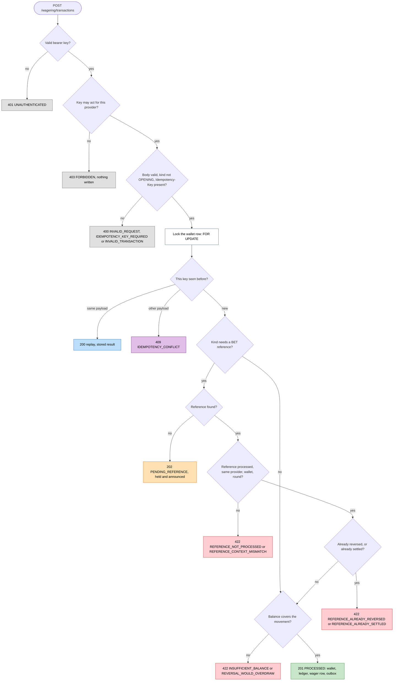
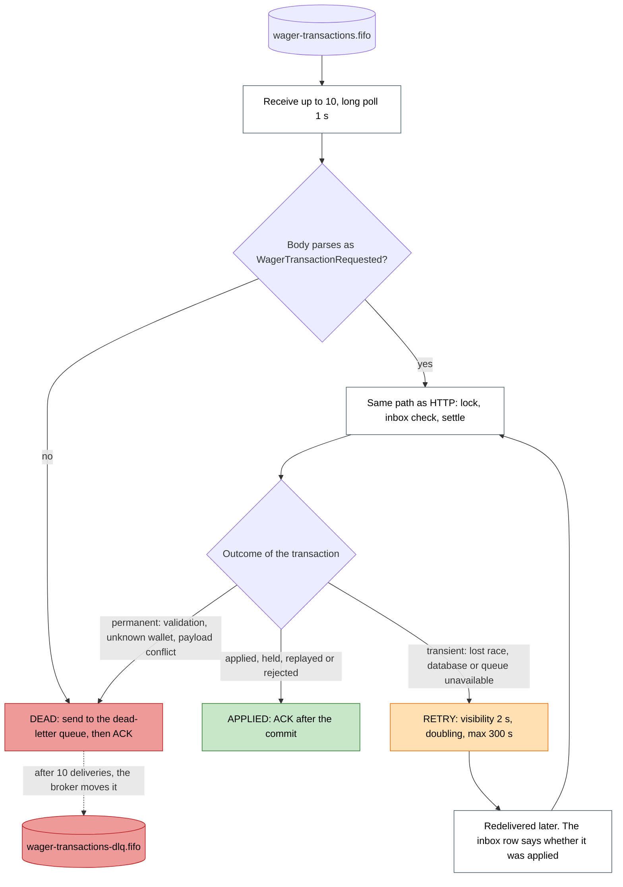
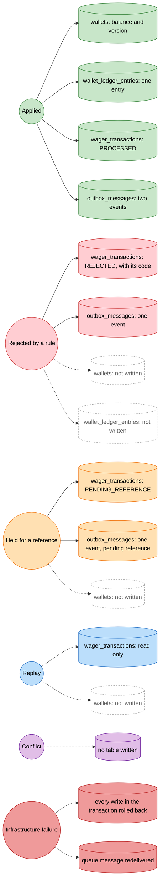
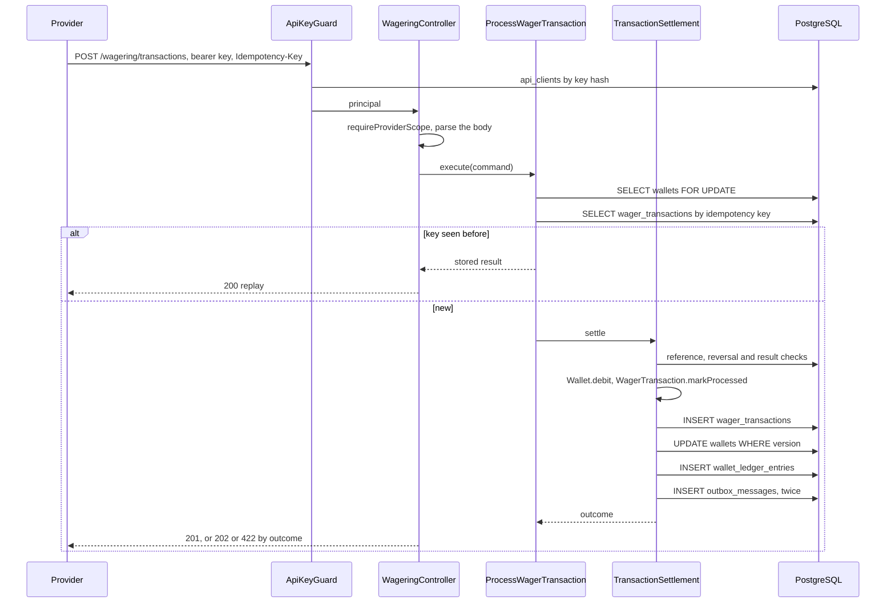
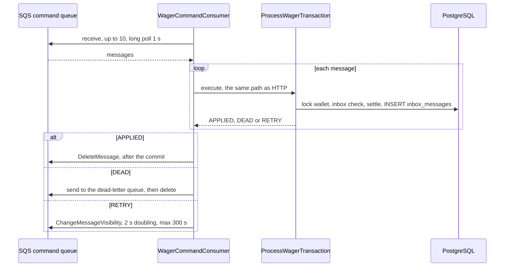
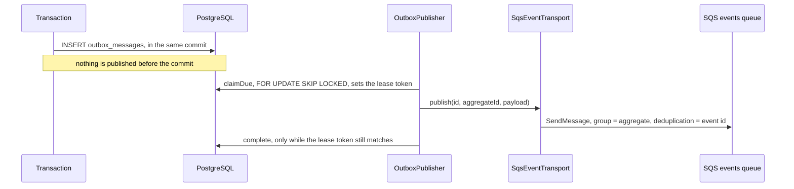
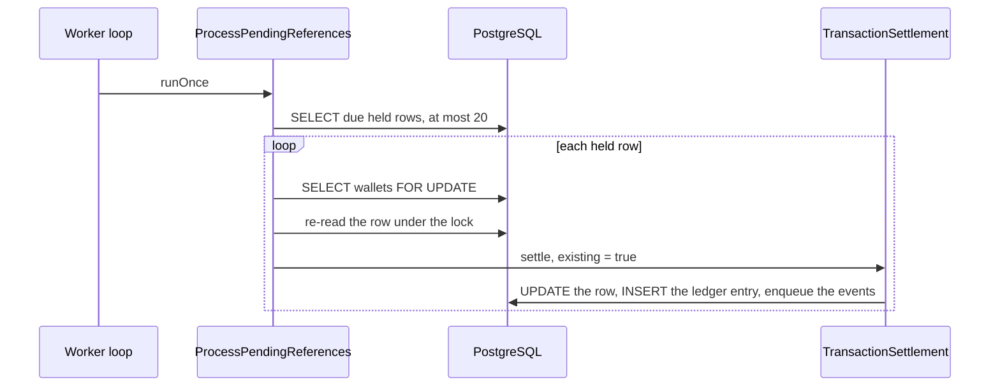
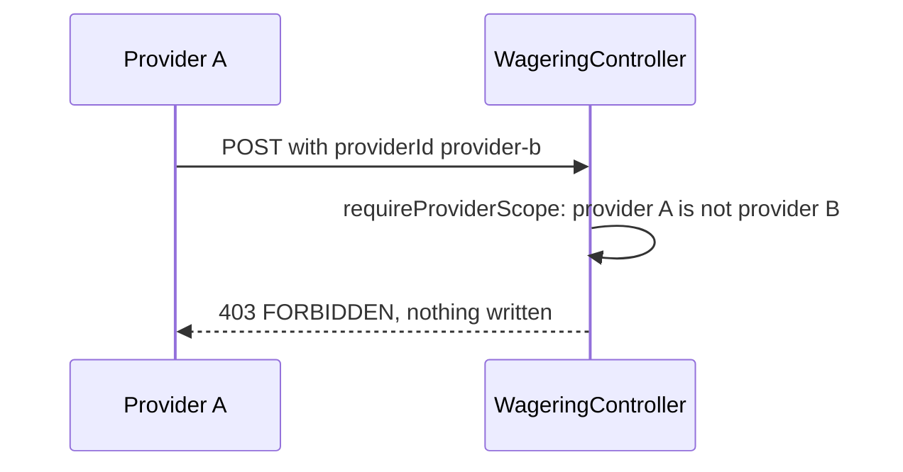

# Flow matrix

> **Appendix.** A reference for a reviewer who traces one operation through the code. The overview is in
> [ARCHITECTURE.md](../ARCHITECTURE.md), sections 1 and 5.

One document for the flow of data through the system: which entity each step touches, which
function does it, what the step decides, and what response or record each outcome leaves behind.
The graphs are coloured by outcome, so a reader can follow one request from its entry point to
the response, and see which entities that outcome writes.

It replaces the earlier entity map. The inventory was generated from `src/`, and each function
name was checked against its file.

## How to read it

1. **Colours.** Every terminal outcome has a colour. The same colour is used for the entities
   that outcome writes.
2. **Response table.** Each outcome maps to one HTTP status and one failure code, or to one queue
   disposition.
3. **Graphs.** Diamonds are decisions. Boxes are steps. Coloured boxes are outcomes.
4. **Matrix.** Rows are functions, in the order they run. Columns are the entities. A cell says
   what the function does to that entity.
5. **Entities.** Each entity has its table, its record class, its repository, its domain class, and
   the functions that write and read it.

| Colour        | Outcome                                                         | Style in the graphs |
| ------------- | --------------------------------------------------------------- | ------------------- |
| Green         | applied: the balance, the ledger and the outbox changed         | `applied`           |
| Blue          | replay: the stored result came back, nothing changed            | `replay`            |
| Amber         | held: waiting for a reference, nothing changed yet              | `held`              |
| Red           | rejected by a business rule: a row is written, no balance moves | `rejected`          |
| Purple        | conflict: the same key with another payload, nothing written    | `conflict`          |
| Grey          | denied before the domain: authentication, scope or validation   | `denied`            |
| Dark red      | infrastructure failure: the transaction rolls back              | `failure`           |
| White, dashed | an entity this outcome does not touch                           | `untouched`         |

## Response table

| Outcome                          | Colour   | HTTP status             | Body code or failure code                                                                                                                                                                                                                                                                                                    | Queue disposition (SQS)          | Written                                      |
| -------------------------------- | -------- | ----------------------- | ---------------------------------------------------------------------------------------------------------------------------------------------------------------------------------------------------------------------------------------------------------------------------------------------------------------------------- | -------------------------------- | -------------------------------------------- |
| Applied                          | green    | `201`                   | `status: PROCESSED`                                                                                                                                                                                                                                                                                                          | ACK after commit                 | wallet, ledger, wager row, two outbox events |
| Replay                           | blue     | `200`                   | `idempotentReplay: true`                                                                                                                                                                                                                                                                                                     | ACK after commit (the inbox row) | nothing                                      |
| Held for a reference             | amber    | `202`                   | `status: PENDING_REFERENCE`                                                                                                                                                                                                                                                                                                  | ACK after commit                 | wager row (held), one outbox event           |
| Rejected by a business rule      | red      | `422`                   | `failureCode`: `INSUFFICIENT_BALANCE`, `REVERSAL_WOULD_OVERDRAW`, `REFERENCE_NOT_FOUND`, `REFERENCE_NOT_PROCESSED`, `REFERENCE_CONTEXT_MISMATCH`, `REFERENCE_KIND_NOT_ALLOWED`, `REFERENCE_AMOUNT_MISMATCH`, `REFERENCE_ALREADY_REVERSED`, `REFERENCE_ALREADY_SETTLED`, `WALLET_PLAYER_MISMATCH`, `WALLET_CURRENCY_MISMATCH` | ACK after commit                 | wager row (rejected), one outbox event       |
| Same key, other payload          | purple   | `409`                   | `IDEMPOTENCY_CONFLICT`                                                                                                                                                                                                                                                                                                       | dead-lettered (permanent)        | nothing                                      |
| No valid bearer key              | grey     | `401`                   | `UNAUTHENTICATED`, with `WWW-Authenticate`                                                                                                                                                                                                                                                                                   | not applicable                   | nothing                                      |
| Key may not act for the provider | grey     | `403`                   | `FORBIDDEN`                                                                                                                                                                                                                                                                                                                  | not applicable                   | nothing                                      |
| Invalid body, or missing key     | grey     | `400`                   | `INVALID_REQUEST`, `IDEMPOTENCY_KEY_REQUIRED`, `INVALID_TRANSACTION` (OPENING, zero amount, negative amount, missing reference)                                                                                                                                                                                              | dead-lettered (permanent)        | nothing                                      |
| Unknown wallet or transaction    | grey     | `404`                   | `WALLET_NOT_FOUND`, `TRANSACTION_NOT_FOUND`                                                                                                                                                                                                                                                                                  | dead-lettered (permanent)        | nothing                                      |
| Wallet already exists            | purple   | `409`                   | `WALLET_ALREADY_EXISTS`                                                                                                                                                                                                                                                                                                      | not applicable                   | nothing                                      |
| Lost lock race, retries used up  | dark red | `503`, `retry-after: 1` | `CONCURRENCY_CONFLICT`                                                                                                                                                                                                                                                                                                       | retried with backoff             | nothing (rolled back)                        |
| Anything unexpected              | dark red | `500`                   | `INTERNAL_ERROR`, no message                                                                                                                                                                                                                                                                                                 | retried with backoff             | nothing (rolled back)                        |
| Readiness, a dependency is down  | dark red | `503`                   | `checks` names the failing dependency                                                                                                                                                                                                                                                                                        | not applicable                   | nothing                                      |

The status mapping lives in `src/modules/wagering/http/wagering.controller.ts` (`statusOf`) and
`src/shared/http/error-response.ts` (`toErrorResponse`). A test asserts each row.

## Graph 1: a BET over HTTP, coloured by outcome

Rendered as an image: [`docs/diagrams/bet-over-http.svg`](diagrams/bet-over-http.svg), so it can be shown without GitHub.

## Graph 2: a queued command, and the same path

Rendered as an image: [`docs/diagrams/queued-command.svg`](diagrams/queued-command.svg), so it can be shown without GitHub.

The queue reaches the same decision code as HTTP, from the lock onwards. Only the entry and the
acknowledgement differ.

A replay from the queue is an APPLIED disposition too: the inbox row shows the message was seen,
and the stored result is returned without a second effect.

## Graph 3: which entities each outcome writes

Rendered as an image: [`docs/diagrams/outcome-entities.svg`](diagrams/outcome-entities.svg), so it can be shown without GitHub.

## Matrix: functions against entities

Legend: **L** the wallet row lock, **R** read, **W** write (insert or update), **C** created in
memory and returned, **E** enqueued in the outbox in the same transaction, **—** not touched.

| #   | Function (in run order)                                                                             | Wallet                     | Ledger | Wager transaction | Inbox | Outbox                     | API client                | Event | Flow                      |
| --- | --------------------------------------------------------------------------------------------------- | -------------------------- | ------ | ----------------- | ----- | -------------------------- | ------------------------- | ----- | ------------------------- |
| 1   | `ApiKeyGuard.canActivate` → `AuthenticateApiKey.execute`                                            | —                          | —      | —                 | —     | —                          | R (`findActiveByKeyHash`) | —     | HTTP                      |
| 2   | `WageringController.submit` → `requireProviderScope`                                                | —                          | —      | —                 | —     | —                          | —                         | —     | HTTP                      |
| 3   | `parseProcessWagerRequest` (or `parseWagerCommandMessage`)                                          | —                          | —      | —                 | —     | —                          | —                         | —     | HTTP, queue               |
| 4   | `ProcessWagerTransaction.execute` → `WagerTransaction.create`                                       | —                          | —      | C                 | —     | —                          | —                         | —     | HTTP, queue               |
| 5   | `process` → `MikroOrmWalletRepository.findForUpdate`                                                | L                          | —      | —                 | —     | —                          | —                         | —     | HTTP, queue, reference    |
| 6   | `isInboundRecorded` → `MikroOrmInboxRepository.find`                                                | —                          | —      | —                 | R     | —                          | —                         | —     | queue                     |
| 7   | `MikroOrmWagerTransactionRepository.findByIdempotencyKey`                                           | —                          | —      | R                 | —     | —                          | —                         | —     | HTTP, queue               |
| 8   | `replay` (when the key was seen)                                                                    | —                          | —      | R                 | —     | —                          | —                         | —     | HTTP, queue               |
| 9   | `TransactionSettlement.settle` → `findByExternalId` (reference)                                     | —                          | —      | R                 | —     | —                          | —                         | —     | HTTP, queue, reference    |
| 10  | `WagerTransaction.walletMismatch`, `WagerTransaction.evaluateReference`                             | —                          | —      | —                 | —     | —                          | —                         | —     | all                       |
| 11  | `hasProcessedReversal`, `hasProcessedResult`                                                        | —                          | —      | R                 | —     | —                          | —                         | —     | all                       |
| 12  | `Wallet.canDebit`, `Wallet.debit` or `Wallet.credit`                                                | —                          | C      | —                 | —     | —                          | —                         | —     | all                       |
| 13  | `WagerTransaction.markProcessed`, `reject`, `markPendingReference`                                  | —                          | —      | C (state)         | —     | —                          | —                         | —     | all                       |
| 14  | `save` → `MikroOrmWagerTransactionRepository.insert` or `update`                                    | —                          | —      | W                 | —     | —                          | —                         | —     | all                       |
| 15  | `save` → `MikroOrmWalletRepository.save` (guarded by version)                                       | W                          | —      | —                 | —     | —                          | —                         | —     | all with a balance change |
| 16  | `save` → `MikroOrmWalletLedgerRepository.append`                                                    | —                          | W      | —                 | —     | —                          | —                         | —     | all with a balance change |
| 17  | `repositories.outbox.enqueue` (events built from the state)                                         | —                          | —      | —                 | —     | E                          | —                         | C     | all                       |
| 18  | `recordInbound` → `MikroOrmInboxRepository.insert`                                                  | —                          | —      | —                 | W     | —                          | —                         | —     | queue                     |
| 19  | Commit of the unit of work                                                                          | all of the above, together |        |                   |       |                            |                           |       | all                       |
| 20  | `OutboxPublisher.publishOnce` → `claimDue`                                                          | —                          | —      | —                 | —     | W (lease)                  | —                         | —     | after commit              |
| 21  | `SqsEventTransport.publish` → `SqsQueue.send`                                                       | —                          | —      | —                 | —     | R                          | —                         | sent  | after commit              |
| 22  | `OutboxPublisher.deliver` → `complete` or `reschedule`                                              | —                          | —      | —                 | —     | W (guarded by lease token) | —                         | —     | after commit              |
| 23  | `WalletQueries.reconcile` → `findForShare`, `summarize`                                             | S                          | R      | —                 | —     | —                          | —                         | —     | reconciliation            |
| 24  | `WalletQueries.listLedger` → `listPageAfter`                                                        | —                          | R      | —                 | —     | —                          | —                         | —     | ledger                    |
| 25  | `ProcessPendingReferences.runOnce` → `findDueForReferenceLookup`                                    | —                          | —      | R                 | —     | —                          | —                         | —     | reference                 |
| 26  | `ProcessPendingReferences.resolveOne` → `findForUpdate`, `findById`, then `settle(existing = true)` | L, R                       | —      | R, W              | —     | E                          | —                         | —     | reference                 |

Row 19 is the point of atomicity. A failure at any row before it leaves no write behind, which is
why a crashed transaction shows nothing in any table.

`S` in row 23 is a shared lock: it lets reads through, and makes a debit wait.

## Entities

| Entity                | Table                   | Record class              | Repository                                                            | Domain class                                                                                        |
| --------------------- | ----------------------- | ------------------------- | --------------------------------------------------------------------- | --------------------------------------------------------------------------------------------------- |
| `Wallet`              | `wallets`               | `WalletRecord`            | `MikroOrmWalletRepository`                                            | `Wallet`                                                                                            |
| `WalletLedgerEntry`   | `wallet_ledger_entries` | `WalletLedgerEntryRecord` | `MikroOrmWalletLedgerRepository`                                      | `WalletLedgerEntry`                                                                                 |
| `WagerTransaction`    | `wager_transactions`    | `WagerTransactionRecord`  | `MikroOrmWagerTransactionRepository`                                  | `WagerTransaction`                                                                                  |
| `InboxMessage`        | `inbox_messages`        | `InboxMessageRecord`      | `MikroOrmInboxRepository`                                             | `InboxMessage`                                                                                      |
| `OutboxMessage`       | `outbox_messages`       | `OutboxMessageRecord`     | `MikroOrmOutboxRepository` (enqueue), `MikroOrmOutboxStore` (publish) | `OutboxMessage`                                                                                     |
| `ApiClient`           | `api_clients`           | `ApiClientRecord`         | `MikroOrmApiClientRepository`                                         | `Principal`, `api-key` functions                                                                    |
| Integration events    | in `outbox_messages`    | none                      | `MikroOrmOutboxRepository.enqueue`                                    | `IntegrationEvent` and its four subclasses                                                          |
| Commands and messages | none                    | none                      | none                                                                  | `ProcessWagerCommand`, `OpenWalletInput`, `CreateApiClientInput`, `ReceivedMessage`                 |
| Values and policies   | none                    | none                      | none                                                                  | `Money`, `KIND_RULES`, `FAILURE_CODES`, `referenceRetryDelayMs`, `wagerPayloadHash`, `LedgerCursor` |
| Errors                | none                    | none                      | none                                                                  | `DomainError`, application errors, `RequestValidationError`                                         |

Six tables hold everything. The rest is passed in memory, or in a message.

### Wallet

| Method                  | Caller                                     | Effect                                         |
| ----------------------- | ------------------------------------------ | ---------------------------------------------- |
| `findForUpdate`         | `process`, `resolveOne`                    | the wallet lock, `FOR UPDATE`                  |
| `findForShare`          | `WalletQueries.reconcile`                  | `FOR SHARE`, so a debit waits for the read     |
| `findById`              | `WalletQueries.getWallet`, `resolveOne`    | read, without a lock                           |
| `insert`                | `OpenWallet.execute`                       | one row                                        |
| `save(wallet, version)` | `TransactionSettlement.applyBalanceChange` | `UPDATE ... WHERE version = expected`, one row |

`Wallet.open` creates the wallet. It returns the opening ledger entry only for a positive balance.
`Wallet.debit` and `Wallet.credit` return the new state and an entry, and bump `version` once.

### WalletLedgerEntry

| Method                            | Caller                                     | Effect                                            |
| --------------------------------- | ------------------------------------------ | ------------------------------------------------- |
| `append`                          | `OpenWallet.execute`, `applyBalanceChange` | one `INSERT`; a trigger refuses update and delete |
| `summarize(walletId, currency)`   | `WalletQueries.reconcile`                  | the sum and whether the chain is intact           |
| `listPageAfter(walletId, seq, n)` | `WalletQueries.listLedger`                 | keyset page                                       |
| `listByWallet`                    | diagnostics and tests                      | all entries, in order                             |

### WagerTransaction

| Method                      | Caller                                   | Effect                                              |
| --------------------------- | ---------------------------------------- | --------------------------------------------------- |
| `findByIdempotencyKey`      | `process`                                | the replay check                                    |
| `findByExternalId`          | `settle`, `WagerQueries.getByExternalId` | the reference, or a lookup by provider id           |
| `findById`                  | `WagerQueries.getById`, `resolveOne`     | one row                                             |
| `findDueForReferenceLookup` | `ProcessPendingReferences.runOnce`       | held rows whose lookup is due, at most 20           |
| `hasProcessedReversal`      | `settle`                                 | REFUND or ROLLBACK already applied to the reference |
| `hasProcessedResult`        | `settle`                                 | WIN or LOSS already applied to the BET              |
| `insert`, `update`          | `save`, `holdOrRecordMiss`               | one row                                             |

### InboxMessage and OutboxMessage

| Method                             | Caller                         | Effect                                              |
| ---------------------------------- | ------------------------------ | --------------------------------------------------- |
| `MikroOrmInboxRepository.find`     | `isInboundRecorded`            | was this message applied, and with which payload    |
| `MikroOrmInboxRepository.insert`   | `recordInbound`                | one row, primary key `(consumer_name, message_id)`  |
| `MikroOrmOutboxRepository.enqueue` | `settle`, `OpenWallet.execute` | one row, in the same transaction                    |
| `MikroOrmOutboxStore.claimDue`     | `publishOnce`                  | `FOR UPDATE SKIP LOCKED`, sets the lease            |
| `MikroOrmOutboxStore.complete`     | `deliver`                      | marks published, only while the lease token matches |
| `MikroOrmOutboxStore.reschedule`   | `deliver`                      | a failed send, with the next attempt                |

### ApiClient

| Method                | Caller                       | Effect                                         |
| --------------------- | ---------------------------- | ---------------------------------------------- |
| `findActiveByKeyHash` | `AuthenticateApiKey.execute` | the client that holds the hash, if not revoked |
| `insert`              | `CreateApiClient.execute`    | one row, with the hash of the key              |
| `revoke`              | `auth:revoke`                | sets `revoked_at` once                         |

## Sequence diagrams

### A BET over HTTP

### A command from the queue

### An event, from commit to the events queue

### A held reference, resolved later

### A provider out of scope

## Where to change what

- **A new kind of operation:** `KIND_RULES` in `wager-transaction-kind.ts`, the CHECK in a new
  migration, and tests in `test/unit/wagering` and `test/integration/wagering`.
- **A new event:** a class that extends `IntegrationEvent`, enqueued in `TransactionSettlement` or
  `OpenWallet`, with a test in `test/integration/messaging`.
- **A new table:** a migration, a record class, a repository, and a probe in
  `test/integration/schema/schema-constraints.test.ts`.
